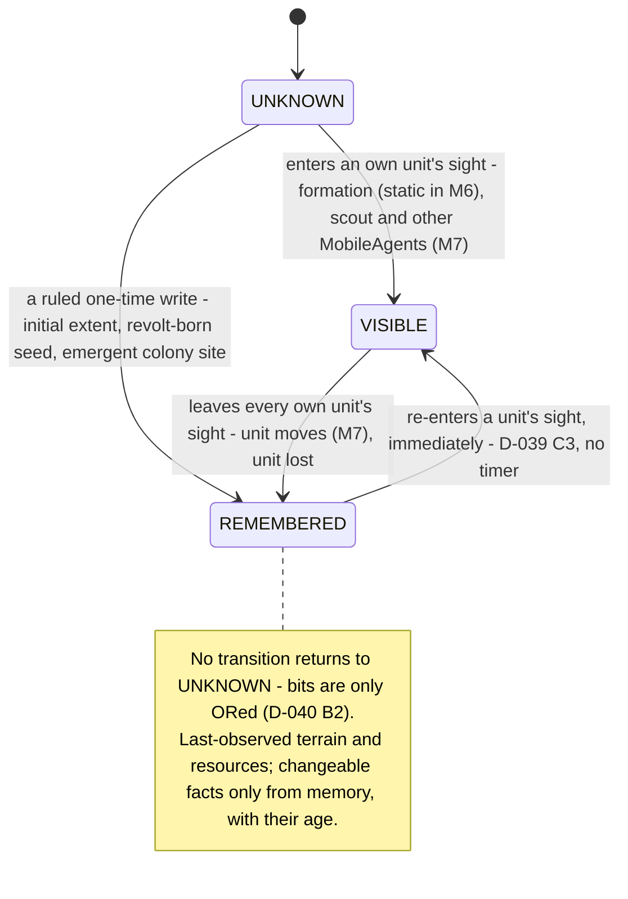
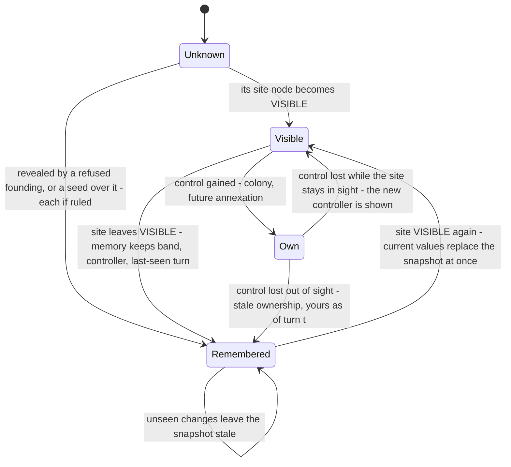
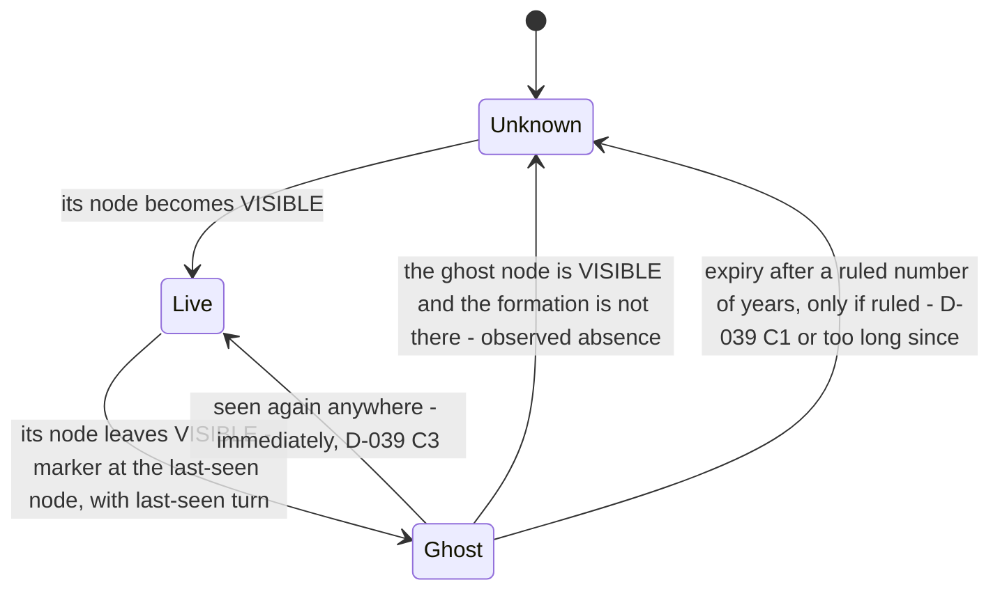

# Fog of war, discovery, sighting memory and AI information — design proposal

**Status: PROPOSED — a design for the Director's review, part of the M6 knowledge-redesign package. Not ratified. Nothing
here is implemented, no test exists for it, and no test result is claimed.** Written 2026-10-22; revised the same day to
the Director's intent (§0). The revision marks nothing ratified and changes no frozen record.

- **Tree.** `/home/user/m5w/dev`, branch `claude/new-session-yavghm`. First written at HEAD `edba2b5`; revised at
  `92fe440`, which differs from `edba2b5` in documents only (`git diff --stat edba2b5 92fe440 -- Sim.Core Sim.Data Sim.Ui
  Sim.Tests Sim.Cli` is empty), so every code citation still holds. No file under `Sim.*` was changed.
- **What this document is.** The principal designer's ten decisions (D1–D10, §1.1) turned into a code-grounded design,
  then revised to the Director's intent of 2026-10-22 (authoritative input, not a ruling; §0). Where either input meets a
  ratified record, the record is not changed here: the deviation and the path that would resolve it are listed in
  **§18.0**, and the design stays an open proposal.
- **Evidence base.** `docs/m6-plan/knowledge-redesign/audit/fog-and-ai-information-audit.md` (secondary evidence; its
  citations were spot-checked, a sample in every family of the leak matrix) and the records and code it cites.
- **New measurements.** §2.3 reports figures from a throwaway probe built against a copy of `Sim.Core`/`Sim.Data` at
  `edba2b5` in the session scratchpad (not in the repository; method in Appendix A). They are labelled
  **MEASURED (probe)**. They describe today's all-known code; they are not measurements of any fog implementation.
- **Labels.** **MEASURED** (read from code, content, tests or the probe, cited) · **RECORDED** (a figure or ruling taken
  from a record, cited) · **RESEARCHED** (an external source: the package's `sources/comparative-sources.json`, or a
  web-search result extract, then marked *search-corroborated* because the page itself was not fetched) · **INFERENCE** ·
  **PROPOSED** (this document's design) · **OPEN DECISION** (needs a ruling) · **IMPLEMENTATION DEFERRED** (contract now,
  code in a later milestone). Record status words (RATIFIED, RULED, DRAFT, OPEN) are the records' own.

---

## 0. Changes in this revision (2026-10-22)

| # | Change | Why | Where |
|---|---|---|---|
| C1 | Per-empire, per-node states are **UNKNOWN · VISIBLE · REMEMBERED (explored)**. "LIVE" and "GHOST" stay only as D-039 C1's words for how an enemy FORMATION is displayed | Director intent 1; D-039 C1 is an entity display, not a tile state | §4, §5 |
| C2 | Three structures kept apart: the stored monotone **explored extent**, the computed **current sight**, the stored **last-seen memory** of entities | intent 9 | §1.2, §4.1 |
| C3 | **Sight comes from units by default.** Passive settlement sight (population-band radius plus elevation vantage), the previous default, is withdrawn as default and kept, with its reasoning, as option **X4** — an exception only the Director can grant | intent 3; it was already a named deviation from D-040 B2 / D-039 B1, B3 (§18 R8) | §6.1, §6.9 |
| C4 | M6/M7 timing audited (formations stand still until M7; the scout is M7's): six M6 exploration options, one recommended (X2) | intent 3 | §6.7, §17 |
| C5 | Radius by unit type, vantage, sea visibility, line-of-sight blockers and passive sources are options with Civ VI / Age of Empires precedent; none exists in code | intent 4 | §6.2, §6.3 |
| C6 | When a unit leaves, foreign and neutral unit positions disappear; an enemy formation leaves a D-039 C1 GHOST (dated, distinct, never current); no neutral-unit memory | intent 2 | §4.2, §4.3, §6.5 |
| C7 | Resource chain split into observation (no research), knowledge, prospecting, practical capability and infrastructure; the identification-capability gate on visible surface signatures withdrawn | intent 6 | §12.1 |
| C8 | Founding under fog re-examined: "unknown = impassable" binds plans, never movement; the survey margin demoted to an option; the "sight radius ≥ 12 nodes" consequence of the first draft withdrawn | intent 3; §18 R17, R21 | §10.4 |
| C9 | Strict AI parity incl. difficulty; independent per-empire maps (no sharing); leak tests for unseen enemy movement, unseen world change, research and other empires' maps | intents 5, 7 | §10.1, §11.1 |
| C10 | Contact and controller in remembered land use last-observed values | intent 8 | §4.2 rule 7 |
| C11 | Deviation register with a resolution path per item; decisions flagged architecture gate vs later packet | intent 10 | §17, §18.0 |
| C12 | UI shading for the three states | intents 1, 9 | §13 |

---

## 1. Executive summary and recommended model

### 1.1 The designer's decisions (input, restated) and their status after this revision

| # | Decision (principal designer) | Status after 2026-10-22 | Where designed |
|---|---|---|---|
| D1 | Seven separated information layers: (a) discovered extent, STORED monotone per-polity bitset; (b) LIVE sight, DERIVED on demand, never stored; (c) physical control and (d) ownership/jurisdiction, the existing control rows; (e) remembered observations, a STORED sparse sighting memory of dynamic facts (formations LIVE-only); (f) contact, derived; map exchange/treaties M8; (g) resource access states | kept; (b) is "current sight (VISIBLE)"; (e) includes enemy-formation GHOST rows (§19 R1) | §4 |
| D2 | Per node per polity: UNKNOWN · REMEMBERED (GHOST) · LIVE; extent never clears; sight follows current control | renamed UNKNOWN · VISIBLE · REMEMBERED; sight follows current UNITS | §5 |
| D3 | Sight is a deterministic geometric disc (wrap-aware integer offsets, precomputed), radius by producer class plus an elevation vantage bonus, water visible, no ray casting, never along foreign roads — NOT `Pathfinder.Isochrone` | disc kept as the contract shape; producer = unit class; vantage, water, radius are options (§6.3); settlement producers only under X4 | §6 |
| D4 | Extent seeded by a founding-time sight write; turn 0 is fogged; every golden moves, with a `PreFog` twin | founding write = formation sight plus a ruled one-time initial extent (§6.7) | §6.5, §11.4 |
| D5 | Gating: founding and AI site choice inside known extent; unknown nodes impassable and worthless for AI valuation (D-T); road plans through known nodes; trade needs a known route and a partner known by contact (DW-006); raid targets known; emergent colonization and migration keep reading world truth (people, not state); each AI polity judges against PREV plus its own orders, conflicts refused at delivery (DW-002) | kept; D-T scoped to plans (§10.4) | §10 |
| D6 | Every AI read goes through polity-scoped `PolityKnowledge` queries; the 53 leak rows and the global-truth systems mapped; player/AI symmetry | kept; difficulty grants no information (§10.1) | §7.3, §10 |
| D7 | M6 defines the mobile sight-producer contract; the scout unit is M7's first MobileAgent; resolve D-052 §5 vs D-J formally | kept; M6 exploration options added (§6.7) | §6.8, §17 |
| D8 | Append-only sections for extent and memory, nothing for LIVE; next landed version (D-H); v34 migration seeds extent from current state, memory empty; canonical serialization, populated tests, replay, `--from-save`, attribution, session files (telemetry/F12 world-wide, chronicle filtered) | kept; four sections (formation ghosts) | §14 |
| D9 | Resource discovery chain: exists → located → identified → prospected → extractable → processable → industrial use; place-level geology IMPLEMENTATION DEFERRED to the first consumer of a new mineral; four chains tested | re-split by source of each fact (§12.1) | §12 |
| D10 | Performance and memory budget without caches | kept | §9 |

### 1.2 The recommended model (PROPOSED)

Each empire holds, for every 16 km lattice node, one of three states. **UNKNOWN** — never observed: terrain and contents
are absent from everything the empire sees or plans with. **VISIBLE** — inside the current sight of one of the empire's
units: current terrain, resources under the observation policy of §12.1, and current foreign units and neutral entities.
**REMEMBERED** (explored) — observed before, not now: last-observed terrain and resources under a darker partial-fog
overlay, changeable facts only as last seen, nothing refreshed from hidden live state. Three separate structures produce
the states: a **stored, monotone explored extent** (one bit per node, 8 KiB per empire, never cleared); the **current
sight**, a pure function of the judged state, never stored; and a **stored last-seen memory** of entities and changeable
facts (settlement presence, population band and controller; road class; an enemy formation's GHOST marker; later,
surface observations and prospecting results), each with its last-seen turn. VISIBLE = current sight; REMEMBERED =
explored minus VISIBLE; UNKNOWN = the rest. **Sight comes from units**: in M6 the empire's formations (one warband per
Empire, standing at its capital until M7 gives movement), from M7 every MobileAgent with a sight class, the scout first.
**No passive settlement, city or border sight exists by default**; it is option X4, for the Director to grant or refuse.
Because nothing moves before M7, what exploration looks like in M6 is an explicit choice (§6.7); the recommendation is
**X2** — fog on in M6, formation sight, and a one-time initial known extent written at world founding from a reference
class the Director rules — with its cost stated: ordered colonization nearly stops until M7's scout (§18 R17). Every AI
policy and every predicate a decision-maker runs reads `PolityKnowledge` for its own empire; the player reads the same
structure through `PlayerKnowledge`; authoritative systems still read truth to resolve the world. Each empire's map is
its own: no ally, embassy or spy shares it until a separate rule exists. Founding, roads, trade and raiding are gated as
D5 rules, with "unknown = impassable" binding plans and never movement, and a delivery refusal recorded as an
observation (§10.4). Persistence appends four sections at the next landed schema version; the PreFog configuration
reproduces every pre-fog hash through the v34 projection `WorldHash.ComputeHexAsSchema` provides.

### 1.3 What the Director is asked to rule (details §17; **A** = before the architecture gate, **L** = a later packet)

1. **A** — the three-state model and its three structures (§4–§5), with D-K ruled on the geometric (not `Isochrone`)
   contract.
2. **A** — units as the only default sight source; settlement sight only as the explicit exception X4 (§6.1, §6.9).
3. **A** — the M6 exploration option (X1–X6; X2 recommended) and the initial-extent reference class (§6.7).
4. **A** — enemy-formation GHOSTs in M6 (D-039 C1 via D-052 §5), and whether a ghost ever expires ("or too long since").
5. **A** — scouts: a dated clarification of D-052 §5 and `docs/milestones.md` that M6 delivers the sight-producer
   contract and the scout unit is M7's first MobileAgent (D-J).
6. **A** — the resource-observation policy (§12.1); D-T scoped to plans; revolt-born knowledge beside D-048 r1; no
   difficulty-based reveal; no map sharing.
7. **L** — survey margin and refusal observation, DW-002, DW-006, PathBuild, emergent colonization, Decision A, session
   files, geology, pre-fog sessions, D-H.

### 1.4 Headline numbers

| Quantity | Value | Label |
|---|---|---|
| Disc size, radius r nodes (integer dx²+dy² ≤ r²) | r=1: 5 · r=2: 13 · r=3: 29 · r=8: 197 · r=12: 441 · r=16: 797 nodes | MEASURED (probe) for r ≥ 8; r ≤ 3 counted by hand (INFERENCE) |
| Sight derivation, one empire, producers × disc | 12 producers at r=10: ≈ 7 µs · 584 producers at r=10: ≈ 0.30 ms (≈ 1.6 ns per stamped node) | MEASURED (probe, micro-benchmark) |
| Sight producers in M6 under the default | one formation per founded Empire, at its capital; none for a revolt-born polity | MEASURED (`WorldFounding.cs:272-295`; `unit-families.json:13-17`) |
| Extent storage | 8 KiB payload; ≤ 1,024 rows × 16 B = 16 KiB per polity in the row form | INFERENCE from the row shape (§7.1) |
| Spacing radius vs candidate initial-extent radii | spacing 95.2 km = 1.9046 × the 50 km hinterland (`worldgen.json:51-52`); daily territory 5–10 km; hinterland 50 km | RECORDED; RESEARCHED (search-corroborated) |
| Founding candidates at turn 0, previous default (settlement discs + survey margin) | r=8: 0 · r=10: 0–24 · r=12: 137–302 candidate nodes per world | MEASURED (probe, Euclidean approximation) |
| Founding candidates at turn 0 under unit-only sight with any seed radius < 95.2 km | ≈ 0: no node of a seed lies a spacing radius from the settlement whose seed made it known (§18 R17) | INFERENCE (geometry) |
| Settlements: founding / turn 600 (1 AI Empire) / capacity | 12 / 23 on seeds 1, 2, 42, 7 / median 381, max 584 on the shipped cylinder | MEASURED (probe); RECORDED (`Sim.Data/content/worldgen.json:51`) |
| Nearest rival settlement at turn 0 (1 AI Empire) | 10.63–18.03 nodes (170–288 km) | MEASURED (probe) |

### 1.5 Findings (summary of §18; register §18.0; resolutions §19)

Against ratified records, each with a resolution path in §18.0: **R1** (formation ghosts — now adopted), **R18** (scouts:
D-052 §5 and `milestones.md` vs D-039's 2026-10-06 pointer and docket D-J), **R3/R19** (revolt-born knowledge vs D-048
r1, and no sight producer for a revolt-born polity), **R8** (formation sight and any seed are not bought with food and
people, D-040 B2 / D-039 B1), **R11** (emergent founding vs D-040 A3/B1), **R14** (PreFog switch vs ADR-037 §1),
**R20** (difficulty and Spine principle 7). Consequences the code exposes: **R17** (unit-only sight leaves no
ordered-founding site in M6), **R13** (trade between scattered holdings), **R21** (unknown must not be impassable to
movement), **R4** (refusal liveness), **R5** (contact uses the remembered controller). Method: **R2** (constants from
reference classes, never fitted). Corrections: **R7, R9, R10, R12, R15**. Precedent: **R22** (Civ VI and Age of Empires
both give cities passive sight; the unit-led default departs from both, and matches D-040 B2). Endorsed: **R16**
(geometric sight over `Isochrone`).

---

## 2. Current state (MEASURED)

### 2.1 What exists

| # | Fact | Evidence | Label |
|---|---|---|---|
| 2.1.1 | No fog state of any kind: the canonical stream ends at section 61 `ConstructionHolds`; schema version 34; readable set {32, 33, 34} | `Sim.Core/Kernel/CanonicalSchema.cs:971-979, 181, 195` | MEASURED |
| 2.1.2 | `PolityKnowledge.Of` is all-known: both masks null, every answer "yes" | `Sim.Core/State/PolityKnowledge.cs:81-85, 137-147` | MEASURED |
| 2.1.3 | `KnowsSettlement` = controls it, or its site is VISIBLE (no memory: an unseen rival vanishes) | `Sim.Core/State/PolityKnowledge.cs:153-162` | MEASURED |
| 2.1.4 | `KnowsPolity` (contact) reads the TRUE controller from `Controls` | `Sim.Core/State/PolityKnowledge.cs:177-186` | MEASURED |
| 2.1.5 | `Restricted` builds a stub from explicit masks; production must never call it (source guard) | `Sim.Core/State/PolityKnowledge.cs:93-103`; `Sim.Ui.Tests/KnowledgeLeakTests.cs:1378-1381` | MEASURED |
| 2.1.6 | Eight production `Of` call sites | `Sim.Core/State/InfoQuery.cs:213, 327, 335`; `Sim.Core/Systems/Colonization/AiFoundingPolicy.cs:194, 296`; `Sim.Core/Systems/Construction/AiConstructionPolicy.cs:108, 250`; `Sim.Ui/ViewModel/PlayerKnowledge.cs:83` | MEASURED (grep) |
| 2.1.7 | `Pathfinder.Isochrone` builds a lane overlay of every network edge and travelled road, never enters an impassable node, and lists only passable unreached neighbours as its boundary | `Sim.Core/Pathing/Pathfinder.cs:170, 177, 209, 523, 533, 575-600` | MEASURED |
| 2.1.8 | Pathfinding purity mandate: no persistent caches, no memoization | `Sim.Core/Pathing/Pathfinder.cs:8-11` | MEASURED |
| 2.1.9 | Lattice 256 × 256 = 65,536 nodes of 16 km; a node is impassable iff its block is ≥ 50 % water | `Sim.Core/Pathing/TraversalLattice.cs:14-15, 104, 113, 159` | MEASURED |
| 2.1.10 | Founding deals settlements round-robin; each Empire's capital is its first; formations stand at capitals; founding writes no catchment | `Sim.Core/Worldgen/WorldFounding.cs:331-382, 262-296, 257-259`; audit 12.4 | MEASURED |
| 2.1.11 | AI site scan: first arm `KnowsCell`, valuation from the whole-map frontier raster, reachability from an uncapped `Isochrone`, one `Sites` batch shared by every AI polity of a producer call | `Sim.Core/Systems/Colonization/AiFoundingPolicy.cs:313-321, 333-340, 50-55, 107-175`; `Sim.Core/AiOrders.cs:59, 73` | MEASURED |
| 2.1.12 | The founding predicate's known-extent arm is inert; reachability is `FindPath` over the whole lattice and every lane | `Sim.Core/State/FoundingQuery.cs:175, 195, 69-71` | MEASURED |
| 2.1.13 | Emergent colonization takes a whole-map argmax with no reachability rule | `Sim.Core/Systems/Colonization/ColonizationSystem.cs:224-225`; `Sim.Core/Worldgen/SettlementSiting.cs:394-400, 461-464` | MEASURED |
| 2.1.14 | Order intake judges on PREV with every standing site, grown by earlier orders of the batch | `Sim.Core/Systems/Colonization/ColonizationSystem.cs:193, 256-276` | MEASURED |
| 2.1.15 | Deposits are per settlement, immutable; extraction is ungated; 14 goods, copper and tin the only ores, no uranium/coal/oil/iron good | `Sim.Core/State/WorldState.cs:270-279`; `Sim.Core/Systems/Production/ProductionSystem.cs:369-390`; `Sim.Data/content/goods.json:48-62`; audit §2.2 | MEASURED |
| 2.1.16 | Bronze is the only chain with goods: copper-ore 8 + tin-ore 1 + timber 2 per bronze, artisan predicate; the recipe entity requires `tin_bronze` | `Sim.Data/content/goods.json:137-158`; `Sim.Data/content/research.json:29415-29421` | MEASURED |
| 2.1.17 | Revolt makes each revolted place a new AI polity with a control row, a full copy of the parent's completed research and the parent's Age; ids are max + 1 | `Sim.Core/Systems/Revolt/RevoltSystem.cs:176-191, 204-209` | MEASURED |
| 2.1.18 | Trade pairs any two connected settlements whose knowledge allows trade; no contact or extent term | `Sim.Core/State/TradeQuery.cs:26-28`; `Sim.Core/Systems/Trade/TradeArbitrageSystem.cs:124-137` | MEASURED |
| 2.1.19 | Road candidates: every finite `SettlementDistances` pair with an own endpoint, the other endpoint any settlement within 600 km | `Sim.Core/State/RoadDevelopmentQuery.cs:179-191` | MEASURED |
| 2.1.20 | The only sim-side settlement size class (T3.8 `SizeTier`, 0–4 by dwellings) is designed to saturate near founding scale | `Sim.Core/Systems/Catchment/CatchmentSystem.cs:60-66`; `Sim.Data/content/sim.json:17` | MEASURED |
| 2.1.21 | A population size scale exists only in UI content: thresholds 0, 250, 1,000, 4,000 … 4,096,000 (×4) | `Sim.Ui/UiContent/world/settlement-classes.json:3-13` | MEASURED |
| 2.1.22 | Elevation is a dimensionless fBm value in [0, 1) with no declared unit; temperature lapses 25 °C per elevation unit | `Sim.Core/Worldgen/Worldgen.cs:100, 266-280, 123-126`; `Sim.Data/content/worldgen.json:27` | MEASURED |
| 2.1.23 | UI: no Fog layer; the terrain bake is drawn whole; the overlay's accessibility is an unbounded `Isochrone` while the viewer sees all | `Sim.Ui/World/MapLayers.cs:5-22`; `Sim.Ui/SimUiGame.cs:206-213`; `Sim.Ui/World/ResourceOverlay.cs:497-507` | MEASURED |
| 2.1.24 | Snapshot load attaches terrain after the canonical read, then returns; load-time invariants refuse states no rule writes | `Sim.Core/Kernel/Snapshot.cs:92, 130, 154, 166-185` | MEASURED |
| 2.1.25 | A world's hash as an older schema is the stream less the sections appended since | `Sim.Core/Kernel/WorldHash.cs:36-45`; `Sim.Core/Kernel/CanonicalSchema.cs:205-214` | MEASURED |
| 2.1.26 | Order kinds 1–9 and 11–13 exist; kind 10 is reserved for MoveFormation (M7) | `Sim.Core/Kernel/OrderLog.cs:12-203, 150` | MEASURED |
| 2.1.27 | No sight model of any kind: no line of sight, no elevation or vantage term, no sea-visibility rule, no sight radius per unit type, no passive source (a grep for sight / vision / line of sight in `Sim.Core` finds only the seam's comments) | `Sim.Core/State/PolityKnowledge.cs:18-27, 140` | MEASURED (grep) |
| 2.1.28 | Formations: one per founded Empire (`formationsPerPolity` 1, identity `warband`), stationed at its capital; a formation holds no people and no goods; no writer moves one (Age conversion only); movement is M7 | `Sim.Core/Worldgen/WorldFounding.cs:258, 272-295`; `Sim.Data/content/unit-families.json:13-17`; `Sim.Core/State/WorldState.cs:996-1011`; `docs/d052-m5-integration-audit-rulings.md:46-51` | MEASURED |
| 2.1.29 | Unit families carry no statistic ("NO COMBAT STATISTICS. Attack, defence, range and movement are deferred"); the light-infantry family's A1 identity is named "Scouts" but no Empire is founded with it | `Sim.Data/content/unit-families.json:6, 20-31` | MEASURED |
| 2.1.30 | `baseline.exploration` "Scouting and exploration": "not yet simulated — no mobile agents exist (D-043)" | `Sim.Data/content/research.json:57-60` | MEASURED |
| 2.1.31 | A revolt-born polity receives no formation (no `MilitaryUnits` write in `RevoltSystem`) and no capital (D-048 r4) | grep of `Sim.Core/Systems/Revolt/RevoltSystem.cs`; `docs/d048-knowledge-persistence-rulings.md:15` | MEASURED |
| 2.1.32 | The economic hinterland radius is 50 km ideal ground, "the country whose produce can profitably flow to the settlement"; the founding spacing 95.2 km is derived from it (× 1.9046) | `Sim.Data/content/sim.json:15-16`; `Sim.Data/content/worldgen.json:51-52` | MEASURED |

### 2.2 The AI leak matrix (from the audit; the mapping is §10)

53 read sites across the producer and six AI policies: 38 read only the polity's own data, 3 already call the seam, 11
are latent leaks (D2, D3, D4, D6, F4, F5, F6, F8, F10, F11, F12), 1 is active today (P2: an AI polity sees another AI
polity's same-turn founding order). Nine systems are listed besides; seven of them (N1–N7) decide for a polity from global
truth. RECORDED (audit §5.2–§5.3), sample spot-checked: `Sim.Core/Systems/Roads/RoadDevelopmentPolicy.cs:31-45`,
`Sim.Core/Systems/Research/AiResearchPolicy.cs:48-60`, `Sim.Core/Systems/Ages/AgeAdvancePolicy.cs:23-30`,
`Sim.Core/Systems/Governance/AiGovernance.cs:38-51`, `Sim.Core/Systems/Construction/AiConstructionPolicy.cs:100-140,
245-262` — all MEASURED to match.

### 2.3 Founding geometry and the cost of discs (MEASURED (probe))

Canonical config (1024 px, 12 settlements, cylinder), seeds 1, 2, 42, 7; "nodes" are lattice nodes (16 km). Distances are
Euclidean on the cylinder between settlements' lattice nodes.
The extent rows below measure discs around every settlement — the first draft's default, now option X4 (§6.9); they
remain the evidence for X4 and for the disc costs, not a description of the units-only default.

| Seed | Nearest rival settlement, 1 AI Empire | Nearest rival, 3 AI Empires | Nearest own other settlement, 1 AI Empire |
|---|---|---|---|
| 1 | 17.72 nodes (284 km) | 8.94 (143 km) | 8.94–62.10 nodes (143–994 km) |
| 2 | 18.03 (288 km) | 15.81 (253 km) | 15.81–34.66 (253–554 km) |
| 42 | 10.63 (170 km) | 10.63 (170 km) | 15.81–71.11 (253–1,138 km) |
| 7 | 16.03 (256 km) | 12.37 (198 km) | 11.70–39.56 (187–633 km) |

| Measure (per polity, turn 0, 1 AI Empire = 6 settlements each) | r=8 | r=10 | r=12 |
|---|---|---|---|
| Known extent (nodes, union of the polity's discs) | 1,119–1,182 | 1,759–1,902 | 2,317–2,636 |
| …of which sea/lake (impassable) nodes | 3–52 | 23–102 | 33–153 |
| A rival settlement inside the polity's turn-0 discs | none | none (seed 1 with 3 AI: yes) | seed 42 (1 and 3 AI), seed 1 (3 AI) |

- Passable land is 22,875–22,891 nodes per world; at r=12 a polity's turn-0 extent is ≈ 10–11 % of the land, in six
  disjoint islands (the round-robin deal scatters each polity's holdings across the continent, `WorldFounding.cs:331-382`).
- Height above sea at the 48 founded sites: 0.012–0.200 elevation units; over all land nodes p50 0.053–0.083, p90
  0.141–0.176, max 0.235–0.297.
- 600 turns, 1 AI Empire, all-known trajectory (today's code): 23 settlements on every seed at turn 600 — the AI issued 11
  Found Settlement orders and grew from 6 to 17, the player's 6 never changed (no emergent colony) — and 2 polities
  throughout (no revolt-born polity). First turn at which some polity has a rival settlement within r of
  one of its own (a pre-fog approximation of first contact under radius r; fog itself would change the AI's colony
  placement): r=10: seeds 1/2/42/7 → turn 144 / never / never / 144; r=12: 144 / never / 0 / 144; r=16: 108 / 36 / 0 /
  144.
- Canonical stream (seed 42, 1 AI): 72,513 bytes at turn 0; 254,987 bytes at turn 600 (23 settlements, 51 transport edges,
  460 network edges).
- Costs on the probe host (4-CPU Xeon 2.1 GHz, .NET 10.0.112, Release): stamping discs for 12 / 100 / 584 producers at
  r=10 takes ≈ 7 / 52 / 297 µs; decoding one polity's 1,024 extent rows ≈ 1.1 µs; a full passable-component labelling of
  the 65,536-node lattice ≈ 0.65 ms; `SettlementSiting.PrepareFrontier` at 1024 px ≈ 50 ms per call.

---

## 3. Recorded decisions: ratified versus open

| Record | Status | What it fixes for this design | Citation |
|---|---|---|---|
| Spine principle 7 | FROZEN | AI uses the player's verbs and information class; difficulty = information and friction, never hidden resources | `docs/civ-sim-architecture-v3-outline.md:25` |
| Spine nuclear rescope | FROZEN | Nuclear layer → modern-era expansion, deterrence-abstraction only | `docs/civ-sim-architecture-v3-outline.md:154` |
| CLAUDE.md laws 3, 4, 5 | FROZEN | dt-correct rates; no calendar gates; banned constructs (no `float`, no dictionary iteration, no `System.Random`) | `CLAUDE.md:18-20` |
| D-039 A, B1–B5, C1–C4 | RATIFIED | Position/strength/outcome channels; recon bought with food and people, diminishing, pointed, mild distance degradation with vantage, stale not wrong; LIVE/GHOST/UNKNOWN for enemy formations; return to LIVE immediately | `docs/d039-command-fog-and-siege.md:12-46, 48-75, 84-100` |
| D-039 B6 | OPEN | Scouts: class, flag or capability score | `docs/d039-command-fog-and-siege.md:77-82` |
| D-040 A4, B1, B2, B3, B5, E4 | RATIFIED | Extent discovered, not a fog overlay; settle/claim/trade only within known extent; discovery = reconnaissance at scale, no second exploration system, once known stays known; no tech unlock of reach; storage and granularity not designed; every constant derived from a stated reference class | `docs/d040-discovery-and-control.md:29-39, 41-57, 59-69, 82-88, 180-181` |
| D-048 r1–r8, Age pointer | RATIFIED | Revolt copies completed research "and nothing else"; knowledge never decays; annexation is a union; Age inheritance needed its own ruling | `docs/d048-knowledge-persistence-rulings.md:11-21, 44-56, 60-70` |
| D-051 §2 | RATIFIED, deferred to M6 (R2) | Availability classes; regionally correlated richness incl. copper and tin; rare and strategic goods stay rare | `docs/d051-m5-polish-rulings.md:33-46`; `docs/m6-plan/m6-decision-register.md:242-244` |
| D-051 §5 | RATIFIED | Found Settlement order; "Emergent founding (D-037 B1) continues unchanged"; the AI uses the same order and predicates | `docs/d051-m5-polish-rulings.md:79-89` |
| D-052 §2 (h) | RATIFIED | AI information leak accepted until M6's known extent; median 953 km colony distance as evidence | `docs/d052-m5-integration-audit-rulings.md:27-29` |
| D-052 §3 (ADR-037) | RATIFIED | One seam; production all-known until a stored extent; `Restricted` test-only; ADR-037 §6 channels are M6's | `docs/d052-m5-integration-audit-rulings.md:38-44`; `docs/adr/adr-037-player-knowledge-seam.md:33-48, 136-162` |
| D-052 §4 | RATIFIED | Movement and Action Points are M7 | `docs/d052-m5-integration-audit-rulings.md:46-51` |
| D-052 §5 | RATIFIED | M6: full fog, LIVE/GHOST/UNKNOWN (D-039 C1), scouts, persisted sighting memory, extent storage, settle/claim/trade restriction, closing ADR-037's channels | `docs/d052-m5-integration-audit-rulings.md:53-66` |
| D-052 §8 | RATIFIED (closed as built) | The resource shortcut highlights known places only | `docs/d052-m5-integration-audit-rulings.md:100-106` |
| D-054 instruction | RECORDED | Explored-longitude limits, exploration-unlocked wrapping and Satellites reveal are out of scope | audit §10; `docs/d052-m5-integration-audit-rulings.md:223-224` |
| D-055 note | RATIFIED (accepted at R5) | v35 reserved to S2a (extent), v36 to S3; kind 10 reserved | `docs/d055-batch4-reservations-attribution-allocation-ci-persistence-pathfinding.md:1306-1307` |
| D-060 §5, §6, §11 | ACCEPTED (R5) | A rival's books closed on player surfaces; F12 and session files world-wide; the chronicle file subject to P7's hidden-settlement filter; Decision A (token size) deferred until fog | `docs/d060-rival-internals-isolation.md:66-100, 248-267` |
| ADR-036 | RATIFIED | One founding predicate for player and AI; the known-extent arm's place; S2b must narrow the AI's read and pick | `docs/adr/adr-036-found-settlement-order.md`; `Sim.Core/State/FoundingQuery.cs:69-71` |
| ADR-037 §7 | RATIFIED | A value whose reach touches undiscovered ground is withheld, never estimated; what a polity assumes of unseen ground is S2b's | `docs/adr/adr-037-player-knowledge-seam.md:174-185` |
| D-I, D-D, D-E, D-F | RULED 2026-10-20 | Single pool (D-I, supersession proposed by D-061); government adoption M8; unit progression contract only | `docs/m6-plan/m6-decision-register.md:230-246` |
| M6 spec §3.2, §3.5 F, I-8, I-9, T6.7–T6.9 | DRAFT, not ratified | Sight via `Isochrone` with a cost-unit budget; extent seeded from founding catchments; revolt copies; memory as state if persisted | `docs/m6-spec.md:3-4, 98-102, 127-129, 229-242, 278-280` |
| Docket D-K, D-J, D-T, D-H | OPEN | D-K proposes `Isochrone` sight; D-J no scout in M6; D-T unknown = impassable and worthless; D-H first to land | `docs/m6-plan/m6-ruling-docket.md:37-39, 43` |
| DW-002, DW-004, DW-005, DW-006 | OPEN (ruling owed) | Judged world of a fogged order; token size; scouts as class; trade mutually-known term | `docs/m6-plan/deferred-work-register.md:27-31` |
| m5w plan S2a–S2c and critic | PLANNING (deferred to M6) | Bitset design; "sight must not be modelled as a movement-cost isochrone (D-039 B4 vantage)"; passive sight is a named deviation from D-040 B2 / D-039 B1; the turn-0 seed needs a founding write | `docs/m5w-map-workstream-audit-and-plan.md:5, 725-800, 890-899, 980-981, 995` |
| D-039 pointer (2026-10-06) | APPENDED to a RATIFIED record | "M6" in D-039 names the battle layer, now M7: "the M6 spec", "M6's spec" read the M7 Battle Layer spec — including B6's "M6's spec owns it" (scouts) | `docs/d039-command-fog-and-siege.md:6-10` |
| D-048 r4 | RATIFIED | A revolt-born civilization starts without a capital | `docs/d048-knowledge-persistence-rulings.md:15` |
| D-052 §2 (i) | RATIFIED (accepted reading) | The AI meeting `a4_expansion` (≥ 14 settlements) at turn 358 is the accepted reading of that milestone | `docs/d052-m5-integration-audit-rulings.md:30-31` |
| `docs/milestones.md` 2026-10-12 note | RECORDED (Director) | M6 also carries "fog of war, scouts and visibility persistence (D-052 §5)"; M7 carries movement | `docs/milestones.md:32-36` |
| AI constitution | RECORDED | "A stronger AI should not automatically receive hidden information"; difficulty is decision quality, not information or material advantage | `docs/m5-ai-constitution.md:20, 37, 135-137` |

---

## 4. Information model

### 4.1 The layers (PROPOSED, following D1 as revised)

| Layer | Content | Stored or derived | Granularity | Writer(s) | Reader | Monotone |
|---|---|---|---|---|---|---|
| (a) Explored extent | Nodes the empire has ever had VISIBLE, plus a ruled one-time initial extent (§6.7) | STORED (`KnownExtentRow`, §7.1) | lattice node | initial-extent write (world founding; first step of a polity with no rows, if ruled); the discovery system | `PolityKnowledge` only | yes — bits are only ORed |
| (b) Current sight (VISIBLE) | Nodes inside the sight of the empire's current units (settlements only under X4) | DERIVED from the judged state, never stored | lattice node | none (pure query `Sight.Visible`) | `PolityKnowledge` | no — follows the units |
| (c) Physical control | Which polity a settlement obeys | existing `ControlRow` | settlement | colonization, revolt, governance (unchanged, `Sim.Core/SystemCatalog.cs` header) | everything | no |
| (d) Ownership / jurisdiction | Claim and recognition | existing `ClaimRow`, `RecognitionRow` (schema only, no writer) | settlement | none in M6 | — | — |
| (e) Last-seen memory | Changeable facts as last observed: settlement presence, population band, controller; road class; an enemy formation's GHOST (identity, node, strength class); (later) surface observations and prospecting results — each with its last-seen turn | STORED (`SettlementSightingRow`, `RoadSightingRow`, `FormationSightingRow`) | object | the discovery system, from VISIBLE only; the refusal observation (if ruled, §10.4) | `PolityKnowledge` | settlement and road rows refresh or are added, never removed; a GHOST row is removed only by observed absence or a ruled expiry (§6.5) |
| (f) Contact and information transfer | Contact derived from (b) and (e) with the last-observed controller; map exchange, treaties, recognition | DERIVED; any sharing IMPLEMENTATION DEFERRED to its own rule (M8 diplomacy, M11+ espionage) | polity pair | none | `PolityKnowledge.Contact` | contact persists through memory |
| (g) Resource observation and access | observed surface signatures (from VISIBLE); prospected deposits; usability by knowledge and capability (§12.1) | observed: static facts need no row while deposits are immutable; prospected STORED, IMPLEMENTATION DEFERRED; usability DERIVED | node × resource kind | — in M6 | `PolityKnowledge` (contract) | yes |

### 4.2 Composition rules (PROPOSED)

1. **Explored = stored extent ∪ VISIBLE** (the seam's `Known`) for the state being judged. VISIBLE ⊆ Explored by
   construction, so the seam's invariant `Visible ⊆ Known` (`Sim.Core/State/PolityKnowledge.cs:25`) needs no ordering
   between systems. REMEMBERED = Explored \ VISIBLE; UNKNOWN = the rest.
2. **Stored(t+1) = Stored(t) ∪ VISIBLE(t)** (plus a ruled one-time write). The discovery system reads PREV only, so
   Explored(t) ⊆ Stored(t+1) ⊆ Explored(t+1): once known, land stays known (D-040 B2; I-8), including through loss of
   units or control.
3. **Static facts on REMEMBERED nodes are the last-observed values.** Terrain is immutable (ADR-008;
   `Sim.Core/Worldgen/TerrainSet.cs:5-13`), so last observed equals current and no terrain snapshot is stored. Standing
   rule: any layer that becomes mutable (a depleting deposit, a changed river) must move into memory before it may be
   shown on a REMEMBERED node.
4. **Memory is written only from VISIBLE** (and the ruled refusal observation): never from the extent, never from truth
   outside sight, never by research (§12.1). Nothing on a REMEMBERED node is refreshed from hidden live state.
5. **Units are shown only while VISIBLE.** Own units always (own information). When a foreign or neutral unit's node
   leaves VISIBLE, its current position disappears from every answer. An **enemy formation** leaves a **GHOST** (D-039
   C1): "last known position and strength, from a report now stale" (`docs/d039-command-fog-and-siege.md:88`) — a dated
   marker typed separately in the seam (`FormationView.Ghost`), drawn distinctly (§13), never returned as a current
   unit, never moved to the true position. It "may be wrong because the enemy moved, never because the report lied"
   (C2, `:92-93`), and it reverts to LIVE the moment the formation is seen again (C3, `:95-97`). **Neutral entities**
   leave nothing: D-039 C1 names ENEMY formations only and no other record asks for neutral memory (none exists in code:
   every `MilitaryUnitRow` has an owner, §2.1.28).
   *Director and governance reconciled:* what disappears is the CURRENT position — the Director's rule. A GHOST is not a
   current position but a record of an observation, so it satisfies D-039 C1 and D-052 §5 without revealing where the
   formation actually is.
6. **Settlements are places, not units.** A settlement on a REMEMBERED node is drawn from memory (band, controller,
   last-seen turn) — as Age of Empires keeps explored buildings frozen at their last-seen state while hiding units
   (RESEARCHED, search-corroborated: the official tutorial and a forum report, R22). Own settlements show their own
   books wherever their node lies (D-060).
7. **Contact(P, Q)** holds iff P knows a settlement whose KNOWN controller is Q — current if the settlement is VISIBLE,
   the remembered controller otherwise (§18 R5). Controller, owner and contact details on REMEMBERED land are always the
   last-observed ones.
8. **Books stay books.** `ReadsInternals` is unchanged: only a controller reads a settlement's people, stocks, queues and
   deposits (D-060). Fog decides what is KNOWN; D-060 decides what of a known rival is PUBLIC.
9. **Each empire's map is independent.** Extent, sight and memory are per empire; alliance, recognition, embassy and
   espionage share nothing until a separate rule defines sharing (Civ VI also has no map-trade item, [CIV-08, CIV-16]
   in `civ-vi-comparative-research.md` §3.10). Leak test M9 (§11.1).

### 4.3 Information policy per data class (PROPOSED)

| Data class | UNKNOWN node | REMEMBERED node | VISIBLE node | Own | Stored? | Notes |
|---|---|---|---|---|---|---|
| Terrain, elevation | absent (not drawn, not read) | last observed (= current, ADR-008), under the darker overlay | current | exact | no (regenerated from seed, ADR-008) | D-040 A4: unknown land is absent, not dark terrain |
| Rivers, coasts, seas | absent | last observed | current | exact | no | water nodes inside sight are observed if option G4 is ruled (§6.3); a river is a sub-node feature, known with its node (D-040 B5) |
| Resources | nothing | last-observed surface signatures; concealed deposits only as prospected (memory) | surface signatures observed without research (§12.1); concealed deposits never by sight | own settlements' `DepositRow` books | observed: no row while immutable; prospected: yes (deferred) | research never reveals a deposit |
| Settlements and structures | nothing | memory marker: population band, controller, last-seen turn; no structures, no institutions | current public identity (D-060 public list), population band | full books | memory row | a settlement founded in REMEMBERED land after the last sighting stays unknown until seen |
| Roads (TransportEdges) | nothing | remembered class and last-seen turn | current class | current | memory row | dirt paths (NetworkEdges) are VISIBLE-only: drawn and read where both nodes are VISIBLE |
| Ownership and borders | nothing | remembered controller at the settlement marker, with age; no territory shading | current controller and catchment shading | own catchments | memory controller field | no per-node remembered owner layer (cost §9) |
| Enemy military formations | nothing | GHOST at the last-seen node: identity, strength class, last-seen turn — never the current position | identity, family, Age form, owner, station, position (D-060 public) | full | `FormationSightingRow` | formations do not move before M7 (`WorldState.cs:996-1011`), so in M6 a ghost differs from truth only after an Age conversion — the rule is written for M7 |
| Neutral entities (none exist today) | nothing | nothing | current while VISIBLE | — | none | no record requires neutral memory |
| Resource depletion and extraction | nothing | nothing | nothing (a rival's output is its books) | own books | — | no depletion exists (`WorldState.cs:270-279`) |
| Rival changes (founding, capture, revolt, Age, building) | not learned | not learned until seen again; the memory stays stale | learned at once (D-039 C3: no timer) | — | memory refresh | annals tell an event only if its subject was VISIBLE (or own) when it happened |
| Stale observations | — | shown with age: "last seen year Y (N years ago)", years from the era table | — | — | `LastSeenTurn` | reports are stale, never wrong (D-039 B5) |

---

## 5. States and transition diagrams

### 5.1 Node state for one empire (PROPOSED)



### 5.2 A settlement as one empire sees it (PROPOSED)



### 5.3 An enemy formation as one empire sees it (PROPOSED; D-039 C1–C3)



### 5.4 Control changes (PROPOSED effects; current mechanics MEASURED)

| Event | Today (MEASURED) | VISIBLE | Extent | Memory | Contact |
|---|---|---|---|---|---|
| Revolt | Revolted places become new AI polities with research and Age copied, no capital, no formation (`RevoltSystem.cs:176-191`; §2.1.31) | Parent: unchanged (sight is its units'). Child: none (no unit) | Parent keeps every bit. Child: the ruled seed over its own places (§6.7) — or a copy of the parent's if R3 is ruled that way — else nothing | Parent: the lost place stays as last seen ("yours as of t"). Child: empty unless R3 copies | Parent–child contact through the parent's memory |
| Annexation / conquest | No path exists; `KnowledgeTransfer.MergeInto` is a union (`docs/d048-knowledge-persistence-rulings.md:44-56`) | Annexer gains nothing by annexation itself | Union (OR) of both extents when a path is built (D-048 r8 analogue; IMPLEMENTATION DEFERRED) | Merge per subject: the row with the larger `LastSeenTurn` | — |
| Settlement destruction / abandonment | None: `Settlements` is append-only; an emptied place keeps its row (audit §7) | a VISIBLE emptied settlement shows band 0 | unchanged | a remembered thriving town may since have emptied: stale by design | unchanged |
| Capital loss | Capital row persists; the formation keeps `Location` at the lost capital (`WorldState.cs:996-1011`) | The formation, physically there, keeps seeing until M7 moves it (§17 item 21) | unchanged | refreshed while VISIBLE | — |
| Colony by order | inside explored land (D-040 B1 gate) | no new sight (no unit) | unchanged | own | — |
| Emergent colony (people) | Whole-map argmax; the colony inherits the parent's controller (`ColonizationSystem.cs:224-225, 335-338`) | none | its site node only, if ruled (§6.7) | own | possible new contact only through observation |
| Polity extinction | Derived: controls nothing; the row remains (`EmpireQuery.cs:30-45`) | its units' sight while units exist | kept | kept; others' memory of it stays | others keep contact through memory |

---

## 6. Sight producers and algorithm

### 6.1 Producers (PROPOSED default: units only)

- **An empire's sight is the union of the sight of the units it owns.** In M6 the only units are formations
  (`MilitaryUnitRow`): one warband per founded Empire, stationed at its capital, never moved before M7 (§2.1.28). From
  M7 every MobileAgent with a sight class — the scout first (docket D-J) — is a producer through the contract of §6.8.
- **Not producers by default:** settlements, catchments, borders, roads, trade partners, allies. Passive settlement
  sight is option **X4** (§6.9), a Director-approved exception only; it is not introduced to ease colonization.
- A formation stationed at a place its owner no longer controls still produces sight: the troops are there (§17 item 21).
- No pass over roads, lanes or network edges enters the computation (D3: sight never travels along foreign roads).

### 6.2 What exists today (MEASURED)

None of the following exists in code (§2.1.27–2.1.31): line-of-sight blockers; an elevation or vantage term for sight
(elevation is a dimensionless fBm value, §2.1.22); a sea-visibility rule (the lattice only marks ≥ 50 % water
impassable, `TraversalLattice.cs:159`); a sight radius per unit type (unit families carry no statistic); any passive
source (`PolityKnowledge.Of` is all-known); exploration (`baseline.exploration` not simulated); unit movement (M7).
Everything in §6.3 is therefore a design option, not a description.

### 6.3 Sight geometry options (OPEN DECISION; precedent RESEARCHED)

| Option | What it is | Precedent | Against ratified records | Recommendation |
|---|---|---|---|---|
| G1 Disc | integer disc of radius r nodes around the unit's node, wrap-aware (§6.4) | Civ VI: most units have Sight 2 tiles (community LOS guide, search-corroborated); Age of Empires II: per-object line of sight, e.g. Town Center 8 (Liquipedia, search-corroborated) | D-039 B4 "distance degrades … mild": a radius is the simplest mild degradation | adopt as the contract shape |
| G2 Radius by unit class | `fog.sight.classes[class]` → base radius | Civ VI: the scout's Spyglass promotion +1 sight (fan wiki, search-corroborated); AoE II scout cavalry described as high line of sight, upgraded per Age (search-corroborated; no number found) | D-039 B6 (scout as class / flag / score) is OPEN; a class radius is a coefficient inside the sight equation, not a free buff (law 2) | adopt the field; values with M7 units |
| G3 Vantage | + k nodes by height above sea | Civ VI: hills are seen at +1 range, but standing on a hill does not raise a unit's own range (community LOS guide, search-corroborated) | **D-039 B4 (RATIFIED) asks for it**: "a vantage point extends effective reconnaissance range" (`d039:66-70`) — its form is open, its presence is not, for reconnaissance | adopt for M7 mobile units; OPEN whether M6's static formations apply it (sites are 0.012–0.200 units above sea, §2.3) |
| G4 Sea visibility | water nodes inside a disc are observed | INFERENCE from both games' play convention (not sourced) | none: seeing a coast is not travelling it (sea travel is D-040 B4's transport question) | include water nodes |
| G5 Line-of-sight blockers | ray casting over elevation | Civ VI: mountains block line of sight for ranged attack ([CIV-16]) | D-040 B5: ridges are sub-node at 16 km; D-039 B4 rules playability over fidelity | reject for M6; revisit at M7 battle scale (§15) |
| G6 Passive sources | settlements, borders see | Civ VI: units' and cities' field of view (Wikipedia extract, search-corroborated); AoE II Town Center line of sight 8 | contrary to D-040 B2 / D-039 B1, B3 and to the Director's unit-led intent | X4 only (§6.9) |
| G7 Movement-cost sight | `Pathfinder.Isochrone` | — | the m5w applied correction and D-039 B4 (§15, R16) | reject |

**Constants (PROPOSED method).** Every radius comes from an external reference class, never from a fit to simulation
outputs; seed measurements (§2.3) are checks with stated pass conditions only (D-040 E4, `d040:180-181`; S8 §4.1 item 3;
§18 R2). Game precedents fix the SHAPE (a radius per unit type, a vantage term, a scout bonus), never a number — a game
tile is not a kilometre. Candidate classes for a formation's or a scout's radius: the geometric horizon of a standing
observer, d = √(2Rh) ≈ 4.7 km at h = 1.7 m (INFERENCE, geometry) — under one 16 km node; and a field force's foragers and
patrols ranging about a day's march from camp (INFERENCE; T6.7 must source it). Both put unit sight at roughly 0–2
nodes: at this lattice's granularity a unit sees little, and what explores is its swept path (§6.8), not its disc.

**Dimensional declaration (replaces `docs/m6-spec.md:127` for sight).** Sight radius: lattice nodes, a length (16 km per
node step, Euclidean on the cylinder), not a cost. Vantage (if ruled): nodes added per threshold of height above sea in
elevation units, a unit the code does not declare (§2.1.22). Extent: bits over nodes. Ghost expiry (if ruled): sim-years,
compared against the turn's year span (law 3). No other rate exists in sight.

### 6.4 VISIBLE derivation (PROPOSED pseudocode)

```text
DiscOffsets[r], r = 0..capNodes: every integer (dx, dy) with dx*dx + dy*dy <= r*r, ordered by (dy, dx).
  Built once from the config's integer radii at config load (a constant of the config, like Pathfinder's Dx/Dy
  tables, Sim.Core/Pathing/Pathfinder.cs:61-63) — not state, not a cache of world data.

Sight.Visible(world, fogCfg, P) -> ulong[W]     W = ceil(L*L / 64); pure; reads only `world`
  (L, block, wrap) = PolityKnowledge.Grid(world.Terrain.Size), world.Terrain.WrapX
  visible = new ulong[W]
  site[] = per-settlement site cell: ONE pass over world.Settlements (array indexed by dense settlement id)
  for each MilitaryUnitRow u in world.MilitaryUnits, row order:           // M6: formations; M7: every MobileAgent
      if u.Owner != P: continue
      cell = u.Location >= 0 ? site[u.Location] : cell under (u.X, u.Y)   (as KnowsUnit, PolityKnowledge.cs:166-173)
      Stamp(visible, NodeOfCell(cell), Radius(classOf(u), cell))
  if fogCfg.settlementVision is present:                                  // option X4 only; absent by default
      for each ControlRow c with c.Polity == P, row order:  Stamp(visible, NodeOfCell(site[c.Place]), X4Radius(c, cell))
  return visible

Radius(class, cell) = min(capNodes, base[class] + (G3 ruled ? Vantage(cell) : 0))
Vantage(cell): h = Elevation[cell] - SeaLevel; k = 0; for t in thresholds (ascending): if h >= t then k += 1; return k

Stamp(bits, centre, r):
  cx = centre % L; cy = centre / L
  for (dx, dy) in DiscOffsets[r]:
      y = cy + dy;  if y < 0 or y >= L: continue                       // the poles keep hard edges
      x = MapTopology.NeighbourX(cx, dx, L, wrap);  if x < 0: continue  // flat map edge
      if wrap and MapTopology.Dx(cx, x, L, wrap) != dx: continue        // a disc wider than the map: each column once
      v = y * L + x;  bits[v >> 6] |= 1UL << (v & 63)
```

The wrap guard is the one `WorldFounding.HinterlandMeans` uses (`Sim.Core/Worldgen/WorldFounding.cs:430-435`); all
geometry goes through `MapTopology` (cylinder topology, ADR-039), as `MapTopologyGuardTests` enforces
(`docs/m5w-map-workstream-audit-and-plan.md`, 2026-10-15 note). Water nodes are stamped unless G4 is refused.

### 6.5 Discovery, initial extent and memory (PROPOSED pseudocode)

```text
Initial extent (only as ruled, §6.7) — WorldFounding.Assemble, after FoundInitialFormations (WorldFounding.cs:257-258):
  for each polity P on the roster, ids ascending:
      bits = Sight.Visible(world0, fogCfg, P) | Seed(world0, fogCfg, P)
      Seed(P) = union over the settlements P controls of Disc(node of site, seedRadiusNodes)   // one-time; never recomputed
      write rows (P, w, bits[w]) for bits[w] != 0

DiscoverySystem.Step(PREV -> NEXT), reads PREV only:
  for each polity P on PREV's roster, ids ascending:
      vis  = Sight.Visible(PREV, fogCfg, P)
      bits = Decode(PREV.KnownExtent, P) | vis
      if P holds no extent row in PREV and the seed rule is ruled:  bits |= Seed(PREV, fogCfg, P)   // revolt-born; migrated saves
      if the emergent-colony rule is ruled: for each settlement P controls whose site node is not in bits: set it
      emit (P, w, bits[w]) for w ascending with bits[w] != 0
      settlements (table order): if vis[node(s)]: row (P, s, band(s), controllerOrMinus1(s), LastSeen = PREV.Turn)
                                 else carry P's row for s unchanged, if any
      roads (row order):         if vis[node(e.A)] or vis[node(e.B)]: row (P, e.Id, e.EdgeType, LastSeen = PREV.Turn)
                                 else carry
      enemy formations (u.Owner != P, row order): if vis[node(u)]: row (P, u.Id, u.Identity, node(u), strengthClass(u), PREV.Turn)
      for each carried GHOST row g of P (not refreshed above):
          if vis[g.Node]: drop g                                            // observed absence: it is not where it was
          else if ghost expiry is ruled and yearsBetween(g.LastSeen, PREV.Turn) >= ghostExpiryYears: drop g
          else carry g unchanged                                            // never moved toward the truth
      no row for neutral entities
      [if ruled, §10.4 (b)] for each FoundSettlement order of P refused at delivery because of settlement s unknown
          to P (FoundingQuery.Obstructors, the predicate's own pure function): row (P, s, band, controller, PREV.Turn)
  carry unchanged any NEXT row whose holder is absent from PREV's roster
  every table strictly ascending by (holder/observer, word/subject)
```

`EmpireQuery.TryGetController` takes the lowest polity id when a place has two control rows
(`Sim.Core/State/EmpireQuery.cs:123-139`), so a memory row's controller is deterministic. `strengthClass` is the number of
the owner's formations sharing the node (the only count the state holds, D-052 §7); headcount arrives with M7
recruitment.

### 6.6 Determinism (PROPOSED)

- No RNG (a deterministic sight needs none, `docs/m6-foundations-audit.md:77`); no clock; no `float`; no dictionary or
  hash set (arrays indexed by dense ids); no LINQ in the step.
- Sight and extent are sets: the OR is commutative, so producer iteration order cannot change the result; rows are
  emitted in strictly ascending integer keys, so the stream is canonical whatever the table order.
- Every stored field is an integer (`long` turns, `int` ids and classes, `ulong` bits). The only double reads are
  `Elevation` and `SeaLevel` compared with thresholds (exact IEEE comparisons) and nothing double is stored.
- No new argmax exists in sight or memory. The founding argmax keeps its composite key (score DESC, cell ASC,
  `Sim.Core/Systems/Colonization/AiFoundingPolicy.cs:350-363`) over the knowledge-scoped raster; its tie-dense test is
  re-run on the scoped raster.

### 6.7 M6 and M7: what exploration looks like (PROPOSED options; OPEN DECISION)

**Facts.** Formations do not move before M7 (D-052 §4); each founded Empire has one, at its capital; a revolt-born
polity has none and no capital (§2.1.31); the founding deal scatters an Empire's places 143–1,663 km apart (§2.3); the
spacing radius is 95.2 km (§2.1.32).

**What unit-only sight gives in M6 (INFERENCE from those facts).** Each Empire sees one small disc around its capital
for the whole milestone and gains nothing else; its other settlements stand in UNKNOWN land unless an initial-extent rule
writes it; a revolt-born polity knows nothing; ordered founding (D-051 §5) needs a known site a spacing radius from every
known settlement, which no disc or seed smaller than that radius supplies (§18 R17); emergent colonization (people, N1)
continues; most of the map is parchment. Exploration in the Director's sense — units walking into the unknown — starts
when M7 gives a unit movement.

| Option | M6 behaviour | For | Against (records) | Resolution path |
|---|---|---|---|---|
| **X1** Contract only, fog dark | tables, seam, memory, display and tests built and pinned under a test configuration; production keeps `fog` absent (all-known) until M7's scout switches it on | no M6 play on an unexplorable map; M7 switches fog on with real exploration | D-052 §5 places "full fog" and the settle/claim/trade restriction in M6; D-052 §2(h)'s accepted AI leak lasts to M7 | CR (moves a ratified milestone placement) |
| **X2** Fog on; formation sight + one-time initial extent — **recommended** | turn 0 explored = formation discs ∪ a seed around each founded settlement; REMEMBERED except where a formation sees; ordered colonies lie in explored land (D-040 B1); an emergent colony writes its site node; a revolt-born polity gets the same seed over its own places | meets D-052 §5's full fog and closes §2(h) in M6; unit-led afterwards; no continuous passive sight; the seed is the founding peoples' past, not vision (D-040 A4: "knows the land along its river") | ordered colonization ~stops in M6 (R17) and moves D-052 §2(i)'s `a4_expansion` reading; domestic trade between scattered holdings stops unless DW-006 exempts own pairs (R13); the seed is a free one-time grant, a named deviation from D-040 B2 / D-039 B1 | T6.7 ADR naming the deviation; Director ruling on the seed's reference class; dated clarification of D-052 §2(i) |
| **X3** Fog on; formation sight only, no seed | as X2 without seed | the purest unit-led reading | own settlements in UNKNOWN land; revolt-born polities blind; no ordered founding, almost no trade | ordinary design change (no record conflict), likely unplayable |
| **X4** Settlement sight as an explicit exception | continuous discs around controlled settlements (§6.9) | ordered founding stays live at r ≥ 12 nodes (probe, §10.4) | contrary to the Director's unit-led intent and to D-040 B2 / D-039 B1, B3; 12 nodes (192 km) exceeds every observation reference class of §6.3 | Director ruling (named deviation), with a sunset at M7 if chosen |
| **X5** Abstract expedition order | an order spending food and people to reveal a pointed sector, no unit | the only M6 mechanism that is bought and pointed (D-039 B1–B3) | not unit-led; a second exploration system beside M7's scouts (D-040 B2 "Do not invent a second exploration system"); a new order kind (kernel) | CR + ADR; not recommended |
| **X6** Minimal mobile scout in M6 | MobileAgent and movement pulled forward | real exploration in M6 | movement and Action Points are M7 (D-052 §4); kind 10 reserved for M7 | CR; not recommended |

**Recommendation: X2**, with the Director stating plainly that M6 ships the fog model with almost no exploration and
that exploration — and so ordered expansion — begins with M7's scout. If an M6 playtest finds that unacceptable, X4 with
a sunset at M7 is the fallback: a Director ruling, never an implementation choice.

**Initial-extent reference classes (OPEN DECISION; never fitted to founding outcomes).**

| Class | Radius | Source | Effect |
|---|---|---|---|
| none | — | — | X3 |
| site node only | 0 nodes | — | each place's own node, nothing around it |
| daily exploitation territory | 5 km (farming) / 10 km (foraging, pastoral) — Vita-Finzi & Higgs 1970, site-catchment analysis | RESEARCHED, search-corroborated (secondary sources quote the radii; the paper itself not read) | under one node: equal to "site node only" |
| economic hinterland | 50 km, `catchment.hinterlandRadiusKm` (`sim.json:15-16`): "the country whose produce can profitably flow to the settlement" | RECORDED (an existing model constant; no new number) | ≈ 3 nodes (Euclidean disc of 50 km ideal ground); **recommended** — it is the model's own statement of the land a settlement works |
| annual range / exchange network | to be sourced | — | larger; T6.7 must source it before it may be chosen |

A radius chosen so that ordered founding stays live (≥ 95.2 km plus a margin) would be fitted to a simulation outcome
and is refused (§18 R2).

### 6.8 dt-correctness and the M7 mobile-producer contract (PROPOSED; IMPLEMENTATION DEFERRED to M7)

M6 producers are static between steps, so the extent does not depend on dt. A producer that MOVES (M7) must contribute
the union of discs along its swept path within the step, not only its end point; otherwise halving dt (era pacing goes
from 10 to 0.5 years, `docs/d039-command-fog-and-siege.md:166-175`) would discover more land along the same route — a
law-3 violation. Movement into UNKNOWN nodes must be legal: the move resolves on truth (an authoritative system), its plan
reads the mover's knowledge, and D-T's "unknown is impassable" binds plans, never movement (§18 R21). The contract M6
writes for M7 (decision D7):

```text
ISightProducer (contract only; no M6 implementation beyond formations)
  Owner: PolityId
  Class: a content key with a base radius (fog.sight.classes; G2)
  Cell (state end point) and SweptCells (the cells crossed during the step; empty when static)
  Contribution to VISIBLE(state) = disc at Cell; contribution to the next stored extent = discs along SweptCells ∪ Cell
  Cost: none in M6. D-039 B1 (paid in food and people), B2 (diminishing returns) and B3 (pointed) bind the M7 scout
  unit, which is M7's first MobileAgent (docket D-J) — not an M6 entity.
```

### 6.9 Retained alternative X4: passive settlement sight (the first draft's default; REJECTED AS DEFAULT 2026-10-22)

Kept so that the reasoning survives and X4 can be ruled with evidence. **Radius:** `r = min(capNodes, base(band) +
vantage(h))`, the band `b = max{i : population ≥ minPop[i]}` over the ×4 thresholds now in UI content
(`Sim.Ui/UiContent/world/settlement-classes.json:5-13`), moved to shared content (the T3.8 `SizeTier` saturates at
founding scale, `sim.json:17`; §18 R6); `h` the site's height above sea; no passability test.

| Parameter | First-draft value | Reference class offered | Check (MEASURED (probe)) |
|---|---|---|---|
| `settlementBaseNodes[band]` | band 0: 10 · band 1: 12 · band 2: 13 · band 3: 14 · band 4+: 15 | "the land a community habitually ranges over and reports … 6–12 nodes" — INFERENCE, never sourced | with the survey margin, 0 candidates at r=8, 0–24 at r=10, 137–302 at r=12 per world |
| `formationBaseNodes` | 8 | a field force's screen (≈ 100–150 km) — INFERENCE | — |
| `vantageThresholds` | 0.06, 0.10, 0.15 elevation units (+1, +2, +3 nodes) | horizon d = √(2Rh) with the lapse-implied 1 unit ≈ 3.85 km (INFERENCE) | sites 0.012–0.200 → 0–3 |
| `capNodes` | 16 (256 km) | D-039 B4 "mild" | contact by turn 144 on all four seeds |

Why it is not the default: it is not bought with food and people, not pointed (D-040 B2 / D-039 B1, B3; the m5w critic's
"named deviation", `docs/m5w-map-workstream-audit-and-plan.md:981`); its band-1 value of 12 nodes was pushed up by the
founding coupling, which is the fitting R2 forbids; and the Director wants exploration led by units. Its geometry (discs,
wrap guard, vantage) is reused by §6.4.
---

## 7. Data model

### 7.1 State (PROPOSED; widths are canonical-stream bytes)

| Row | Fields | Width | Order and invariants | Writers | Readers | Consumers |
|---|---|---|---|---|---|---|
| `KnownExtentRow` | `PolityId Holder` (int32), `int Word`, `ulong Bits` | 16 | strictly ascending (Holder, Word); Bits ≠ 0; 0 ≤ Word < ⌈N/64⌉; Holder on the roster | initial-extent write; DiscoverySystem | `PolityKnowledge` | every gated reader through the seam |
| `SettlementSightingRow` | `PolityId Observer`, `SettlementId Subject`, `int PopulationBand`, `PolityId Controller` (−1 stateless), `long LastSeenTurn` | 24 | strictly ascending (Observer, Subject); Subject exists; LastSeenTurn < Clock.Turn | DiscoverySystem (incl. the refusal observation, if ruled) | `PolityKnowledge` | map markers, contact, the AI's known standing sites |
| `RoadSightingRow` | `PolityId Observer`, `int Edge`, `int EdgeType`, `long LastSeenTurn` | 20 | strictly ascending (Observer, Edge); Edge exists | DiscoverySystem | `PolityKnowledge` | remembered roads, knowledge-scoped lanes |
| `FormationSightingRow` | `PolityId Observer`, `int Unit`, `int Identity`, `int Node`, `int StrengthClass`, `long LastSeenTurn` | 28 | strictly ascending (Observer, Unit); Observer ≠ the unit's owner at LastSeenTurn | DiscoverySystem | `PolityKnowledge` | GHOST markers (D-039 C1) |
| `ProspectRow` | `PolityId Polity`, `int Node`, `int ResourceKind`, `int GradeClass`, `int SizeClass`, `long Turn` | 28 | ascending (Polity, Node, ResourceKind) | a prospecting action | `PolityKnowledge` | §12 (IMPLEMENTATION DEFERRED) |

**Bit and byte order (canonical).** Node v is bit `v & 63` of word `v >> 6`, least significant bit first; `Bits` is written
little-endian like every primitive (`Sim.Core/Kernel/CanonicalSchema.cs:12`), so byte k of a word carries nodes
64·Word + 8k … 64·Word + 8k + 7, lowest node in the lowest bit.

All four state rows are unmanaged structs, as `Table<T>` requires (`Sim.Core/State/Table.cs:23`), and join the
double-buffer clone (`Sim.Core/State/WorldState.cs:1709-1724`). A formation id is stable and never reused (`WorldState.cs`
`MilitaryUnitRow` comment), so a ghost row cannot be re-attached to another formation.

### 7.2 Configuration (PROPOSED; sim.json section `fog`)

`enabled`; `sight.classes` (unit class → base radius in nodes; G2); `sight.vantageThresholds` (only if G3 is ruled);
`sight.includeWater` (G4); `capNodes`; `initialExtent` (`none` · `siteNode` · `radiusKm`, with its reference class
named in a `_doc`); `emergentColonySiteNode`; `ghostExpiryYears` (absent = never); `refusalObservation`; `surveyMargin`
(an option, §10.4); `settlementVision` (X4 only — **absent by default**; holds the §6.9 table if ruled). **An absent
section is the PreFog world**: `PolityKnowledge` all-known, no row written, every gate inert, the shared AI founding batch
restored — the attribution control, never a gameplay or difficulty setting (the `colonization.aiFounding.enabled`
precedent, `Sim.Data/content/sim.json:301`). ADR-037 §1's "nothing else may feed it" needs a dated note accepting this
switch (§18 R14).

### 7.3 The `PolityKnowledge` query set (PROPOSED; D6)

| Query | Answer | Replaces / serves |
|---|---|---|
| `Known(node)`, `KnowsCell(cell)` | explored = stored ∪ VISIBLE | existing (`PolityKnowledge.cs:137-144`), now real |
| `Visible(node)`, `SeesCell(cell)` | current sight | existing, now real |
| `NodeState(node)` | Unknown · Remembered · Visible | the map's three-state shading (§13) |
| `KnownPassable(node)` | Known ∧ lattice passable (static) | D-T plans; F8, F12 |
| `KnownComponent(node)` | connected-component label over KnownPassable nodes plus known lanes; computed once per instance, lazily (≈ 0.65 ms) | founding, road and trade routes |
| `KnownLanes` | remembered or VISIBLE roads (class as observed); dirt-path lanes whose both nodes are VISIBLE | the knowledge-scoped flood |
| `KnowsSettlement(id)` | own ∨ site VISIBLE ∨ remembered | existing (`PolityKnowledge.cs:153-162`) + memory |
| `SettlementView(id)` | Unknown · Own · Visible(band, controller) · Remembered(band, controller, lastSeenTurn) | maps, cards, the AI's standing sites |
| `KnowsUnit(unit)` | own ∨ position VISIBLE — a current answer only | existing (`PolityKnowledge.cs:166-173`) |
| `FormationView(unit)` | Unknown · Own · Live(position, …) · Ghost(node, identity, strength class, lastSeenTurn) — a ghost is never a position answer | GHOST display (D-039 C1), AI threat memory |
| `KnownStandingSites()` | site cells of every settlement the polity knows, settlement-table order | F5 (occupancy and spacing seed) |
| `VisibleClaimed(node)` | node in some settlement's catchment AND node VISIBLE (own catchments always) | F6 |
| `Surveyed(cell)` | the spacing neighbourhood touches no unknown node — only if the survey margin is ruled | §10.4 option (a) |
| `KnownFrontier(cfg, worldgen)` | the frontier raster recomputed with unknown cells worthless (fertility 0, no water — D-T valuation), floor = median over known positive cells; a local of the call | F4, F10, F11 |
| `Contact(other)` / `KnowsPolity(other)` | self ∨ a known settlement whose KNOWN controller is `other` | existing (`PolityKnowledge.cs:177-186`), fixed per §4.2.7 |
| `KnownRoad(edge, out class, out lastSeen)` | VISIBLE (current) or remembered | maps |
| `ObservedSurface(node, kind)` | Known(node) ∧ the node carries a surface signature of `kind` (observation, no research) — contract | §12, IMPLEMENTATION DEFERRED |
| `Prospected(node, kind, …)` | the prospecting row — contract | §12, IMPLEMENTATION DEFERRED |
| `ReadsInternals(id)` | unchanged: controller only | existing (`PolityKnowledge.cs:195-196`) |

Construction: `Of(world, cfg, polity)` decodes the polity's rows (binary search on (Holder, Word)) and derives VISIBLE
lazily on first need; an instance answers for one world and caches nothing across worlds, as today
(`PolityKnowledge.cs:36-37`). The AI producer builds one instance per polity per call and passes it to every policy.

### 7.4 Ownership and pipeline (PROPOSED)

- `DiscoverySystem` (the next free `SystemId`; the m5w plan named 29, `docs/m5w-map-workstream-audit-and-plan.md:733`) owns
  the four tables. It reads PREV only; its position in `Sim.Data/content/pipeline.json` is free except that it runs
  before `revolt` (`Sim.Data/content/pipeline.json:16`), and it carries any row whose holder is absent from PREV, so a
  reordered pipeline gives the same result — pinned by a reversed-pipeline test (the ConstructionHolds precedent,
  `Sim.Core/SystemCatalog.cs` header).
- A revolt-born polity's knowledge comes from the discovery system's "no rows yet" seed rule (§6.5) — no write in
  `RevoltSystem`, so no sanctioned share is needed. Only if R3 is ruled as a copy of the parent's rows would
  `RevoltSystem` append them, as it does for `AgeStates` and `ResearchCompleted` (`RevoltSystem.cs:100-107, 186-190`).
- The initial-extent write is not a system (worldgen assembly, like formations).

---

## 8. Affected code paths (PROPOSED changes at MEASURED locations)

| Area | File:line | Change |
|---|---|---|
| The seam | `Sim.Core/State/PolityKnowledge.cs:81-85` | `Of` reads stored extent + derives VISIBLE; config switch for PreFog |
| | `Sim.Core/State/PolityKnowledge.cs:137-147, 153-162, 166-173, 177-186` | bitset masks; memory in `KnowsSettlement`; `FormationView` ghosts; contact from known controllers |
| | `Sim.Core/State/PolityKnowledge.cs:27-28` | stale "M7" ghost comment (already listed, `docs/m6-spec.md:332-334`) |
| Sight query (new) | `Sim.Core/State/` (new `Sight` static class) | disc tables, `Sight.Visible` (units; settlements only under X4) |
| Initial extent | `Sim.Core/Worldgen/WorldFounding.cs:257-259` | write formation sight ∪ the ruled seed after formations (§6.5) |
| Discovery (new) | `Sim.Core/Systems/Discovery/` (new); `Sim.Core/SystemCatalog.cs` registration; `Sim.Data/content/pipeline.json:2-26` | extent OR, seed for polities with no rows, memory and ghost refresh, refusal observation |
| Revolt | `Sim.Core/Systems/Revolt/RevoltSystem.cs:176-191`; `Sim.Core/SystemCatalog.cs:366` | none under the seed rule; a child copy only if R3 is ruled as a copy |
| Founding predicate | `Sim.Core/State/FoundingQuery.cs:160-197` | known-extent arm (`:175`), claims and occupancy from knowledge, knowledge-scoped route (`:195`), D-T valuation; survey margin only if ruled |
| AI founding | `Sim.Core/Systems/Colonization/AiFoundingPolicy.cs:107-175, 313-340`; `Sim.Core/AiOrders.cs:59-74` | per-issuer `Sites`; scoped pre-filter, raster and flood |
| Intake | `Sim.Core/Systems/Colonization/ColonizationSystem.cs:256-276` | knowledge-scoped arms + physical arms, shared `Obstructors` |
| Emergent siting | `Sim.Core/Systems/Colonization/ColonizationSystem.cs:224-225` | unchanged (D5) |
| Trade | `Sim.Core/State/TradeQuery.cs:26-28`; `Sim.Core/Systems/Trade/TradeArbitrageSystem.cs:124-137` | contact + known route per endpoint controller |
| Roads | `Sim.Core/State/RoadDevelopmentQuery.cs:155-191, 642-658` | known endpoint + known component |
| PathBuild (OPEN) | `Sim.Core/Systems/PathBuild/PathBuildSystem.cs:206-221, 311-339` | target inside the controller's known component, if ruled |
| Raiding | `Sim.Core/Systems/Appropriation/AppropriationSystem.cs:238-268` | victims the raider knows (OPEN: a stateless raider owns no unit, so under units-only sight it sees nothing but its own node; dormant) |
| Place card | `Sim.Core/State/SiteAssessment.cs:393-511, 683-696` | show the scoped predicate's own values (§13) |
| Cell card | `Sim.Core/State/InfoQuery.cs:1475-1477, 1527-1531` | real discovery states; new "not simulated" wording |
| Schema | `Sim.Core/Kernel/CanonicalSchema.cs:181, 195, 205-214, 971-979, 1583-1588, 1598-1661` | version, readable set, appended bytes, Write/Read/ExpectedLength |
| Load | `Sim.Core/Kernel/Snapshot.cs:130, 166-185` | row invariants |
| State | `Sim.Core/State/WorldState.cs:1155-1266, 1709-1724` | tables, interface, clone |
| UI | `Sim.Ui/ViewModel/PlayerKnowledge.cs:80-133`; `Sim.Ui/World/MapLayers.cs:5-22`; `Sim.Ui/SimUiGame.cs:206-213`; `Sim.Ui/World/ResourceOverlay.cs:497-507`; `Sim.Ui/UiSession.cs:300-340` | three-state Fog layer, bake mask, GHOST markers, scoped accessibility, annals |
| Tests | `Sim.Tests/State/PolityKnowledgeTests.cs:65-88, 310-366, 410-464`; `Sim.Ui.Tests/KnowledgeLeakTests.cs:1287-1304, 1378-1394`; `Sim.Tests/Systems/AiFoundingPolicyTests.cs:227-290` | flip, extend, keep (§11.5) |

---

## 9. Performance and memory budget

### 9.1 Time (MEASURED (probe) costs, INFERENCE for totals)

| Item | Per call | Calls per step | Today (12–23 settlements, 2–4 polities) | At capacity (584 settlements) |
|---|---|---|---|---|
| `Sight.Visible` | producers × disc nodes × ≈ 1.6 ns | discovery: 1 per polity; AI producer: 1 per AI polity (one shared instance); UI: 1; intake: 1 per founding order; trade and roads: 1 per polity concerned | units-only M6: 1 formation per Empire at r ≤ 2 (≤ 13 nodes): well under 1 µs each | an M7 army of hundreds of units, or X4 with 584 settlements at r=15: ≈ 0.66 ms each; a few ms per step |
| Extent decode | ≈ 1.1 µs | as above | negligible | negligible |
| `KnownComponent` labelling | ≈ 0.65 ms | trade: 1 per polity with cross-pair trade; roads: 1 per DevelopRoads order; founding: 1 per site arm reached | ≈ 2–3 ms per step | proportional to polities that trade |
| `KnownFrontier` (D-T raster) | ≈ 50 ms (`PrepareFrontier` cost) | only when an AI polity reaches the site arm (at most once per 350 years per AI polity, `Sim.Data/content/sim.json:303-304`), per Found Settlement order at delivery, once per turn for the player's placement mode | ≈ 50 ms every ~35 turns per AI polity at dt 10 | unchanged per event |
| Reference: a whole step | ≈ 197 ms (11,843 ms / 60 turns, seed 42; `docs/d055-batch4-reservations-attribution-allocation-ci-persistence-pathfinding.md:906-912`) | — | fog ≤ ≈ 2 % of a step except on a founding event | — |

### 9.2 Memory and stream size

| Item | Bound | Today (MEASURED (probe) / INFERENCE) |
|---|---|---|
| Extent per polity | payload 8 KiB; row form ≤ 1,024 × 16 B = 16 KiB | X4 at turn 0, r=12: 253–382 rows across all polities (4.0–6.0 KiB, 5.6–8.4 % of the 72,513-byte turn-0 stream); X2 with a 3-node seed: far fewer (INFERENCE) |
| Polities | founded Empires + revolt-born polities (each revolt creates one per revolted settlement, `RevoltSystem.cs:184-188`) | 2–4; no revolt-born polity in the 600-turn probe runs. Theoretical worst case: 585 polities × 16 KiB ≈ 9.1 MiB if every settlement were its own polity knowing the whole map (INFERENCE) |
| Settlement sightings | observers × settlements × 24 B | turn 600 playtest: ≤ 2 × 23 = 46 rows ≈ 1.1 KiB; 20 polities × 584 ≈ 274 KiB |
| Road sightings | observers × roads × 20 B | turn 600: ≤ 2 × 51 rows ≈ 2.0 KiB |
| Formation ghosts | observers × foreign formations × 28 B | M6: ≤ polities² rows (one formation each); negligible |
| Stream growth at turn 600 (seed 42, 1 AI) | +32 KiB if both polities knew the whole map, +3 KiB memory | ≤ +14 % of 254,987 bytes |
| Double-buffer clone | memcpy of the four tables | ≤ ≈ 35 KiB per step today |

### 9.3 Meeting the budget without caches

Every derived structure is a local of one call or of one `PolityKnowledge` instance built for one world — the precedent
D-055 O2 records as allowed ("a local of the call", `docs/d055-batch4-reservations-attribution-allocation-ci-persistence-pathfinding.md:926`). The disc offset tables are constants of the
configuration. Nothing survives a step except the stored rows, so there is no invalidation problem and no second source
of truth (ADR-037 §1). The one measurable risk is `KnownFrontier` (≈ 50 ms) on founding events; a narrower recomputation
(only cells whose fertility box or water BFS reaches an unknown node differ from the global raster) is an optimization
available to T6.8 without state. R-07 (`docs/m6-plan/m6-risk-register.md:15`) is answered by a `sim bench` before and
after each fog packet.

---

## 10. AI information

### 10.1 Principle (PROPOSED, D6)

Every AI read that a polity's knowledge should limit goes through `PolityKnowledge` for that polity. Reads of the polity's
own data (its command source, research, Age, tax, the books of the settlements it controls) are exempt by class: they are
`ReadsInternals` information, which fog does not change. The player reads through `PlayerKnowledge`, a per-turn view of the
same `PolityKnowledge` (`Sim.Ui/ViewModel/PlayerKnowledge.cs:80-90`). One structure, one information class (Spine
principle 7; the AI constitution: "A stronger AI should not automatically receive hidden information",
`docs/m5-ai-constitution.md:124-137`).

**Planning versus resolution.** Planning and valuation — every AI policy, every player surface, and any predicate a
decision-maker runs to choose — read `PolityKnowledge` for the deciding empire. Authoritative systems that resolve the
world (production, catchment, the intake's physical arms, M7 movement and combat) read truth: resolving what happens is
not information given to a decision-maker. **Difficulty grants no hidden information by default** (§18 R20): it may change
how well an AI acquires, retains and acts on what it is permitted to know, never what it is permitted. Test M8 (§11.1).

### 10.2 The 53 read sites mapped (PROPOSED; read sites RECORDED in the audit, spot-checked)

Exempt rows are grouped by family (row ids and counts kept; each was mapped individually in the first draft and in the
audit, §5.2).

| Row | Read site | Audit class | M6 disposition | Query |
|---|---|---|---|---|
| P1, R1–R8, A1–A3 (12) | `Sim.Core/AiOrders.cs:60-66`; `AiResearchPolicy.cs:51-246`; `AgeAdvancePolicy.cs:25-28` | none | exempt: own existence, command source, research, target, cost modifiers, road and tax knowledge, eligibility, Age, own settlements, formations and trade | — |
| D1, D5, D7, D8 (4) | `RoadDevelopmentPolicy.cs:34, 43`; `RoadDevelopmentQuery.cs:165-176, 359-372` | none | exempt: own trade flows, payers, stocks | — |
| C1, C3–C13 (12) | `AiConstructionPolicy.cs:104-261` | none | exempt: own books (C3, C4 after `ReadsInternals`; C10 filtered by owner) | `ReadsInternals` |
| F1–F3, F7, F14 (5) | `AiFoundingPolicy.cs:203-268, 307-309, 217` | none | exempt: control first, own sources, order stamp | — |
| G1–G5 (5) | `AiGovernance.cs:41-46` | none | exempt: own governance and happiness | — |
| P2 | `Sim.Core/AiOrders.cs:59, 73`; `AiFoundingPolicy.cs:146-157` | **active** | one `Sites` per issuer: the issuer's known standing sites on PREV plus its own orders; conflicts refused at delivery (D5, DW-002) | `KnownStandingSites()` |
| D2 | `RoadDevelopmentQuery.cs:179-191` | **latent** | a candidate's other endpoint must be known, and both origin nodes in one known component | `KnowsSettlement`, `KnownComponent` |
| D3 | `RoadDevelopmentQuery.cs:187-189, 213-220` | **latent** | site cells of known settlements only (a site is static once known); crow-flies length is public geometry of two known places | `SettlementView` |
| D4 | `RoadDevelopmentQuery.cs:238-276` | **latent** | road rows only on pairs whose other endpoint is known; a road with an own endpoint is always observed at that end, so its current class is legitimate | `KnownRoad` |
| D6 | `RoadDevelopmentQuery.cs:642-658` | **latent** | `Plan` over the scoped `Routes` | as D2–D4 |
| C2 | `AiConstructionPolicy.cs:108, 250` | gated | kept: one shared instance per polity | `Of` |
| F4 | `AiFoundingPolicy.cs:209` | **latent** | D-T raster: unknown cells worthless; floor over known positive cells | `KnownFrontier` |
| F5 | `AiFoundingPolicy.cs:159-167, 317` | **latent** | occupancy and spacing seeded from known standing sites only; hidden ones refused at delivery and then remembered | `KnownStandingSites` (`Surveyed` only if ruled) |
| F6 | `AiFoundingPolicy.cs:168-173, 319` | **latent** | claimed mask from catchment rows on VISIBLE nodes and own catchments; no sight requirement on the candidate (§10.4) | `VisibleClaimed` |
| F8 | `AiFoundingPolicy.cs:312, 333-340` | **latent** | flood over known passable nodes and known lanes (D-T: unknown not assumed passable for a plan) | `KnownComponent` |
| F9 | `AiFoundingPolicy.cs:315` | gated | becomes the predicate's real known-extent arm | `KnowsCell` |
| F10 | `AiFoundingPolicy.cs:316` | **latent** | candidate test on the scoped raster | `KnownFrontier` |
| F11 | `AiFoundingPolicy.cs:321, 324, 350-363` | **latent** | ranking on the scoped raster; the quarantined test flips (`PolityKnowledgeTests.cs:310-366`) | `KnownFrontier` |
| F12 | `AiFoundingPolicy.cs:322, 326-327` → `FoundingQuery.cs:131-197` | **latent** | the knowledge-scoped predicate (§10.4) for player and AI alike | the predicate |
| F13 | `AiFoundingPolicy.cs:194, 296` | gated | kept | `Of` |

**Count: 53 rows mapped — 38 exempt by class (own information), 3 seam calls kept (C2, F9, F13; F9 becomes the live arm),
11 latent rows each mapped to a scoped query, 1 active row (P2) closed by per-issuer batches.**

### 10.3 Systems that decide for a polity from global truth (PROPOSED)

| # | System | Disposition | Justification |
|---|---|---|---|
| N1 | Emergent colonization (`ColonizationSystem.cs:224-225`) | **exempt** — reads world truth (D5) | People, not the state: D-051 §5 "Emergent founding (D-037 B1) continues unchanged" (`docs/d051-m5-polish-rulings.md:86`). The colony adds only its site node to its polity's extent, if ruled (§6.7). Must be recorded as a ruled D-040 B1 deviation (§18 R11) |
| N2 | Order intake (`ColonizationSystem.cs:272-276`) | **gated** — the issuer's scoped predicate on PREV, then the physical arms on truth (§10.4) | One predicate, two callers; offered equals accepted for everything the issuer could know |
| N3 | Migration (`MigrationSystem.cs:404-414`) | **exempt** — reads world truth (D5) | People; D-040 B1 names settlement, claim and trade, not migration |
| N4 | Trade (`TradeArbitrageSystem.cs:124-137`) | **gated** — §10.5 | D-040 B1; DW-006 |
| N5 | PathBuild (`PathBuildSystem.cs:206-221, 311-339`) | **OPEN DECISION** — recommended: target inside the controller's known component | No decision covers it. The path is state-directed labour (sector orders, `PathBuildSystem.cs:18-26`) and is drawn to the player; today every seed-42 settlement routes to one global target (`docs/d055-batch4-reservations-attribution-allocation-ci-persistence-pathfinding.md:906-910`), the purest global read |
| N6 | Road development (applies `Plan`, `Sim.Core/State/RoadDevelopmentQuery.cs:71-75`) | **gated** through D2–D6 | Player and AI orders go through the one `Plan` |
| N7 | Appropriation (`AppropriationSystem.cs:238-268`) | **gated** — victims the raider knows (OPEN) | A stateless raider has no polity, no stored extent and, under units-only sight, no sight beyond its own node. Dormant: no founded world produces a stateless settlement (INFERENCE from writers, audit N7). Its wealth ranking reads victims' grain — a people-level act like migration's attractiveness (OPEN sub-point) |
| N8 | Catchment (`Sim.Core/Systems/Catchment/CatchmentSystem.cs:108-182`) | none (physics) | Outputs are consumed through gated readers |
| N9 | Governance reach (`Sim.Core/State/Governance.cs:94-115`) | none (physics of the polity's own places) | Reach is an outcome, not a decision |

### 10.4 Founding under fog: the predicate arm by arm (PROPOSED; D5 re-examined for unit-led exploration; OPEN DECISION)

| Arm (`FoundingQuery`) | Issuer's judgement (player and AI, on PREV) | Delivery re-check on truth (intake) |
|---|---|---|
| Known extent (new, `:175`) | site node explored, else `NotKnown` | — |
| Candidate (score, floor, water) | `KnownFrontier` (D-T: unknown cells worthless) | — |
| Occupancy, spacing | known standing sites (own, VISIBLE, remembered) plus the issuer's own orders of the batch; [option (a): the site must be `Surveyed`, else `NotSurveyed`] | all standing sites plus earlier accepted orders of the batch (`ColonizationSystem.cs:193, 256-276`): `TooClose` / `Occupied` |
| Claim | claims the issuer knows: catchments on VISIBLE nodes and own catchments (`VisibleClaimed`); REMEMBERED nodes carry no catchment memory, so no claim is assumed there | catchment rows on truth: `Claimed`, the claimant named |
| People, food | own books (unchanged) | live departure (unchanged) |
| Route | `KnownComponent(source) == KnownComponent(site)` — unknown is not assumed passable for this plan | implied by the issuer's route (a known passable path is a physical path) |

**Re-examination of the first draft's companion rules under unit-led exploration.**

1. **"Unknown = impassable" (D-T) binds plans, never movement.** It stays for valuation (unknown cells worthless) and
   for every plan that needs a known route (founding route, trade route, road plan): an empire does not plan on land it
   has never seen. It must NOT bind M7 movement: a scout's whole purpose is to enter UNKNOWN nodes; its move resolves on
   truth and its plan targets the frontier of its own extent (§6.8; §18 R21). Without this split, exploration would be
   impossible by construction.
2. **The claim arm no longer requires sight.** The first draft refused a site that was not VISIBLE (`OutOfSight`).
   Under unit-only sight nearly every explored node is REMEMBERED, so that arm alone would forbid all ordered founding
   in M6 and most in M7. The issuer judges claims it knows; truth refuses at delivery, naming the claimant.
3. **Survey margin (companion (a)) — demoted to an option.** Under settlement discs it cost candidates (0 at r=8,
   137–302 at r=12, MEASURED (probe)); under unit-only sight with a seed smaller than the spacing radius there are no
   candidates to lose (R17). Its purpose — no repeated refusal — is served by (b).
4. **Refusal as observation (companion (b)) — kept, recommended.** A delivery refusal caused by a settlement the issuer
   did not know (founded in REMEMBERED land after the last sighting; a same-step order of another issuer, P2; a spacing
   neighbour closer through unknown land than the issuer could judge) records that settlement in the issuer's memory. It
   is an observation by the empire's own founding party on the spot — event-driven, the same for player and AI — not
   passive sight. Each refusal adds at least one settlement and settlements are finite, so the AI's re-issue loop
   (`IsDue` stays true while no founding succeeds, `AiFoundingPolicy.cs:228-240`) terminates: at most one refusal per
   (issuer, obstructing settlement). A same-step order's colony is learned one step later (it exists only in NEXT).

**Consequence (INFERENCE; §18 R17).** Under X2 with the recommended hinterland seed, a node of a seed lies within 50 km of
the settlement whose seed made it known, inside the 95.2 km spacing radius derived from that very hinterland
(`worldgen.json:51`): a seed alone offers no legal site. Travel-cost spacing can exceed Euclidean distance in rugged
ground, so a few seed nodes may pass; T6.8 must measure it on seeds 1, 2, 42, 7. Ordered colonization in M6 is therefore
expected to be ≈ 0 until M7 units explore, and emergent colonization (people, N1) is the only expansion.

**DW-002 recommendation.** A fogged order is judged on PREV through the issuer's information class (the scoped predicate,
the same function its UI or AI ran, so the placement mode's verdict bit tells nothing unseen — `docs/queue.md:1473`
closes), then on the world's physical arms with the batch's earlier accepted orders; a physical refusal is reported to
the issuer with the obstructing settlement named, which companion (b) makes known.

### 10.5 Trade and roads under fog (PROPOSED; DW-006)

- **Trade.** A pair (a, b) trades iff `TradeQuery.CanTrade` holds (`TradeQuery.cs:26-28`) AND, for each endpoint's
  controller P: P knows the other settlement (`KnowsSettlement`) and `KnownComponent_P(a) == KnownComponent_P(b)`. A
  stateless endpoint has no information class and adds no condition (dormant). Recognition-gated trade access stays M8
  (D-037 C7, `docs/t4.6-foreign-trade-decision.md:115-130`). §18 R13 records that the route rule, read literally, also
  stops much domestic trade at turn 0 — under X2 nearly all of it between scattered holdings, whose seeds do not touch
  (INFERENCE), so DW-006's own-pair question moves to the architecture gate if X2 is ruled (§17 item 18).
- **Roads.** A route is a candidate iff it has an own endpoint, the other endpoint is known, both origin nodes lie in one
  known component, and the crow-flies length is within 600 km (`RoadDevelopmentQuery.cs:213-220`). Routes are judged at
  delivery with the issuer's knowledge on PREV, so the plan the issuer saw is the plan applied.

### 10.6 Symmetry statement (PROPOSED)

The player and every AI polity hold identical structures (extent rows, memory rows, sight derived from the units each
owns), are judged by one founding predicate, one trade gate and one road plan, and read the world through one seam. No
AI policy reads a table the player's information class cannot read. Asymmetries, each justified:

1. People-level systems (N1 emergent colonization, N3 migration, N5 if exempted) read world truth for every polity's people
   equally — the player's people and an AI's people alike. It is an asymmetry between STATE and PEOPLE, not between player
   and AI.
2. Developer surfaces (F12 panels, session files) are world-wide by decision (D-060 §5–§6); they are instruments, not the
   player's information class, and the AI has no analogue.
3. The player sees memory drawn with its age; the AI reads the same rows, ghosts included.
4. No difficulty or personality setting changes any `PolityKnowledge` answer (§10.1, test M8).

---

## 11. Deterministic test strategy (PROPOSED; nothing here exists yet)

### 11.1 Metamorphic leak tests (the gate of record, ADR-037 §4's pattern)

Rig: seeds 1, 2, 42, 7; 1 and 3 AI Empires; the real producer plays T turns (60 for the gate, 300 nightly). Each turn, for
each AI polity P, a twin of the current world is mutated as below and **P's orders from `AiOrders.For` (serialized
`OrderRecord` bytes, the order-log encoding) must be byte-identical** between the world and its twin. The twin is never
stepped (the `TheAiProducersOrders_DoNotDependOnAnyOtherPolitysBooks` pattern, `Sim.Tests/State/PolityKnowledgeTests.cs:
410-464`).

| Test | Mutation (outside what P may know) | Positive control (proves teeth) |
|---|---|---|
| M1 hidden terrain | terrain under every node not Known(P): fertility, moisture, elevation, rivers, water (via `TerrainSet.FromLayers`) | the same mutation applied to Known nodes changes P's orders on at least one turn of the rig; and with the fog section absent the M1 mutation changes them |
| M2 hidden rivals | unknown settlements: move, add, perturb population band and controller; their catchments; roads and paths among unknown places; `SettlementDistances` rows touching them; trade flows not touching P | the same perturbation of a VISIBLE rival (e.g. moved into P's best site's spacing ball) changes P's pick |
| M3 unseen world change after last sighting | in a REMEMBERED region: change a rival's controller, its population band, a road's class, add or empty a settlement, add a dirt path, (when it exists) deplete a deposit | the same change in a VISIBLE region changes P's knowledge answers and, on the rig, P's orders |
| M4 hidden deposits | `DepositRow` of every settlement P does not control (and, when it exists, geology under unknown nodes) | P's own deposits change P's orders (the existing control) |
| M5 issuer isolation (P2) | a 2-AI rig: make AI A issue a founding order or not (A's own stocks) | with the shared batch restored (`sharedBatch` mutant), B's orders change |
| M6 unseen enemy movement | outside VISIBLE(P): move, add, remove or Age-convert a foreign formation (the twin may place a formation anywhere, though nothing moves before M7) | P's orders, every `PlayerKnowledge` answer and P's ghost rows are identical — a ghost never follows the truth; control: the same change inside VISIBLE(P) changes `FormationView` |
| M7 research reveals nothing | in the twin, complete every knowledge node for P | extent, memory, VISIBLE, `NodeState`, `ObservedSurface` and every map-facing answer identical; control: P's capability answers change |
| M8 difficulty invariance | change P's difficulty and personality settings | every `PolityKnowledge` answer for every polity identical; control: changing P's extent rows changes them |
| M9 independent maps | another empire's extent, memory and units outside VISIBLE(P) | P's answers and orders identical; control: the same change to P's own rows moves them |

Each test fails if its control does not move (a vacuous rig is a failure, as the existing tests assert,
`PolityKnowledgeTests.cs:449`).

### 11.2 Turn-exact pins

1. **Discovery.** A node first VISIBLE in state t (a formation placed there in a rig in M6; a move in M7) is Known in
   state t and stored in state t+1. An order stamped t−1 for a node first Known at t is refused `NotKnown`; the same
   order stamped t is accepted (the m5w pin "land first known in state t is legal for an order delivered at t+1 and illegal at t",
   `docs/m5w-map-workstream-audit-and-plan.md:769`, stated in stamping terms).
2. **Initial extent.** Stored(P, 0) == VISIBLE(P, 0) ∪ Seed(P) bit for bit, every polity, every measured seed; with
   `settlementVision` absent, a world whose formations are removed has VISIBLE = ∅ (no passive source).
3. **Memory.** A rival VISIBLE at t and not at t+1 reads REMEMBERED at t+1 with `LastSeenTurn` = t; a revolt at step
   t→t+1 out of sight leaves the remembered controller unchanged; when it is VISIBLE again at u the current controller
   shows in u (D-039 C3). A foreign formation VISIBLE at t and not at t+1 is a GHOST at its t node in t+1; it stays
   there however the formation moves; it is dropped in the first state whose VISIBLE covers its node without the
   formation; neutral entities leave no row.
4. **Monotonicity.** For every polity and step over 1,000 sim-years including revolts: Stored(t+1) ⊇ Known(t)
   (`Sim.Tests/Systems/KnowledgeMonotonicTests.cs` extended).
5. **Revolt.** Under the seed rule: the child's extent, one step after it first appears, == Seed(child); its memory is
   empty; the parent's rows are unchanged. (If R3 is ruled as a copy: child extent == Known(parent, t).)
6. **Refusal observation (if ruled).** An order refused at delivery on step t→t+1 for hidden settlement S makes S
   REMEMBERED by the issuer in t+1 with `LastSeenTurn` = t; the AI's order in t+1 differs from its order in t.
7. **Liveness.** Over 600 turns on seeds 1, 2, 42, 7 (1 and 3 AI Empires), no Found Settlement order is refused at
   delivery twice by the same (issuer, obstructing settlement).

### 11.3 Populated tables and persistence

- One POPULATED test per row type (CLAUDE.md): exact `ExpectedLength`; bit-exact round trip with masks 1, `~0UL` and
  `1UL << 63`; hash equality; one flipped bit moves the hash; clone independence; the loader refuses unsorted,
  duplicate, zero-bits or out-of-range rows.
- Snapshot save and load at turn k and `sim run --from-save` to N equal the uninterrupted run to N (the AI reads extent and
  memory, so both must be state, `Sim.Cli/FromSave.cs:8-38`); UI resume by replay reproduces extent, memory and every
  `PlayerKnowledge` answer; the cross-process leg of ci.yml extended to fog worlds.
- The v34 → v-next migration: a v34 fixture loads with empty extent and memory tables; every `Known` answer at the
  loaded state equals VISIBLE(load), and after one step the extent equals VISIBLE ∪ Seed (the "no rows yet" rule, §6.5).
- UI: pixels under UNKNOWN are invariant to hidden terrain; REMEMBERED pixels and GHOST markers are invariant to
  post-sighting changes; the Fog mask is seamless across the wrap seam.

### 11.4 PreFog twin and golden attribution

`TestConfigs.PreFog` removes the `fog` section and restores the shared AI founding batch (the R4 chained-twin rule: an
older-layer twin strips every newer layer, `Sim.Tests/TestUtil/TestConfigs.cs:9, 97`). A PreFog world writes only the
empty count prefixes of the new sections, so its v34 projection (`WorldHash.ComputeHexAsSchema(w, 34)`,
`Sim.Core/Kernel/WorldHash.cs:36-45`) reproduces the pre-fog references byte for byte — the founded seed-42 golden, the
60-turn hash `827d9b00…3878a0` (`docs/d060-rival-internals-isolation.md:206-208`), the AI legs and the
`AiFoundingAttributionTests` constants. Single-layer twins attribute the separate moves: `PreFogGatingOnly` (S2b arms
inert), `PreSightingMemoryOnly`, `PreSharedBatchOnly` (P2 alone, which moves multi-AI worlds even all-known). Every moved
pin carries a RE-PIN cause block.

### 11.5 Existing tests to flip, replace or keep

| Test | Action |
|---|---|
| `Of_IsAllKnown_EveryAnswerIsYes_AndTheBooksAreTheControllers` (`Sim.Tests/State/PolityKnowledgeTests.cs:65-88`) | flip: production is no longer all-known; an all-known variant under PreFog |
| `KnownCellsValuations_StillIntegrateTerrainUnderUnknownNodes_TheRecordedChannelQuarantined` (`:310-366`) | flips by design at S2b: restore `Assert.Equal(before, after)`; strike the channel from ADR-037 §6 and ADR-036 §8.3 |
| `TheAiProducersOrders_DoNotDependOnAnyOtherPolitysBooks` (`:410-464`) | extend into M1–M9 |
| `TheProductionView_IsAllKnown_AndEveryReaderGivesWhatItGaveWithoutKnowledge` (`Sim.Ui.Tests/KnowledgeLeakTests.cs:1287-1304`) | flip; re-anchor every positive control that is "the all-known production view" to PreFog or an explicit reveal |
| `SourceGuard_TheKnowledgeStub_IsBuiltOnlyByTheHarness_AndNoReaderBuildsASecondView` (`:1378-1394`) | keep: the stored extent enters through `Of`, never `Restricted` |
| The emulated known-extent arm (`Sim.Tests/Systems/AiFoundingPolicyTests.cs:227-290`) | replace with the real arm and pin 11.2.1 |

### 11.6 Mutants (ADR-015 §6–§7)

Each mutant must be killed by at least one SEMANTIC test (not a golden), each run bounded at 3× the clean-suite baseline of
the selected tests, a hang recorded as non-termination: (1) `Of` ignores the extent; (2) a bit is cleared on revolt;
(3) sight from a foreign producer; (4) memory refreshed from Known or truth instead of VISIBLE; (5) contact from the true controller;
(6) the AI reads the global frontier raster; (7) the shared batch restored; (8) a disc counts a column twice on a narrow
wrapped map; (9) refusal observation dropped (killed by the liveness pin 11.2.7 on a rig where a known neighbour lies closer through
unknown land than through known land, so the AI otherwise re-issues the same refused order every turn; bounded by turns);
(10) a ghost row refreshed from the hidden formation (killed by M6); (11) settlement sight left on by default (killed by
pin 11.2.2's no-formation world); (12) neutral-entity positions retained out of sight; (13) a research completion writes
extent or memory (killed by M7).

---

## 12. Resource discovery integration and the four chains

### 12.1 Observation, knowledge, prospecting, capability and infrastructure (PROPOSED, D9 re-split)

Four things are kept distinct (Director intent 6): **observation** (what an empire's units physically see — fog),
**scientific knowledge** (what research lets it understand and value — completion rows), **practical capability**
(techniques it can execute — `production:activity.*`, `production:recipe.*`), and **infrastructure** (works and access on
the ground — a controlled settlement's catchment, a mine, a facility). Prospecting is an action that combines the first
two for concealed deposits.

| Stage | Meaning | Comes from | Storage | Milestone |
|---|---|---|---|---|
| 1 Exists | a deposit of kind K with grade, size and either a surface signature or none (concealed) at a node | **world truth** | an immutable worldgen layer regenerated from the seed and hashed like terrain (ADR-008) — only a mutable remainder (depletion) would be state (§18 R9) | IMPLEMENTATION DEFERRED to its first consumer |
| 2 Located | the node is explored | **observation** (fog) | extent bits | M6 (T6.7) |
| 3 Identified — surface | K's surface signature seen at a VISIBLE node ("copper-stained outcrop", "oil seep", "coal outcrop") | **observation, no research unlock** | none while deposits are immutable (static fact of an explored node); memory row once depletion exists | contract M6; content with the first consumer |
| 3 Identified — concealed | a deposit with no surface signature | **never by sight**; only by prospecting (stage 4) | — | — |
| 4 Prospected | grade and size established at a node | **an action** on an explored node, requiring a prospecting technique (knowledge) and, from M7, a unit or a controlled catchment on the spot | `ProspectRow` (state) | contract M6; IMPLEMENTATION DEFERRED |
| 5 Extracted | output flows | **capability + infrastructure + access**: an extraction technique, a work, a controlled catchment | existing per-settlement `DepositRow` and labour | today for surface goods; gated for new deep goods |
| 6 Processed | a processing recipe executes | **capability + infrastructure**: recipe + facility | content | today (bronze) |
| 7 Used | application nodes and consumers | the consuming systems | content | M11+ (new industries, `docs/milestones.md:109-112`) |

**Rules (PROPOSED).**
1. **Observing a visible surface resource needs no research.** An empire that sees an outcrop knows the outcrop is
   there; knowledge decides what it can DO with it (stages 5–7), not whether it sees it. The first draft's
   `identification:deposit.<K>` gate on surface signatures is withdrawn; Civ VI's reveal technologies ([CIV-04]) are
   rejected as a model (§15).
2. **Research never creates a deposit, never reveals deposits anywhere, and never updates the remembered map.** A
   completion row changes only eligibility (I-1, `docs/m6-spec.md:81-83`); no completion writes extent, memory, deposit
   or prospect state — a structural validator rule and metamorphic test M7 (§11.1).
3. **Whether knowledge may re-label an observation** (e.g. a "green-stained rock" read as "copper ore" once the empire
   knows copper) is an OPEN DECISION. Recommended: no — the observation is stored and shown under its physical kind;
   knowledge changes use and value only. If the Director prefers re-labelling, it must apply only to the empire's own
   stored observations, as a pure function of observation × knowledge, so no node is revealed and nothing remembered is
   refreshed.
4. **Concealed deposits need prospecting** — an action on explored land, never global; its result is the empire's own
   (not shared, §4.2.9).
5. **No technology unlocks reach** (D-040 B3).
6. **Capability strings** use the package vocabulary (`docs/m6-plan/knowledge-redesign/data-schema.md:112-113`):
   `prospecting:deposit.<kind>`, `production:activity.<extraction>`, `production:recipe.<process>`. At this tree
   `technology-tree-proposal.json` carries no prospecting capability yet (`provenance.lanes` empty, `:6`).
7. **Surface ores stay ungated (OPEN DECISION, recommended):** copper and tin keep today's ungated extraction, so the
   bronze economy is unchanged; prospecting gates only new concealed resources.
8. **What the M6 map shows for resources today:** the P9 overlay's terrain-channel expectations on explored nodes
   (static, exact on REMEMBERED nodes) and the empire's own `DepositRow` books; never a rival's deposits (D-060), never
   unknown nodes (D-052 §8, ADR-037 §8–§9).

| Fact | From observation (fog) | From knowledge / prospecting / capability |
|---|---|---|
| that a node exists, its terrain, water, vegetation | yes (explored) | — |
| a surface resource signature at the node | yes (when VISIBLE; kept when REMEMBERED) | — |
| what the resource is good for; whether it can be worked | — | knowledge + capability |
| a concealed deposit, its grade and size | never | prospecting (action + technique) |
| current extraction at a rival's settlement | never (books) | — |

### 12.2 Chain A — copper + tin → bronze (the only chain with goods today)

| State | Owner | Milestone | Node capability | UI |
|---|---|---|---|---|
| Exists | world truth; today collapsed into the per-settlement `DepositRow` drawn from the elevation channel with spread 0.8 / 0.9 (`goods.json:48-62`; `WorldFounding.cs:565-580`); D-051 §2(b) regional richness would make it a place field | today; regional field with T6.21 | — | — |
| Located | observation (fog) | M6 | — | node REMEMBERED / VISIBLE |
| Identified | observation: surface ores seen when VISIBLE, no research (recommended ungated) | today | `copper_native` (A2, `research.json:4382`) stays a technique, not an identification gate | overlay "expected (not a deposit)" as P9 |
| Prospected | none (surface) | — | — | — |
| Extracted | production, from turn 1, ungated (`ProductionSystem.cs:369-390`) | today | `activity.mining` is a label, not a gate (audit 2.3.5) | own books |
| Processed | recipe `bronze_casting` requires `tin_bronze` + artisan share > 0.05 (`goods.json:137-158`; `research.json:29415-29421`) | today | `production:recipe.bronze_casting` | recipe availability with reason |
| Used | projects, tools (`goods.json:182-320`) | today | — | — |

Today's behaviour maps onto the chain without change: states 1 and 5 are fused in the founding roll,
state 3 is observation (copper and tin are surface ores).

### 12.3 Chains B, C, D — iron + coal, petroleum, uranium (no goods today; all IMPLEMENTATION DEFERRED, M11+)

| Stage | B: iron ore + coal → coke iron / steel | C: petroleum → refining → combustion | D: uranium → nuclear fuel and power |
|---|---|---|---|
| Exists | geology: iron (bog and outcrop ores, deep beds), coal (outcrops, deep seams) | seeps (surface signature), deep reservoirs (none) | deep, no surface signature in the model |
| Located | observation (fog), M6 | observation (fog), M6 | observation (fog), M6 |
| Identified | outcrops and bog ore observed when VISIBLE — no research | seeps observed when VISIBLE — no research | never by observation |
| Prospected | deep seams and beds: a survey action; `prospecting:deposit.coal` | reservoirs: survey and drilling; `prospecting:deposit.petroleum` | a radiometric survey on explored nodes; `prospecting:deposit.uranium` |
| Extracted | shaft mining, `mining_shaft` (A3, `research.json:5811`) as `production:activity.*` | drilling infrastructure, `production:activity.drilling` | mining, `production:activity.mining` |
| Processed | `iron_bloomery` (A4, `:7530`), `coke` (A7, `:15751`), `bessemer` (A8, `:16736`) as `production:recipe.*` | `petroleum_refining` (A8, `:19173`) | an enrichment facility (new node) |
| Used | tools, rails, machinery | engines, transport; `internal_combustion` (A8, `:19112`) | power plants, within the Spine's industrial "energy" expansion (`docs/civ-sim-architecture-v3-outline.md:137`); weapons only as D-011 deterrence; `nuclear_power` (A9, `:21208`); `nuclear_fission` (`:21125`) grants knowledge and eligibility only — **it never reveals a deposit** |

The frozen Spine scopes the nuclear layer to deterrence (`docs/civ-sim-architecture-v3-outline.md:154`); chain D tests
the model's generality, it does not schedule nuclear content (§18 R10).

### 12.6 Coupling with D-051 §2 (RATIFIED, M6 via T6.21)

D-051 §2(b) asks for regionally correlated richness of copper, tin, stone, clay and fibre (`docs/d051-m5-polish-rulings.md:
40-46`). A place-level richness field is state 1 for those goods. If T6.21 builds it, it is the first consumer of a
place-level geology layer in M6, and should be built in the shape of state 1 above (immutable, regenerated, hashed), so
that new minerals later add kinds rather than a second layer. A colony's `DepositRow` would then read the place's richness
instead of a spread keyed to the new settlement's id (audit 2.1.6). The fog proposal changes nothing in production for
these goods.

---

## 13. UI design (PROPOSED)

- **One owner, one Fog layer** (`MapLayer` gains `Fog`; `Sim.Ui/World/MapLayers.cs:5-22`). A per-turn node mask (256 × 256,
  three states, from `NodeState`) applied to the baked terrain and the river mesh at draw time; the bake itself stays
  static (`Sim.Ui/SimUiGame.cs:206-213`). The mask is indexed through `MapTopology`, so the shading is seamless across the
  cylinder's wrap seam (ADR-039) and hard at the poles.
  - **UNKNOWN:** plain parchment — no terrain, no coast ink, no rivers, no objects, nothing hit-testable. Not darkened
    terrain: a darkened bake still draws the coastline, and D-040 A4 says unknown land is absent, not dark.
  - **REMEMBERED (explored):** last-observed terrain, rivers and surface resources under a **darker partial-fog
    overlay** (Director intent 1; Civ VI's "old map" treatment of left areas is the familiar precedent, [CIV-38, CIV-39]);
    objects only from memory, each with "last seen year Y (N years ago)"; no current foreign or neutral unit.
  - **VISIBLE:** full colour; current terrain, resources and objects, foreign units and neutral entities included.
- **Settlements:** VISIBLE tokens by the observed population band and controller colour; REMEMBERED tokens by the
  remembered band and controller with a hatched rim ("Held by X when last seen, N years ago"; for a lost own place "Yours
  when last seen"); no structure or institution markers on REMEMBERED settlements. Own settlements always from own books,
  whatever their node's shading. **Decision A (DW-004) recommendation:** a rival's token is a function of its observed
  band only (`docs/d060-rival-internals-isolation.md:226-229`).
- **Enemy formations:** LIVE in full colour while VISIBLE; a **GHOST** after that — outlined, desaturated, with a dashed
  "last seen" tag and age, never the LIVE symbol, never animated, never grouped with LIVE formations (grouping only among
  formations observed alike, D-052 §7; D-043 F12); its card says "Last seen here in year Y; it may have moved." Own
  formations always shown. Neutral entities only while VISIBLE.
- **Roads and paths:** remembered roads drawn ghosted with their remembered class; dirt paths only where both nodes are
  VISIBLE; territory shading only on VISIBLE nodes and own catchments.
- **Deposits overlay legend:** Unknown ground · Explored · Surface sign observed · Prospected (grade, size, year). The P9
  channel layers stay labelled as expectations of terrain, not deposits.
- **Place card:** the founding predicate is knowledge-scoped, so the card shows the predicate's own values ("judged on
  known ground") instead of ADR-037 §7's "not judged": otherwise card and predicate would disagree, against "one
  predicate, two callers; the UI never computes legality itself" (`docs/m6-spec.md:224-227`). ADR-037 §7 needs a dated
  note.
- **Blocked-action explanations** (the `Governance.GateOf` template): `NotKnown` "You have not explored this place.";
  `NotSurveyed` (only if ruled) "The land within 95 km of this site is not fully known."; delivery refusal "Your colonists
  found the land settled: X stands too close." (X now remembered) or "…claimed by X."; trade "No known route to X." / "X
  is not known to you."; roads "No known route to X.". In M6 under X2 the founding panel says why it is usually empty:
  "No explored site lies far enough from your settlements; exploration needs units that can move (later)."
- **Cell card:** "Explored" line reads Unknown / Remembered (last seen year Y) / In sight (`InfoQuery.cs:1475-1477`).
- **Annals:** an event is told only if its subject was VISIBLE (or own) when it happened; UI-side discovery annals ("Your
  people sighted a settlement of the X at …") derived from memory changes by a replay-rebuilt observer.
- **HUD world totals:** own settlements only (rival populations are books, D-060), labelled as such.
- **Save/load and resume:** the mask is rebuilt from the stored extent and memory plus VISIBLE of the loaded state; no
  UI-side fog state exists, so a resumed session draws exactly what an uninterrupted one draws (§11.3).
- **Developer F12:** stays world-wide for every KNOWN settlement, REMEMBERED included, showing current books (D-060 §5);
  labelled. It is an instrument, not the player's information class, and no AI reads it.
- **Not in scope:** explored-longitude camera limits, exploration-unlocked wrapping, Satellites reveal (D-054 instruction).

---

## 14. Persistence and migration plan (PROPOSED, D8)

| Item | Plan |
|---|---|
| Version | the next landed version (D-H "first to land"): v35 if fog lands first, else the next free; the D-055 reservation re-noted by dated note |
| Sections | four appended after the last section of the then-current schema: KnownExtent, SettlementSightings, RoadSightings, FormationSightings; nothing for VISIBLE |
| Readable set | {32, 33, 34, [civics' version], fog's version}; `IsReadable` and `BytesAppendedSince` extended in the one place each (`CanonicalSchema.cs:195, 205-214`) |
| Migration v34 → fog | the established append-only migration: a v34 stream ends at section 61 and the four tables are left EMPTY. At the loaded state Known = VISIBLE(load) (formation sight); the first step stores it together with the ruled seed through the "no rows yet" rule (§6.5) — no load-time write, so `Snapshot.Load` keeps its signature. Memory starts empty, as D8 decides. The designer's "controlled catchments" term is dropped (§18 R12) |
| Canonical form | §7.1 byte and bit order; field-by-field writes; doubles never stored |
| Load invariants | strictly ascending keys, non-zero bits, ids in range, `LastSeenTurn` < turn, a ghost's observer never the formation's owner — refused as corrupt like the v33/v34 invariants (`Snapshot.cs:166-185`) |
| Tests | §11.3 |
| Replay | UI resume replays the order log through the same steps: extent, memory and ghosts are rebuilt exactly (`Sim.Ui/UiSession.cs:1022`); the UI's three-state mask is derived, never saved |
| `--from-save` | snapshot carries extent and memory, which the AI reads, so continuation equals the uninterrupted run |
| Pre-fog sessions | a pre-fog session replayed by a fog build judges its recorded AI founding orders with the scoped predicate, so some are refused and the replay diverges; the existing schema-mismatch path (replay with notice, D-052 §13) and the trace check catch it. OPEN DECISION: refuse, or resume with notice |
| Golden attribution | §11.4 |
| Session files | telemetry, trace (world hash), orders and forensic files stay world-wide (D-060 §6). The chronicle file is `RecordAnnalLines` filtered by P7's hidden-settlement filter (`Sim.Ui/UiSession.cs:300-312, 336`), which D-060 §6 kept and which never fired while production was all-known; under fog it filters by the player's knowledge — D8's "chronicle filtered". The mixed record (one filtered file, four world-wide) must be stated in `docs/session-records.md` and in T6.14's export |
| F12 | world-wide for known settlements (D-060 §5) |

---

## 15. Alternatives considered

| Alternative | What it is | Why rejected (evidence) |
|---|---|---|
| Isochrone sight (M6 spec §3.2/§3.5 F, docket D-K) | `Pathfinder.Isochrone(source, budget)` in cost units | Never enters water, so seas and lake coasts stay unknown (`Pathfinder.cs:177, 209, 523`); travels every lane of every polity, so sight runs along foreign roads (`:575-600`); movement cost rises with slope (slopeFactor 60), so a mountain sees LESS — the inverse of D-039 B4; the m5w applied correction forbids it (`docs/m5w-map-workstream-audit-and-plan.md:5, 980`); ≈ 0.85 MB of arrays per call whatever the budget (audit 4.5) |
| Ray-cast line of sight | per producer, integer rays to the disc's rim sampling elevation | Cost ≈ rays × samples: r=12 at 4 px per node ≈ 75 rays × 48 cells ≈ 3,600 samples per producer, ≈ 2 ms per derivation at 584 producers (INFERENCE) — affordable but 10–100× the disc. Rejected for M6: D-039 B4 rules playability over fidelity and is met by vantage; ridges and valleys are sub-node features at 16 km (D-040 B5); it adds a terrain-shadow channel to every leak test. Revisit with M7 battle-scale reconnaissance |
| Stored sight set | persist the VISIBLE set each step | ADR-037 §1 "never stored"; a second source of truth to keep consistent with control; derivation costs microseconds |
| Derived-only memory | recompute ghosts from current state | Memory is history: the current state does not hold what was true at the last sighting. The AI reads memory (contact, standing sites), so a non-state memory breaks `--from-save` identity (audit §9); D-K's "lost on resume" is in fact lost on snapshot continuation, not on UI replay (audit 12.6) |
| Per-settlement knowledge | extent per settlement instead of per polity | Decisions are per polity (every AI policy decides per polity); more rows; transfer rules at every control change; no identified benefit (`docs/m6-plan/m6-decision-register.md:150-153`) |
| Probabilistic discovery | discovery or identification drawn from RNG | Reports are reliable, stale not wrong (D-039 B5); an RNG stream adds state and determinism surface; a deterministic flood needs none (`docs/m6-foundations-audit.md:77`) |
| All-known simulation with UI-only fog | draw fog, keep the AI omniscient | D-040 A4/B1 ("not a fog-of-war overlay on a known map"); Spine principle 7 (the AI would hold hidden information); the m5w audit's explicit rejection (`docs/m5w-map-workstream-audit-and-plan.md:899`) |
| Passive settlement sight as the default (the first draft) | population-band discs + vantage around every controlled settlement | kept as option X4 only (§6.9): not bought, not pointed (D-040 B2 / D-039 B1, B3); its radius was pushed by the founding outcome (R2); the Director wants unit-led exploration. Civ VI and AoE give cities sight (R22) — a deliberate departure |
| Research-revealed resources | a technology reveals every deposit of a kind (Civ VI reveal technologies, [CIV-04]) | reveals deposits everywhere, through land never seen; reveal timing used as a balance knob ([CIV-04], 2017 retune); contrary to the Director's intent 6 and to D-040 B3's spirit |
| Abstract expedition order (X5) | food and people spent to reveal a pointed sector with no unit | a second exploration system beside M7's scouts (D-040 B2); a new order kind; not unit-led |
| Shared allied maps | allies, embassies or spies share extent or memory | no ratified rule; Civ VI has no map-trade item ([CIV-08, CIV-16]); a separate future rule (M8 / M11+) |

---

## 16. Implementation sequence (PROPOSED; aligned with T6.7–T6.9)

| Packet | Scope | Prerequisites | Acceptance | Golden implications |
|---|---|---|---|---|
| **T6.7a Fog state core (S2a)** | `fog` config; `Sight.Visible` (formations); `KnownExtentRow` + section + ADR (naming the X2 deviations); initial-extent write; `DiscoverySystem` (extent, "no rows yet" seed); `Of` on stored ∪ VISIBLE; migration (append-empty); loader invariants | spec ratified; §17 items 1–4, 7, 8, 10, 11; D-H | populated test; pins 11.2.1, 11.2.2, 11.2.4, 11.2.5; save/load, `--from-save`, UI resume, xproc; PreFog twin reproduces every pre-fog hash through the v34 projection; `sim bench` before/after | **all goldens move** (layout and behaviour: the AI's existing `KnowsCell` arm narrows its pick at once, `AiFoundingPolicy.cs:315`) — attributed through PreFog |
| **T6.8a Sighting memory and contact** | memory rows + sections incl. formation ghosts; refresh from VISIBLE only; `KnowsSettlement`/`FormationView`/`Contact` via memory | T6.7a; §17 items 5, 6, 12 | populated tests; pin 11.2.3; M3, M6, M9; mutants (4), (5), (10), (12) | layout + seam answers; attributed (`PreSightingMemoryOnly`) |
| **T6.8b Known-extent gating (S2b)** | scoped predicate (known, claims from knowledge, scoped route, D-T raster; survey margin only if ruled); per-issuer batch; refusal observation; trade gate; road gate; PathBuild if ruled; raiding; M1–M9; quarantined test flipped; corridor deltas and M6 ordered-founding count measured (R17) | T6.8a; §17 items 16–20 | M1–M9 green with controls; pins 11.2.1, 11.2.6, 11.2.7; mutants (9), (11), (13) killed; the two quarantined corridors measured before/after on the 20-seed sweep, recorded with attribution | behaviour moves in every world (trade and roads even with 0 AI Empires); `PreFogGatingOnly`, `PreSharedBatchOnly` |
| **T6.9 Fog presentation (S2c)** | three-state Fog layer (darker REMEMBERED overlay); bake and river masking; GHOST markers; objects with age; overlay legend; place-card values; refusal and gate reasons; annals; Decision A | T6.8a (memory exists) | UI leak tests (pixels under UNKNOWN invariant to hidden terrain; REMEMBERED invariant to post-sighting changes); gate rows; Director visual check | none (UI only) |
| **T6.9b Resource-discovery contract** | capability vocabulary in the validator; the rule "no completion writes extent, memory, deposit or prospect state"; `ObservedSurface`/`Prospected` query contracts; prospecting order and `ProspectRow` specified, not built | T6.7a | validator red on a node that grants a reveal; metamorphic "research reveals nothing" | none |
| Coordination | T6.21 (D-051 §2 geology field, §12.6); T6.10 diffusion consumes `Contact`; T6.16 AI strategy under fog | — | — | — |

Memory moves from the spec's T6.9 to T6.8a because the AI reads it (standing sites, contact) before S2b gating can be
correct; T6.9 becomes presentation only.

---

## 17. Open formal decisions

**Gate:** **A** = needed before the architecture gate (M6 spec ratification, before T6.7a code); **L** = a later packet
(named). Every item is an OPEN DECISION; nothing here is ruled.

| # | Exact question | Recommendation | Alternatives | Gate |
|---|---|---|---|---|
| 1 | **Three-state model (D-K):** per-empire UNKNOWN / VISIBLE / REMEMBERED from a stored monotone explored extent, a derived current sight (integer discs, not `Isochrone`) and a stored last-seen memory? | yes | `Isochrone` sight (spec/docket wording); memory derived only | A |
| 2 | **Default sight sources:** units only; no passive settlement, city or border sight unless X4 is ruled | yes | X4 (§6.9) | A |
| 3 | **M6 exploration option** (§6.7) | X2: fog on, formation sight, one-time initial extent; exploration starts at M7 | X1 (CR), X3, X4 (exception), X5/X6 (CR) | A |
| 4 | **Initial-extent rule:** reference class and scope (world founding; revolt-born polities; emergent colony site node; migrated saves) | economic hinterland (50 km, existing constant), all four scopes | none; site node; daily territory (5–10 km); a sourced wider class | A |
| 5 | **Enemy-formation GHOST in M6** (D-039 C1 via D-052 §5), and does a ghost expire ("or too long since")? | ghost rows yes; no expiry in M6 (formations cannot move), expiry in years ruled with M7 movement | expiry now; display moved to M7 by dated note | A |
| 6 | **Neutral entities:** no memory of their positions | yes | — | A |
| 7 | **Scouts (D-052 §5, `milestones.md`, D-J):** M6 delivers the sight-producer contract; the scout unit is M7's first MobileAgent | yes, by a dated Director clarification on D-052 §5 | a scout class now (needs movement — CR against D-052 §4) | A |
| 8 | **Sight geometry options** (§6.3): G1 disc, G2 class radius, G3 vantage, G4 water; G5 LOS and G7 isochrone rejected | as recommended; values sourced, never fitted | ray casting; one constant radius | A (shape) · L (values, T6.7 / M7) |
| 9 | **Resource observation policy** (§12.1): visible surface signatures need no research; concealed deposits only by prospecting; research never reveals or refreshes | yes; no re-labelling by knowledge | knowledge re-labels own observations | A (contract) · L (content, T6.9b/T6.21) |
| 10 | **D-T scoped:** unknown worthless for valuation, not assumed passable for plans, never impassable to movement | yes | unknown impassable everywhere (forbids exploration) | A |
| 11 | **Revolt-born knowledge:** the initial-extent seed over its own places (not a copy of the parent's), by a dated clarification beside D-048 r1 | seed | copy of the parent's extent and memory (needs D-048 r1 amended); nothing (blind polity) | A |
| 12 | **Contact and controller from last-observed values** | yes | true controller (leaks unseen revolts) | A |
| 13 | **Difficulty grants no information;** any reveal mode needs a CR against ADR-037 §1 | yes | a difficulty reveal (CR) | A |
| 14 | **No map sharing** between empires until a separate rule (M8 diplomacy / M11+ espionage) | yes | allied shared maps (a new rule) | A |
| 15 | **ADR-037 notes:** the PreFog attribution switch (§1), memory tables as the seam's second input (D-052 §5), the place card's scoped values (§7) | yes | — | A |
| 16 | **Founding companions:** refusal as observation; survey margin as an option; claim arm without a sight requirement | refusal yes; margin no; claim from known claims | margin on; `OutOfSight` refusal | L (T6.8b) |
| 17 | **DW-002:** judged on PREV through the issuer's class, then physical arms; refusal names the obstruction | yes | judge on truth (leaks the placement bit) | L (T6.8b) |
| 18 | **DW-006:** trade needs contact and a known route per controller; do own pairs need a known route? | measure on seeds 1, 2, 42, 7 first; under X2 an own-pair exemption is likely needed (R13) — a dated amendment of D-040 B1, not an implementation choice | literal D-040 B1 | L (T6.8b; A if X2 is ruled) |
| 19 | **Emergent colonization (N1):** recorded as a ruled D-040 B1 deviation | yes, with a measurement of colonies outside the parent's extent | gate it (moves corridors) | L (T6.8b) |
| 20 | **PathBuild (N5):** path target inside the controller's known component | yes | exempt as people | L (T6.8b) |
| 21 | **Capital loss:** a formation stationed at a lost capital keeps producing sight until M7 moves it | yes | no sight from a place its owner does not control | L (T6.7a) |
| 22 | **Decision A (DW-004):** rival tokens by observed band only | yes | keep dwelling blocks | L (T6.9) |
| 23 | **Session files:** chronicle filtered by the player's knowledge; the others world-wide | yes (D-060 §6's P7 filter) | chronicle world-wide | L (T6.9) |
| 24 | **Surface ores ungated; geology on the ADR-008 path** with D-051 §2 (T6.21) as first consumer | yes | identification gate for all ores; a canonical deposit table | L (T6.9b, T6.21) |
| 25 | **Pre-fog sessions** resume with notice; **D-H** next landed version | yes | refuse; fixed v35 | L (first state packet) |

---

## 18. Designer review notes (evidence-backed objections and corrections)

### 18.0 Deviation register (this revision; every item stays an open proposal)

Resolution paths: **ordinary** (a design change in a DRAFT or OPEN item, no ratified text touched) · **dated note**
(an append-only clarification on a ratified record, GOV-4 §6, by the Director) · **ADR** (a contract touched, written by
the building packet) · **CR** (a genuine conflict between frozen items, `docs/adr/cr-NNN.md`, awaiting a ruling).

| Record and section | Nature of the deviation or tension | Proposed resolution path |
|---|---|---|
| D-039 C1 (RATIFIED) + D-052 §5 (RATIFIED) — enemy-formation LIVE / GHOST / UNKNOWN in M6 | the first draft's "formations LIVE-only" contradicted them (R1); now complied with by `FormationSightingRow`. Open point: C1's "or too long since" (expiry) is undefined | ordinary (adopted); expiry by dated note if ruled |
| D-052 §5 + `docs/milestones.md:35` — "scouts" in M6 | no scout unit in M6 (it needs movement, M7 by D-052 §4); D-052 §5 cites "D-039 B6 already gives them to M6's spec", while D-039's 2026-10-06 pointer reads that "M6" as the M7 Battle Layer (R18) | dated note on D-052 §5 (Director); docket D-J ruled |
| D-052 §5 — "full fog" and the settle/claim/trade restriction in M6 | met by X2/X3/X4; **not** met by X1 (fog dark in M6) | X1 only by CR |
| D-052 §2 (i) — `a4_expansion` at turn 358 as the accepted reading | under X2 ordered colonization ≈ stops in M6, so the reading moves (R17) | dated note (re-measure and re-record the reading) |
| D-052 §4 — movement and Action Points in M7 | X6 (an M6 mobile scout) would breach it | X6 only by CR (not recommended) |
| D-040 B2 / D-039 B1, B3 (RATIFIED) — discovery bought with food and people, pointed | static formation sight (a formation holds no people) and any one-time seed are not bought; X4 settlement sight would be a larger deviation (R8) | ADR (T6.7) naming the deviation; X4 only by Director ruling |
| D-040 B2 — "Do not invent a second exploration system" | X5 (abstract expedition order) beside M7 scouts | X5 only by CR (not recommended) |
| D-040 A3 / B1 — "you cannot settle what you do not know exists" | emergent colonization keeps a whole-map argmax (R11; D-051 §5 "continues unchanged") | dated note recording the deviation (Director) |
| D-040 B1 — trade "only within known extent" | under X2 most domestic trade between scattered holdings stops (R13) | measure; own-pair exemption only by dated amendment |
| D-040 E4 — constants from a stated reference class | the first draft's radii were pushed by founding outcomes (R2); this revision sources or refuses them | ordinary (complied with) |
| D-048 r1 — revolt copies research "and nothing else" | a revolt-born polity has no unit and no capital (r4), so it would know nothing; the recommended seed is its own people's observation, not a copy, but r1's reach is not stated (R3, R19) | dated clarification beside D-048 r1 (as the Age pointer was ruled) |
| ADR-037 §1 (RATIFIED) — "Nothing else may feed it — no UI flag, no difficulty setting, no second table" | the PreFog config switch (R14) and the memory tables as a second input (sanctioned in substance by D-052 §5, which superseded ADR-037 §1's M7 placement) | dated notes on ADR-037; the fog ADR (T6.7) |
| ADR-037 §1 — `KnowsSettlement` "no ghost memory before M7" | superseded in milestone by D-052 §5; now memory-backed | ordinary + fog ADR |
| ADR-037 §7 — place card "not judged" | card shows the scoped predicate's own values | dated note on ADR-037 |
| ADR-036 (RATIFIED) — one founding predicate | gains knowledge arms (known, claim-from-known, scoped route, D-T raster) | ADR addendum (the predicate is a contract) |
| Spine principle 7 (FROZEN) — "Difficulty = information and friction" | read with ADR-037 §1 and the AI constitution, no difficulty reveals hidden information (R20) | ordinary reading; any reveal mode by CR |
| D-055 note — v35 reserved to fog | the version is "next landed" (D-H) | dated note re-noting the reservation |
| `docs/m6-spec.md` §3.2, §3.5 F, T6.7–T6.9 (DRAFT); docket D-K, D-J, D-T (OPEN) | isochrone sight; extent "seeded from founding catchments"; sight from controlled settlements; revolt copies | ordinary (spec revision before ratification) |
| D-052 §8; D-054 instruction; D-060 §5–§6; D-043 F12 / D-052 §7; ADR-008; ADR-039 | complied with: known-only resource shortcut; no explored-longitude gating; F12 and session files world-wide; ghosts never grouped with LIVE; static terrain; cylinder topology | none |

### 18.1 Review notes

R1–R16 were raised against the first draft's input decisions; they are condensed here (full text: `92fe440`), with
section references updated. R17–R22 were raised by this revision. Status of every note: §19.

**R1 — CONTRADICTION: "formations are LIVE-only" contradicts two RATIFIED records.** D-039 C1: "GHOST — last known
position and strength, from a report now stale" (`docs/d039-command-fog-and-siege.md:86-90`); D-052 §5 makes "the
three-state LIVE / GHOST / UNKNOWN display (D-039 C1)" and "persisted sighting memory" M6 work
(`docs/d052-m5-integration-audit-rulings.md:57-59`), repeated in ADR-037's ratification note (`adr-037:9-12`) and the M6
spec draft ("for settlements and formations", `docs/m6-spec.md:238-239`). Fix: `FormationSightingRow`.

**R2 — METHOD: D-040 E4 requires derivation, not fitting.** "Every number is derived by the packet that builds the
mechanism, from a stated reference class" (`docs/d040-discovery-and-control.md:180-181`). Inter-polity distances and
first-contact turns are sim outputs; choosing radii from them is the self-referential calibration S8 §4.1 item 3 refuses
(`docs/m6-spec.md:140-145`). They are checks only.

**R3 — NEEDS A RULING: revolt and extent vs D-048 r1.** The new polity receives "a complete copy of the parent's
ResearchCompleted rows … and nothing else" (`docs/d048-knowledge-persistence-rulings.md:11-12`); copying the Age needed
its own ruling (`:60-70`). The M6 spec's "revolt copies the parent's extent" (`docs/m6-spec.md:230-231`) is DRAFT.

**R4 — GAP: delivery refusal leaves an AI liveness hole.** An AI that stores nothing re-ranks the same knowledge and
re-issues a refused order every turn (`AiFoundingPolicy.cs:228-240`); D-T's "unknown impassable" is optimistic for the
spacing arm. Fix: §10.4.

**R5 — PRECISION: contact must use the known controller.** Read against `Controls` (as `KnowsPolity` does,
`PolityKnowledge.cs:177-186`), contact reveals an unseen revolt or capture in REMEMBERED land (§4.2.7; test M3).

**R6 — the only simulation size class saturates.** T3.8 `SizeTier` saturates at founding scale (`sim.json:17`;
`CatchmentSystem.cs:60-66`); the ×4 population scale exists only in UI content (`settlement-classes.json:3-13`).

**R7 — FACT: the capacity figure.** D-040 A1's 457 is the flat-world median; the shipped cylinder measures median 381,
max 584 (`worldgen.json:51`).

**R8 — HONESTY: passive sight deviates from D-040 B2 / D-039 B1, B3.** Discovery is "the same mechanism as D-039's
reconnaissance" (`docs/d040-discovery-and-control.md:41-49`) — bought with food and people, diminishing, pointed. The m5w
critic asked to name passive settlement and formation sight as a deviation (`docs/m5w-map-workstream-audit-and-plan.md:981`).

**R9 — CORRECTION: geology storage and first consumer.** An immutable worldgen layer belongs on the ADR-008 path
(`TerrainSet.cs:5-13`; `Snapshot.cs:48-55`); a table is needed only for mutable state. D-051 §2(b) (RATIFIED, M6 via
T6.21) is already a consumer of place-level deposit truth (§12.6).

**R10 — FROZEN SCOPE: uranium.** The Spine rescopes "nuclear layer → modern-era expansion, deterrence-abstraction only"
(`docs/civ-sim-architecture-v3-outline.md:154`); uranium content belongs to the industrial "energy" expansion (`:137`).

**R11 — HONESTY: emergent founding is not merely "people".** `ChooseFrontierSite` is a whole-map argmax with no
reachability rule (`SettlementSiting.cs:394-400, 461-464`), so D-040 A3 "YOU CANNOT SETTLE WHAT YOU DO NOT KNOW EXISTS"
(`d040:24-27`) is not met for emergent colonies; record it as a ruled D-040 B1 deviation (m5w option 2,
`docs/m5w-map-workstream-audit-and-plan.md:897`). In the 600-turn probes no emergent colony appeared — MEASURED (probe).

**R12 — CONSISTENCY: the migration seed's catchment term.** No steady-state rule has a catchment term, and the term would
need the fog config inside `Snapshot.Load` (`Snapshot.cs:55`).

**R13 — CONSEQUENCE: the trade route rule and scattered holdings.** Founding deals settlements round-robin
(`WorldFounding.cs:331-382`, a placeholder by its own comment); own settlements lie 143–1,663 km apart (§2.3). Read for
all pairs, the known-route rule stops trade between own settlements whose known land does not connect.

**R14 — RECORD GAP: PreFog needs a switch.** ADR-037 §1: "Nothing else may feed it — no UI flag, no difficulty setting, no
second table" (`adr-037:39-42`). Distinguishing "fog off" from "knows nothing" needs a configuration switch (§7.2).

**R15 — PRECISION: turn-0 fog.** Known(0) = VISIBLE(0) ∪ whatever the founding write stores (§6.5); the M6 spec's
"seeded from founding catchments" is wrong (no catchment exists at turn 0; audit 12.4;
`docs/m5w-map-workstream-audit-and-plan.md:995`).

**R16 — ENDORSED: geometric sight over `Isochrone`.** The spec (`docs/m6-spec.md:127, 233-234`) and docket D-K
(`m6-ruling-docket.md:37`) propose isochrone sight; the m5w applied correction forbids it (`m5w…:5, 980`) and D-039 B4
asks that vantage EXTEND range (`d039:66-70`); the code confirms the failures (§15).

**R17 — CONSEQUENCE (revision): unit-only sight leaves no ordered-founding site in M6.** The spacing radius 95.2 km is
DERIVED as 1.9046 × the 50 km hinterland (`worldgen.json:51`). Every node of a seed of radius < 95.2 km lies inside the
spacing radius of the settlement whose seed made it known; a formation's disc (≈ 0–2 nodes) sits on the capital; an
Empire's places lie ≥ 143 km apart (§2.3). Hence ≈ no legal ordered-founding site under X2/X3 (INFERENCE, geometry;
travel-cost spacing can exceed Euclidean distance in rugged ground, so T6.8 measures). D-052 §2(i)'s `a4_expansion`
reading moves; M6 expansion is emergent only. A radius chosen to avoid this would be fitted (R2).

**R18 — RECORD TENSION: where scouts belong.** D-052 §5 lists "scouts (D-039 B6 already gives them to M6's spec)" as M6
work, as does `docs/milestones.md:35`; D-039's 2026-10-06 pointer (`d039:6-10`) reads D-039's "M6's spec" as the M7
Battle Layer spec, and movement is M7 (D-052 §4). A scout without movement is a capability score (docket D-J: "a
coefficient with no mechanism"). Recommendation: a dated Director clarification (§17 item 7).

**R19 — GAP: a revolt-born polity has no sight producer** — no capital (D-048 r4), no formation (§2.1.31). Under
unit-only sight it would know nothing, not even its own country. Fix: the seed over its own places through the "no rows
yet" rule (§6.5) — its own people's knowledge, not a copy from the parent; D-048 r1's reach should still be clarified.

**R20 — READING: difficulty and information.** Spine principle 7: "Difficulty = information and friction, never hidden
resources" (`docs/civ-sim-architecture-v3-outline.md:25`); ADR-037 §1 forbids a difficulty setting feeding the seam
(`adr-037:41`); the AI constitution: "A stronger AI should not automatically receive hidden information"
(`docs/m5-ai-constitution.md:135`). Together: difficulty changes how well an AI uses what it may know, never what it may
know (test M8). A difficulty reveal would need a CR against ADR-037 §1.

**R21 — PRECISION: "unknown = impassable" must not bind movement** — or no scout could ever enter an UNKNOWN node. D-T is
scoped to valuation and to plans that need a known route (§10.4 item 1); movement (M7) resolves on truth.

**R22 — PRECEDENT: both reference games give cities passive sight.** Civ VI's fog covers explored areas "outside of your
units' and cities' field of view" (Wikipedia extract); AoE II's Town Center has line of sight 8 (Liquipedia), and explored
terrain stays visible while fog hides "any enemy units or unexplored buildings" outside line of sight (ageofempires.com,
"Exploring the map"; a forum post describes seen buildings as frozen in fog) — all search-corroborated. The unit-led
default departs from both deliberately and matches D-040 B2; AoE's explored fog keeping seen buildings is the precedent
for remembered settlements (§4.2.6).

---

## Appendix A — Probe method (MEASURED (probe) figures)

- Source: `Sim.Core`, `Sim.Data` and `Directory.Build.props` copied without `bin`/`obj` from this tree at `edba2b5` into the
  session scratchpad; a console project referencing them; .NET SDK 10.0.112, Release; 4-CPU Intel Xeon 2.1 GHz. The probe
  is not in the repository and changed nothing in it.
- Worlds: `WorldFounding.Found` with `Sim.Data` content, `aiEmpires` 1 or 3, seeds 1, 2, 42, 7. Trajectories: the shipped
  pipeline with `AiOrders.Append` each turn, no player orders, 600 turns.
- Geometry: lattice nodes by `MapTopology.NodeOfCell`; distances Euclidean with `MapTopology.Dx` (wrap); discs as §6.3;
  passability from `TraversalLattice.Build`; heights `Elevation − SeaLevel` at site cells and node-centre cells.
- Founding candidates (§10.4): known passable nodes at ≥ 5.95 nodes from every settlement inside the extent, and (with
  the margin) whose 5.95-node Euclidean disc lies inside the extent — an approximation of the travel-cost spacing arm.
- Timings: `Stopwatch` over repeated calls after warm-up; micro-benchmarks, host variance applies.

---

## 19. Resolution of the review notes (2026-10-22; revised to the Director's intent the same day)

The notes in §18 were raised against the designer's input decisions (§1.1); R17–R22 against this revision. Resolution,
so the proposal reads as one design (each item stays PROPOSED; items needing a Director ruling are in §17 and in
`director-decision-docket.md`):

| Note | Resolution |
|---|---|
| R1 formations LIVE-only | **ACCEPTED — D1 corrected.** `FormationSightingRow` gives the D-039 C1 GHOST in M6 (D-052 §5): a dated last-known marker, never a current position (§4.2.5). Expiry: §17 item 5. |
| R2 derivation, not fitting | **ACCEPTED.** Radii and seeds come from reference classes (§6.3, §6.7); seed measurements are checks, never a fit. |
| R3 revolt and extent | **OPEN DECISION, re-recommended:** the revolt-born polity gets the initial-extent seed over its own places, not a copy of the parent's (R19); a dated clarification beside D-048 r1 first. |
| R4 AI liveness under delivery refusal | **ACCEPTED, revised:** refusal as observation is the liveness mechanism; the survey margin is an option; the first draft's "sight radius ≥ 12 nodes" consequence is **withdrawn** — it existed only to keep settlement-disc founding live. |
| R5 contact uses the known controller | **ACCEPTED** (§4.2.7; test M3). |
| R6 size class saturates | **ACCEPTED for X4 only** — the population band keys settlement sight if X4 is ruled; with units-only sight it keys only the memory's band field. |
| R7 capacity figure | **ACCEPTED** — 584 (measured cylinder maximum) is the budget figure. |
| R8 passive sight is a deviation | **ACCEPTED, and acted on:** passive settlement sight is no longer the default (X4 only). Static formation sight and the one-time seed remain smaller deviations from D-040 B2 / D-039 B1, named in the T6.7 ADR. |
| R9 geology storage | **ACCEPTED — D9 corrected.** Place-level deposit truth on the ADR-008 path; first consumer D-051 §2(b) (T6.21); new minerals deferred to their expansion. |
| R10 uranium and the frozen Spine | **ACCEPTED.** The uranium chain tests the model; civil-nuclear mechanics would need a CR against the Spine. |
| R11 emergent founding | **ACCEPTED** — a named D-040 B1 deviation to be ruled (§17 item 19); under X2 it is M6's only expansion. |
| R12 migration seed catchment term | **ACCEPTED** — dropped; a migrated save gets the ruled seed through the "no rows yet" rule (§6.5, §14). |
| R13 trade and scattered holdings | **OPEN DECISION — measure first;** under X2 the question moves to the architecture gate (§17 item 18). |
| R14 PreFog switch vs ADR-037 §1 | **ACCEPTED** — attribution-only switch; dated note on ADR-037. |
| R15 turn-0 fog | **ACCEPTED, restated:** Known(0) = VISIBLE(0) ∪ the ruled seed, which only the founding write can supply at turn 0 — so the write is now needed, not only kept for completeness. |
| R16 geometric sight | **ENDORSED** — D-K to be ruled with the geometric contract. |
| R17 no ordered-founding site in M6 | **ACCEPTED as a stated consequence of X2** — the Director rules X2 knowing it, or chooses X4 with a sunset. |
| R18 where scouts belong | **OPEN DECISION** — dated clarification on D-052 §5 (§17 item 7). |
| R19 revolt-born polity has no producer | **ACCEPTED** — seed rule (§6.5), ruling beside D-048 r1 (§17 item 11). |
| R20 difficulty and information | **ACCEPTED** — no difficulty reveal; test M8. |
| R21 unknown impassable vs movement | **ACCEPTED** — D-T scoped to plans (§10.4). |
| R22 precedent for city sight | **RECORDED** — the departure is deliberate and matches D-040 B2; X4 remains available. |

## Dated note — 2026-10-23 (as built under D-062; appended, the text above is unchanged)

The Director's final M6 rulings (D-062) put a minimal exploration/prospecting mechanic into M6. What was built
(ADR-044) differs from this proposal's recommendation as follows: a seed disc of 3 nodes around every **controlled
settlement** is written each step (founding knowledge; this proposal's X2 seed made continuous for colonies, revolt and
conquest); **Explore** (order kind 14) widens a settlement's explored radius by 3 nodes up to 15 at a grain cost — an
abstract expedition, which this proposal listed as X5 and did not recommend, ruled in by D-062 R1 as the M6 stand-in
that M7's mobile units replace; VISIBLE comes from own settlement nodes and formations; settlement sighting memory is
stored; rival formations show only while visible (no GHOST rows before M7 movement); founding requires known land; the
AI reads only the polity seam. Trade, roads and claims are not yet gated by the known area (DEFERRED). Everything else
in this proposal remains design input for M7.

