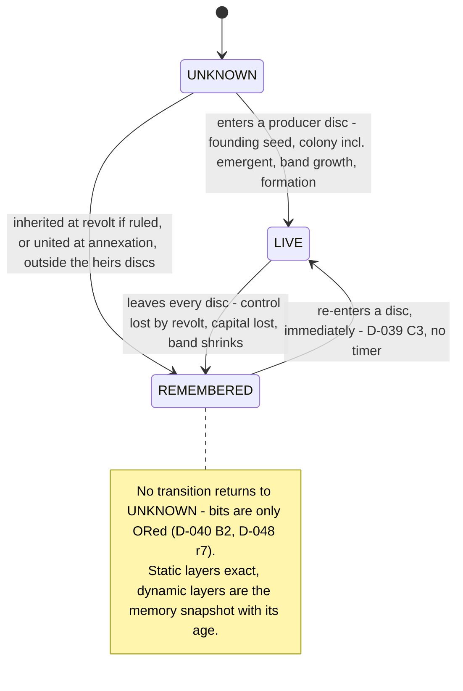
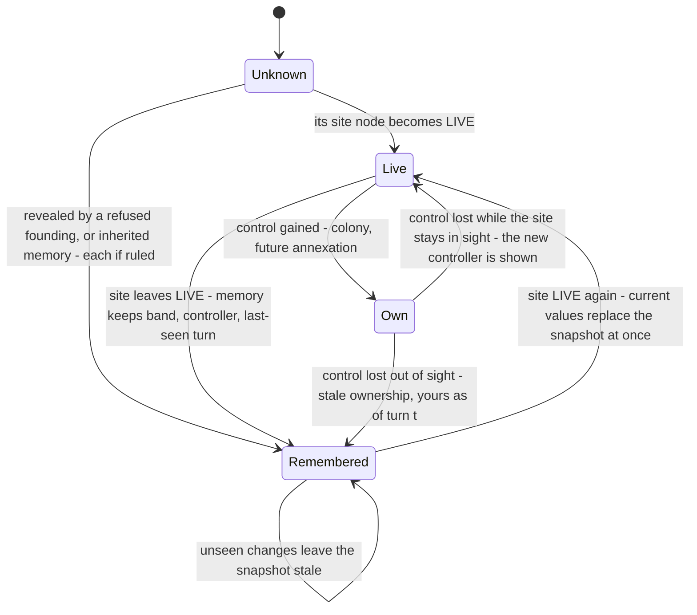

# Fog of war, discovery, sighting memory and AI information — design proposal

**Status: PROPOSED — a design for the Director's review, part of the M6 knowledge-redesign package. Not ratified. Nothing
here is implemented, no test exists for it, and no test result is claimed.** Written 2026-10-22.

- **Tree.** `/home/user/m5w/dev`, branch `claude/new-session-yavghm`, HEAD `edba2b5` (docs-only commits on `main` =
  `m5-exit` = `6e51a3e`). Every code citation was read at this tree. No file under `Sim.*` was changed.
- **What this document is.** The principal designer's ten decisions (D1–D10, restated in §1.1) turned into a code-grounded
  design, tested against the code and the ratified records. Where a decision contradicts code or a ratified record, the
  decision is NOT changed here: the objection is recorded with evidence in **§18 Designer review notes**, and the design
  body follows the decision unless §18 says otherwise.
- **Evidence base.** `docs/m6-plan/knowledge-redesign/audit/fog-and-ai-information-audit.md` (secondary evidence; its
  citations were spot-checked, a sample in every family of the leak matrix) and the records and code it cites.
- **New measurements.** §2.3 reports figures from a throwaway probe built against a copy of `Sim.Core`/`Sim.Data` at
  `edba2b5` in the session scratchpad (not in the repository; method in Appendix A). They are labelled
  **MEASURED (probe)**. They describe today's all-known code; they are not measurements of any fog implementation.
- **Labels.** **MEASURED** (read from code, content, tests or the probe, cited) · **RECORDED** (a figure or ruling taken
  from a record, cited) · **INFERENCE** · **PROPOSED** (this document's design) · **OPEN DECISION** (needs a ruling) ·
  **IMPLEMENTATION DEFERRED** (contract now, code in a later milestone). Record status words (RATIFIED, RULED, DRAFT,
  OPEN) are the records' own.

---

## 1. Executive summary and recommended model

### 1.1 The designer's decisions (input, restated)

| # | Decision (principal designer) | Where designed |
|---|---|---|
| D1 | Seven separated information layers: (a) discovered extent, STORED monotone per-polity bitset; (b) LIVE sight, DERIVED on demand, never stored; (c) physical control and (d) ownership/jurisdiction, the existing control rows; (e) remembered observations, a STORED sparse sighting memory of dynamic facts (formations LIVE-only); (f) contact, derived; map exchange/treaties M8; (g) resource access states | §4 |
| D2 | Per node per polity: UNKNOWN · REMEMBERED (GHOST) · LIVE; extent never clears; sight follows current control | §5 |
| D3 | Sight is a deterministic geometric disc (wrap-aware integer offsets, precomputed), radius by producer class plus an elevation vantage bonus, water visible, no ray casting, never along foreign roads — NOT `Pathfinder.Isochrone` | §6 |
| D4 | Extent seeded by a founding-time sight write; turn 0 is fogged; every golden moves, with a `PreFog` twin | §6.4, §11.4 |
| D5 | Gating: founding and AI site choice inside known extent; unknown nodes impassable and worthless for AI valuation (D-T); road plans through known nodes; trade needs a known route and a partner known by contact (DW-006); raid targets known; emergent colonization and migration keep reading world truth (people, not state); each AI polity judges against PREV plus its own orders, conflicts refused at delivery (DW-002) | §10 |
| D6 | Every AI read goes through polity-scoped `PolityKnowledge` queries; the 53 leak rows and the global-truth systems mapped; player/AI symmetry | §7.3, §10 |
| D7 | M6 defines the mobile sight-producer contract; the scout unit is M7's first MobileAgent; resolve D-052 §5 vs D-J formally | §6.7, §17 |
| D8 | Append-only sections for extent and memory, nothing for LIVE; next landed version (D-H); v34 migration seeds extent from current state, memory empty; canonical serialization, populated tests, replay, `--from-save`, attribution, session files (telemetry/F12 world-wide, chronicle filtered) | §14 |
| D9 | Resource discovery chain: exists → located → identified → prospected → extractable → processable → industrial use; place-level geology IMPLEMENTATION DEFERRED to the first consumer of a new mineral; four chains tested | §12 |
| D10 | Performance and memory budget without caches | §9 |

### 1.2 The recommended model in one paragraph (PROPOSED)

Each polity owns a **stored, monotone known extent** — one bit per 16 km lattice node (65,536 nodes, 8 KiB of payload) —
and a **stored sighting memory** of the dynamic facts it last saw (settlement presence, population band and controller;
road class; later, prospecting results), each with its last-seen turn. Its **LIVE sight** is never stored: it is a pure
function of the state being judged — integer discs stamped around the settlements it controls and the formations it
owns, radius set by a population band (settlements) or a class constant (formations) plus whole nodes of vantage from the
producer's height above sea, sea nodes included, roads irrelevant. The seam composes the three: **Known = stored extent ∪
LIVE**, so Visible ⊆ Known holds by construction and the stored extent may trail LIVE by one step without any loss. One
new system ORs each step's LIVE into the extent and refreshes memory from what was LIVE. Every AI policy and every
simulation predicate that a polity's knowledge should limit asks `PolityKnowledge` (§7.3); the player's surfaces ask the
same structure through `PlayerKnowledge`. Founding, road plans, trade and raiding are restricted as D5 rules, with two
companion rules this document adds because the code shows they are needed (§10.4): a candidate site's spacing
neighbourhood must lie in known land (the ADR-037 §7 reach rule applied to the predicate), and a delivery refusal caused
by a settlement the issuer did not know records that settlement in the issuer's memory — otherwise the AI re-issues the
same refused order every turn. Persistence appends three sections at the next landed schema version; the PreFog
configuration reproduces every pre-fog hash through the v34 projection that `WorldHash.ComputeHexAsSchema` already
provides.

### 1.3 What the Director is asked to rule (details §17)

1. **D-K**: rule the geometric-disc sight model (not `Isochrone`), the stored extent, the stored memory, and
   Known = stored ∪ LIVE.
2. **D-J / D-052 §5**: a dated clarification that M6 delivers the mobile sight-producer contract and the scout unit is
   M7's.
3. **D-T plus its two companions** (survey margin; refusal as observation), with **DW-002** ruled accordingly.
4. **DW-006**: the trade gate, including whether it applies to a polity's own settlement pairs.
5. **Revolt inheritance of extent and memory** (D-048 r1 says "and nothing else").
6. **Formation ghosts**: D-039 C1 and D-052 §5 (both RATIFIED) put a formation GHOST in M6; D1 makes formations
   LIVE-only (§18 R1).
7. The **producer class and the radius table** (TUNE values with a reference class, §6.2).
8. **PathBuild** targets under fog (no decision covers them), **D-H** version, **Decision A** token size, pre-fog
   session resume, and the geology layer's form and first consumer.

### 1.4 Headline numbers

| Quantity | Value | Label |
|---|---|---|
| Disc size, radius r nodes (integer dx²+dy² ≤ r²) | r=8: 197 · r=10: 317 · r=12: 441 · r=14: 613 · r=16: 797 nodes | MEASURED (probe) |
| LIVE derivation, one polity, producers × disc | 12 producers at r=10: ≈ 7 µs · 584 producers at r=10: ≈ 0.30 ms (≈ 1.6 ns per stamped node) | MEASURED (probe, micro-benchmark) |
| Extent storage | 8 KiB payload; ≤ 1,024 rows × 16 B = 16 KiB per polity in the row form | INFERENCE from the row shape (§7.1) |
| Turn-0 extent rows, all polities (r=12) | 253–382 rows (4.0–6.0 KiB) against a 72,513-byte turn-0 stream (seed 42) | MEASURED (probe) |
| Settlements: founding / turn 600 (1 AI Empire) / capacity | 12 / 23 on seeds 1, 2, 42, 7 / median 381, max 584 on the shipped cylinder | MEASURED (probe); RECORDED (`Sim.Data/content/worldgen.json:51`) |
| Nearest rival settlement at turn 0 (1 AI Empire) | 10.63–18.03 nodes (170–288 km) | MEASURED (probe) |
| Founding candidates at turn 0 if a site's spacing neighbourhood must be known | r=8: 0 · r=10: 0–24 · r=12: 137–302 · r=14: 1,235–1,473 candidate nodes per world | MEASURED (probe, Euclidean approximation) |

### 1.5 Findings against the decisions (summary of §18; resolved in §19)

Contradicted by a ratified record: **R1** (formations LIVE-only vs D-039 C1 + D-052 §5). Needing a ruling because a
ratified record is silent or literal: **R3** (revolt copy vs D-048 r1 "and nothing else"). Method objection: **R2** (D-040
E4 requires constants derived from a reference class; sim-measured distances can check them, not derive them). Gaps the
decisions leave that the code exposes: **R4** (the DW-002 resolution has an AI liveness hole), **R5** (contact must use the
remembered controller), **R6** (the only sim-side size class saturates at founding scale), **R11** (emergent founding reads
a whole-map argmax, so "people" is a deviation to record, not compliance), **R13** (the trade route rule stops most
domestic trade of round-robin-scattered empires), **R14** (PreFog needs a switch ADR-037 §1 does not contemplate). Factual
corrections: **R7** (457 is the flat-world capacity; the shipped cylinder measures 381/584), **R9** (geology belongs on the
ADR-008 path, and D-051 §2 is an M6 consumer), **R10** (the frozen Spine scopes the nuclear layer to deterrence).
Endorsed with evidence: D3 (geometric sight; the m5w applied correction and D-039 B4 against the M6 spec and docket D-K).

---

## 2. Current state (MEASURED)

### 2.1 What exists

| # | Fact | Evidence | Label |
|---|---|---|---|
| 2.1.1 | No fog state of any kind: the canonical stream ends at section 61 `ConstructionHolds`; schema version 34; readable set {32, 33, 34} | `Sim.Core/Kernel/CanonicalSchema.cs:971-979, 181, 195` | MEASURED |
| 2.1.2 | `PolityKnowledge.Of` is all-known: both masks null, every answer "yes" | `Sim.Core/State/PolityKnowledge.cs:81-85, 137-147` | MEASURED |
| 2.1.3 | `KnowsSettlement` = controls it, or its site is VISIBLE (no memory: an unseen rival vanishes) | `Sim.Core/State/PolityKnowledge.cs:153-162` | MEASURED |
| 2.1.4 | `KnowsPolity` (contact) reads the TRUE controller from `Controls` | `Sim.Core/State/PolityKnowledge.cs:177-186` | MEASURED |
| 2.1.5 | `Restricted` builds a stub from explicit masks; production must never call it (source guard) | `Sim.Core/State/PolityKnowledge.cs:93-103`; `Sim.Ui.Tests/KnowledgeLeakTests.cs:1378-1381` | MEASURED |
| 2.1.6 | Eight production `Of` call sites | `Sim.Core/State/InfoQuery.cs:213, 327, 335`; `Sim.Core/Systems/Colonization/AiFoundingPolicy.cs:194, 296`; `Sim.Core/Systems/Construction/AiConstructionPolicy.cs:108, 250`; `Sim.Ui/ViewModel/PlayerKnowledge.cs:83` | MEASURED (grep) |
| 2.1.7 | `Pathfinder.Isochrone` builds a lane overlay of every network edge and travelled road, never enters an impassable node, and lists only passable unreached neighbours as its boundary | `Sim.Core/Pathing/Pathfinder.cs:170, 177, 209, 523, 533, 575-600` | MEASURED |
| 2.1.8 | Pathfinding purity mandate: no persistent caches, no memoization | `Sim.Core/Pathing/Pathfinder.cs:8-11` | MEASURED |
| 2.1.9 | Lattice 256 × 256 = 65,536 nodes of 16 km; a node is impassable iff its block is ≥ 50 % water | `Sim.Core/Pathing/TraversalLattice.cs:14-15, 104, 113, 159` | MEASURED |
| 2.1.10 | Founding deals settlements round-robin; each Empire's capital is its first; formations stand at capitals; founding writes no catchment | `Sim.Core/Worldgen/WorldFounding.cs:331-382, 262-296, 257-259`; audit 12.4 | MEASURED |
| 2.1.11 | AI site scan: first arm `KnowsCell`, valuation from the whole-map frontier raster, reachability from an uncapped `Isochrone`, one `Sites` batch shared by every AI polity of a producer call | `Sim.Core/Systems/Colonization/AiFoundingPolicy.cs:313-321, 333-340, 50-55, 107-175`; `Sim.Core/AiOrders.cs:59, 73` | MEASURED |
| 2.1.12 | The founding predicate's known-extent arm is inert; reachability is `FindPath` over the whole lattice and every lane | `Sim.Core/State/FoundingQuery.cs:175, 195, 69-71` | MEASURED |
| 2.1.13 | Emergent colonization takes a whole-map argmax with no reachability rule | `Sim.Core/Systems/Colonization/ColonizationSystem.cs:224-225`; `Sim.Core/Worldgen/SettlementSiting.cs:394-400, 461-464` | MEASURED |
| 2.1.14 | Order intake judges on PREV with every standing site, grown by earlier orders of the batch | `Sim.Core/Systems/Colonization/ColonizationSystem.cs:193, 256-276` | MEASURED |
| 2.1.15 | Deposits are per settlement, immutable; extraction is ungated; 14 goods, copper and tin the only ores, no uranium/coal/oil/iron good | `Sim.Core/State/WorldState.cs:270-279`; `Sim.Core/Systems/Production/ProductionSystem.cs:369-390`; `Sim.Data/content/goods.json:48-62`; audit §2.2 | MEASURED |
| 2.1.16 | Bronze is the only chain with goods: copper-ore 8 + tin-ore 1 + timber 2 per bronze, artisan predicate; the recipe entity requires `tin_bronze` | `Sim.Data/content/goods.json:137-158`; `Sim.Data/content/research.json:29415-29421` | MEASURED |
| 2.1.17 | Revolt makes each revolted place a new AI polity with a control row, a full copy of the parent's completed research and the parent's Age; ids are max + 1 | `Sim.Core/Systems/Revolt/RevoltSystem.cs:176-191, 204-209` | MEASURED |
| 2.1.18 | Trade pairs any two connected settlements whose knowledge allows trade; no contact or extent term | `Sim.Core/State/TradeQuery.cs:26-28`; `Sim.Core/Systems/Trade/TradeArbitrageSystem.cs:124-137` | MEASURED |
| 2.1.19 | Road candidates: every finite `SettlementDistances` pair with an own endpoint, the other endpoint any settlement within 600 km | `Sim.Core/State/RoadDevelopmentQuery.cs:179-191` | MEASURED |
| 2.1.20 | The only sim-side settlement size class (T3.8 `SizeTier`, 0–4 by dwellings) is designed to saturate near founding scale | `Sim.Core/Systems/Catchment/CatchmentSystem.cs:60-66`; `Sim.Data/content/sim.json:17` | MEASURED |
| 2.1.21 | A population size scale exists only in UI content: thresholds 0, 250, 1,000, 4,000 … 4,096,000 (×4) | `Sim.Ui/UiContent/world/settlement-classes.json:3-13` | MEASURED |
| 2.1.22 | Elevation is a dimensionless fBm value in [0, 1) with no declared unit; temperature lapses 25 °C per elevation unit | `Sim.Core/Worldgen/Worldgen.cs:100, 266-280, 123-126`; `Sim.Data/content/worldgen.json:27` | MEASURED |
| 2.1.23 | UI: no Fog layer; the terrain bake is drawn whole; the overlay's accessibility is an unbounded `Isochrone` while the viewer sees all | `Sim.Ui/World/MapLayers.cs:5-22`; `Sim.Ui/SimUiGame.cs:206-213`; `Sim.Ui/World/ResourceOverlay.cs:497-507` | MEASURED |
| 2.1.24 | Snapshot load attaches terrain after the canonical read, then returns; load-time invariants refuse states no rule writes | `Sim.Core/Kernel/Snapshot.cs:92, 130, 154, 166-185` | MEASURED |
| 2.1.25 | A world's hash as an older schema is the stream less the sections appended since | `Sim.Core/Kernel/WorldHash.cs:36-45`; `Sim.Core/Kernel/CanonicalSchema.cs:205-214` | MEASURED |
| 2.1.26 | Order kinds 1–9 and 11–13 exist; kind 10 is reserved for MoveFormation (M7) | `Sim.Core/Kernel/OrderLog.cs:12-203, 150` | MEASURED |

### 2.2 The AI leak matrix (from the audit; the mapping is §10)

53 read sites across the producer and six AI policies: 38 read only the polity's own data, 3 already call the seam, 11
are latent leaks (D2, D3, D4, D6, F4, F5, F6, F8, F10, F11, F12), 1 is active today (P2: an AI polity sees another AI
polity's same-turn founding order). Nine systems are listed besides; seven of them (N1–N7) decide for a polity from global
truth. RECORDED (audit §5.2–§5.3), sample spot-checked: `Sim.Core/Systems/Roads/RoadDevelopmentPolicy.cs:31-45`,
`Sim.Core/Systems/Research/AiResearchPolicy.cs:48-60`, `Sim.Core/Systems/Ages/AgeAdvancePolicy.cs:23-30`,
`Sim.Core/Systems/Governance/AiGovernance.cs:38-51`, `Sim.Core/Systems/Construction/AiConstructionPolicy.cs:100-140,
245-262` — all MEASURED to match.

### 2.3 Founding geometry and the cost of discs (MEASURED (probe))

Canonical config (1024 px, 12 settlements, cylinder), seeds 1, 2, 42, 7; "nodes" are lattice nodes (16 km). Distances are
Euclidean on the cylinder between settlements' lattice nodes.

| Seed | Nearest rival settlement, 1 AI Empire | Nearest rival, 3 AI Empires | Nearest own other settlement, 1 AI Empire |
|---|---|---|---|
| 1 | 17.72 nodes (284 km) | 8.94 (143 km) | 8.94–62.10 nodes (143–994 km) |
| 2 | 18.03 (288 km) | 15.81 (253 km) | 15.81–34.66 (253–554 km) |
| 42 | 10.63 (170 km) | 10.63 (170 km) | 15.81–71.11 (253–1,138 km) |
| 7 | 16.03 (256 km) | 12.37 (198 km) | 11.70–39.56 (187–633 km) |

| Measure (per polity, turn 0, 1 AI Empire = 6 settlements each) | r=8 | r=10 | r=12 |
|---|---|---|---|
| Known extent (nodes, union of the polity's discs) | 1,119–1,182 | 1,759–1,902 | 2,317–2,636 |
| …of which sea/lake (impassable) nodes | 3–52 | 23–102 | 33–153 |
| A rival settlement inside the polity's turn-0 discs | none | none (seed 1 with 3 AI: yes) | seed 42 (1 and 3 AI), seed 1 (3 AI) |

- Passable land is 22,875–22,891 nodes per world; at r=12 a polity's turn-0 extent is ≈ 10–11 % of the land, in six
  disjoint islands (the round-robin deal scatters each polity's holdings across the continent, `WorldFounding.cs:331-382`).
- Height above sea at the 48 founded sites: 0.012–0.200 elevation units; over all land nodes p50 0.053–0.083, p90
  0.141–0.176, max 0.235–0.297.
- 600 turns, 1 AI Empire, all-known trajectory (today's code): 23 settlements on every seed at turn 600 — the AI issued 11
  Found Settlement orders and grew from 6 to 17, the player's 6 never changed (no emergent colony) — and 2 polities
  throughout (no revolt-born polity). First turn at which some polity has a rival settlement within r of
  one of its own (a pre-fog approximation of first contact under radius r; fog itself would change the AI's colony
  placement): r=10: seeds 1/2/42/7 → turn 144 / never / never / 144; r=12: 144 / never / 0 / 144; r=16: 108 / 36 / 0 /
  144.
- Canonical stream (seed 42, 1 AI): 72,513 bytes at turn 0; 254,987 bytes at turn 600 (23 settlements, 51 transport edges,
  460 network edges).
- Costs on the probe host (4-CPU Xeon 2.1 GHz, .NET 10.0.112, Release): stamping discs for 12 / 100 / 584 producers at
  r=10 takes ≈ 7 / 52 / 297 µs; decoding one polity's 1,024 extent rows ≈ 1.1 µs; a full passable-component labelling of
  the 65,536-node lattice ≈ 0.65 ms; `SettlementSiting.PrepareFrontier` at 1024 px ≈ 50 ms per call.

---

## 3. Recorded decisions: ratified versus open

| Record | Status | What it fixes for this design | Citation |
|---|---|---|---|
| Spine principle 7 | FROZEN | AI uses the player's verbs and information class; difficulty = information and friction, never hidden resources | `docs/civ-sim-architecture-v3-outline.md:25` |
| Spine nuclear rescope | FROZEN | Nuclear layer → modern-era expansion, deterrence-abstraction only | `docs/civ-sim-architecture-v3-outline.md:154` |
| CLAUDE.md laws 3, 4, 5 | FROZEN | dt-correct rates; no calendar gates; banned constructs (no `float`, no dictionary iteration, no `System.Random`) | `CLAUDE.md:18-20` |
| D-039 A, B1–B5, C1–C4 | RATIFIED | Position/strength/outcome channels; recon bought with food and people, diminishing, pointed, mild distance degradation with vantage, stale not wrong; LIVE/GHOST/UNKNOWN for enemy formations; return to LIVE immediately | `docs/d039-command-fog-and-siege.md:12-46, 48-75, 84-100` |
| D-039 B6 | OPEN | Scouts: class, flag or capability score | `docs/d039-command-fog-and-siege.md:77-82` |
| D-040 A4, B1, B2, B3, B5, E4 | RATIFIED | Extent discovered, not a fog overlay; settle/claim/trade only within known extent; discovery = reconnaissance at scale, no second exploration system, once known stays known; no tech unlock of reach; storage and granularity not designed; every constant derived from a stated reference class | `docs/d040-discovery-and-control.md:29-39, 41-57, 59-69, 82-88, 180-181` |
| D-048 r1–r8, Age pointer | RATIFIED | Revolt copies completed research "and nothing else"; knowledge never decays; annexation is a union; Age inheritance needed its own ruling | `docs/d048-knowledge-persistence-rulings.md:11-21, 44-56, 60-70` |
| D-051 §2 | RATIFIED, deferred to M6 (R2) | Availability classes; regionally correlated richness incl. copper and tin; rare and strategic goods stay rare | `docs/d051-m5-polish-rulings.md:33-46`; `docs/m6-plan/m6-decision-register.md:242-244` |
| D-051 §5 | RATIFIED | Found Settlement order; "Emergent founding (D-037 B1) continues unchanged"; the AI uses the same order and predicates | `docs/d051-m5-polish-rulings.md:79-89` |
| D-052 §2 (h) | RATIFIED | AI information leak accepted until M6's known extent; median 953 km colony distance as evidence | `docs/d052-m5-integration-audit-rulings.md:27-29` |
| D-052 §3 (ADR-037) | RATIFIED | One seam; production all-known until a stored extent; `Restricted` test-only; ADR-037 §6 channels are M6's | `docs/d052-m5-integration-audit-rulings.md:38-44`; `docs/adr/adr-037-player-knowledge-seam.md:33-48, 136-162` |
| D-052 §4 | RATIFIED | Movement and Action Points are M7 | `docs/d052-m5-integration-audit-rulings.md:46-51` |
| D-052 §5 | RATIFIED | M6: full fog, LIVE/GHOST/UNKNOWN (D-039 C1), scouts, persisted sighting memory, extent storage, settle/claim/trade restriction, closing ADR-037's channels | `docs/d052-m5-integration-audit-rulings.md:53-66` |
| D-052 §8 | RATIFIED (closed as built) | The resource shortcut highlights known places only | `docs/d052-m5-integration-audit-rulings.md:100-106` |
| D-054 instruction | RECORDED | Explored-longitude limits, exploration-unlocked wrapping and Satellites reveal are out of scope | audit §10; `docs/d052-m5-integration-audit-rulings.md:223-224` |
| D-055 note | RATIFIED (accepted at R5) | v35 reserved to S2a (extent), v36 to S3; kind 10 reserved | `docs/d055-batch4-reservations-attribution-allocation-ci-persistence-pathfinding.md:1306-1307` |
| D-060 §5, §6, §11 | ACCEPTED (R5) | A rival's books closed on player surfaces; F12 and session files world-wide; the chronicle file subject to P7's hidden-settlement filter; Decision A (token size) deferred until fog | `docs/d060-rival-internals-isolation.md:66-100, 248-267` |
| ADR-036 | RATIFIED | One founding predicate for player and AI; the known-extent arm's place; S2b must narrow the AI's read and pick | `docs/adr/adr-036-found-settlement-order.md`; `Sim.Core/State/FoundingQuery.cs:69-71` |
| ADR-037 §7 | RATIFIED | A value whose reach touches undiscovered ground is withheld, never estimated; what a polity assumes of unseen ground is S2b's | `docs/adr/adr-037-player-knowledge-seam.md:174-185` |
| D-I, D-D, D-E, D-F | RULED 2026-10-20 | Single pool (D-I, supersession proposed by D-061); government adoption M8; unit progression contract only | `docs/m6-plan/m6-decision-register.md:230-246` |
| M6 spec §3.2, §3.5 F, I-8, I-9, T6.7–T6.9 | DRAFT, not ratified | Sight via `Isochrone` with a cost-unit budget; extent seeded from founding catchments; revolt copies; memory as state if persisted | `docs/m6-spec.md:3-4, 98-102, 127-129, 229-242, 278-280` |
| Docket D-K, D-J, D-T, D-H | OPEN | D-K proposes `Isochrone` sight; D-J no scout in M6; D-T unknown = impassable and worthless; D-H first to land | `docs/m6-plan/m6-ruling-docket.md:37-39, 43` |
| DW-002, DW-004, DW-005, DW-006 | OPEN (ruling owed) | Judged world of a fogged order; token size; scouts as class; trade mutually-known term | `docs/m6-plan/deferred-work-register.md:27-31` |
| m5w plan S2a–S2c and critic | PLANNING (deferred to M6) | Bitset design; "sight must not be modelled as a movement-cost isochrone (D-039 B4 vantage)"; passive sight is a named deviation from D-040 B2 / D-039 B1; the turn-0 seed needs a founding write | `docs/m5w-map-workstream-audit-and-plan.md:5, 725-800, 890-899, 980-981, 995` |

---

## 4. Information model

### 4.1 The seven layers (PROPOSED, following D1)

| Layer | Content | Stored or derived | Granularity | Writer(s) | Reader | Monotone |
|---|---|---|---|---|---|---|
| (a) Discovered extent | Nodes the polity has ever had in LIVE | STORED (`KnownExtentRow`, §7.1) | lattice node | founding seed; the discovery system; revolt (if R3 is ruled yes) | `PolityKnowledge` only | yes — bits are only ORed |
| (b) LIVE sight | Nodes inside the discs of the polity's current producers | DERIVED from the judged state, never stored | lattice node | none (pure query `Sight.Live`) | `PolityKnowledge` | no — follows current control |
| (c) Physical control | Which polity a settlement obeys | existing `ControlRow` | settlement | colonization, revolt, governance (unchanged, `Sim.Core/SystemCatalog.cs` header) | everything | no |
| (d) Ownership / jurisdiction | Claim and recognition | existing `ClaimRow`, `RecognitionRow` (schema only, no writer) | settlement | none in M6 | — | — |
| (e) Remembered observations | Dynamic facts at last sighting: settlement presence, population band, controller; road class; (later) prospecting results | STORED (`SettlementSightingRow`, `RoadSightingRow`) | object | the discovery system; revolt (if R3); the refusal observation (if §10.4 is ruled) | `PolityKnowledge` | rows only refresh or are added; never removed |
| (f) Contact and information transfer | Contact derived from (b) and (e); map exchange, treaties, recognition | DERIVED; exchange IMPLEMENTATION DEFERRED to M8 | polity pair | none | `PolityKnowledge.Contact` | contact persists through memory |
| (g) Resource access states | discovered, identified, prospected (§12) | located = (a); identified DERIVED; prospected STORED, IMPLEMENTATION DEFERRED | node × resource kind | — in M6 | `PolityKnowledge` (contract) | yes |

### 4.2 Composition rules (PROPOSED)

1. **Known = stored extent ∪ LIVE** for the state being judged. LIVE ⊆ Known by construction, so the seam's invariant
   `Visible ⊆ Known` (`Sim.Core/State/PolityKnowledge.cs:25`) needs no ordering constraint between systems.
2. **Stored(t+1) = Stored(t) ∪ LIVE(t).** The discovery system reads PREV only. Hence Known(t) ⊆ Stored(t+1) ⊆ Known(t+1):
   knowledge is monotone across every step, including steps in which control is lost (D-040 B2, D-048 r7, I-8).
3. **Static facts of a known node are exact** (terrain, elevation, water, rivers, coast) whether the node is LIVE or
   REMEMBERED: the land does not change (`Sim.Core/Worldgen/TerrainSet.cs:5-13`, immutable rasters).
4. **Dynamic facts are current only on LIVE nodes.** On a REMEMBERED node they are the memory snapshot with its age;
   anything not in memory (catchments, dirt paths, structures, formations) is not shown and not read there.
5. **Memory records every settlement LIVE for the observer, its own included**, so a place the polity loses keeps its
   last-known state ("yours as of turn t") instead of vanishing.
6. **Contact(P, Q)** holds iff P knows a settlement whose KNOWN controller is Q — the current controller if the settlement
   is LIVE, the remembered controller otherwise (§18 R5 explains why the designer's "a rival settlement in my extent"
   needs this precision).
7. **Books stay books.** `ReadsInternals` is unchanged: only a controller reads a settlement's people, stocks, queues and
   deposits (D-060). Fog decides what is KNOWN; D-060 decides what of a known rival is PUBLIC.

### 4.3 Information policy per data class (PROPOSED)

| Data class | UNKNOWN node | REMEMBERED node (GHOST) | LIVE node | Own | Stored? | Notes |
|---|---|---|---|---|---|---|
| Terrain, elevation | absent (not drawn, not read) | exact | exact | exact | no (terrain regenerated from seed, ADR-008) | D-040 A4: unknown land is absent, not dark terrain |
| Rivers, coasts, seas | absent | exact | exact | exact | no | Sea nodes become known through sight (discs include impassable nodes); a river is a sub-node feature, known with its node (D-040 B5) |
| Deposits | nothing | surface-signature deposits identified iff the polity holds the identification capability (derived); deep deposits only as prospected (memory) | same as REMEMBERED (looking reveals no deep deposit) | own settlements' `DepositRow` books | identified: no; prospected: yes (deferred) | §12; research never reveals a deposit |
| Settlements and structures | nothing | marker from memory: population band, controller, last-seen turn; no structures, no institutions | current public identity (D-060 public list), population band | full books | memory row | A settlement founded in a REMEMBERED region after the last sighting stays unknown until seen |
| Roads (TransportEdges) | nothing | remembered class and last-seen turn | current class | current | memory row | Dirt paths (NetworkEdges) are LIVE-only: drawn and read where both nodes are LIVE |
| Ownership and borders | nothing | remembered controller at the settlement marker, with age; no territory shading | current controller and catchment shading | own catchments | memory controller field | A per-node remembered owner layer is not proposed (cost §9) |
| Military formations | nothing | nothing (D1: LIVE-only) — §18 R1 objects | identity, family, Age form, owner, station, position (D-060 public) | full | none under D1 | Formations do not move before M7 (`Sim.Core/State/WorldState.cs:996-1011`) |
| Resource depletion and extraction | nothing | nothing | nothing (a rival's output is its books) | own books | — | No depletion exists (`Sim.Core/State/WorldState.cs:270-279`) |
| Rival changes (founding, capture, revolt, Age, building) | not learned | not learned until seen again; the memory stays stale | learned at once (D-039 C3: no timer) | — | memory refresh | Annals tell an event only if its subject was LIVE (or own) when it happened |
| Stale observations | — | shown with age: "last seen year Y (N years ago)", years from the era table | — | — | `LastSeenTurn` | Reports are stale, never wrong (D-039 B5) |

---

## 5. States and transition diagram

### 5.1 Node state for one polity (PROPOSED)



### 5.2 A settlement as one polity sees it (PROPOSED)



### 5.3 Control changes (PROPOSED effects; current mechanics MEASURED)

| Event | Today (MEASURED) | LIVE | Extent | Memory | Contact |
|---|---|---|---|---|---|
| Revolt | Revolted places become new AI polities with research and Age copied (`Sim.Core/Systems/Revolt/RevoltSystem.cs:176-191`) | Parent loses the revolted places' discs at once; the child's LIVE is its places' discs | Parent keeps every bit. Child: copy of Known(parent, PREV) **if R3 is ruled yes**, else starts from its own LIVE | Parent: the lost place stays as last seen ("yours as of t") unless still LIVE. Child: copy of the parent's memory if R3 is ruled yes | Parent–child contact holds through the parent's memory or LIVE |
| Annexation / conquest | No path exists; `KnowledgeTransfer.MergeInto` is a union (`docs/d048-knowledge-persistence-rulings.md:44-56`) | Annexer gains the place's disc | Union (OR) of both extents when a path is built (D-048 r8 analogue; IMPLEMENTATION DEFERRED) | Merge per subject: the row with the larger `LastSeenTurn`; equal turns describe the same observed state | — |
| Settlement destruction / abandonment | None: `Settlements` is append-only; an emptied place keeps its row (audit §7) | A LIVE emptied settlement shows its current population band (band 0) | unchanged | A remembered thriving town may since have emptied: stale by design | unchanged |
| Loss of frontier / control decay | No loss path besides revolt; `ControlRow.Strength` is reach, rewritten every step (`Sim.Core/State/WorldState.cs:610-619`) | Sight follows current control rows only | unchanged | as revolt | — |
| Capital loss | Capital row persists; reach 0; the formation keeps `Location` at the lost capital (no writer moves it, `Sim.Core/State/WorldState.cs:996-1011`) | The owner's formation, still stationed there, keeps a LIVE disc over its former capital until M7 moves it (INFERENCE; §17 item 13) | unchanged | refreshed while LIVE | — |
| Emergent colony (people) | Whole-map argmax; the colony inherits the parent's controller (`ColonizationSystem.cs:224-225, 335-338`) | The colony's disc joins the polity's LIVE in the state where it exists, even in land never seen (§10.3 N1) | stored at the next step | refreshed | possible new contact |
| Polity extinction | Derived: controls nothing; the row remains (`Sim.Core/State/EmpireQuery.cs:30-45`) | none | kept | kept; others' memory of it stays | others keep contact through memory |

---

## 6. Sight producers and algorithm

### 6.1 Producers and the radius function (PROPOSED, D3)

`r(producer) = min(capNodes, base(class) + vantage(h))`, where

- **class** — a settlement the polity controls: its **population band** `b = max{i : population ≥ minPop[i]}` over the ×4
  thresholds now held in UI content (`Sim.Ui/UiContent/world/settlement-classes.json:5-13`), moved to shared simulation
  content so the simulation and the token read one definition. A formation the polity owns: the class `formation`.
  (The T3.8 `SizeTier` is rejected as the class: it saturates at founding scale by design, `Sim.Data/content/sim.json:17`;
  §18 R6.)
- **h** — the producer cell's height above sea, `Elevation[cell] − SeaLevel` (the settlement's site cell; a formation's
  station site, or its own cell when in the field).
- **vantage(h)** — the number of entries of an ascending threshold list that `h` reaches; each adds one node (D-039 B4: a
  vantage point extends range, mildly).
- No passability test: sea and lake nodes inside a disc become known (coasts and seas are discovered). No lane, no road and
  no network edge enters the computation (D3: sight never travels along foreign roads).
- No line of sight in M6 (considered in §15).

### 6.2 TUNE parameters, reference classes and calibration (PROPOSED values; OPEN DECISION to ratify)

| Parameter | Proposed value | Range | Reference class (D-040 E4) | Check against the world (MEASURED (probe)) |
|---|---|---|---|---|
| `fog.settlementBaseNodes[band]` | band 0: 10 · band 1 (250–999 people, founding scale): 12 · band 2: 13 · band 3: 14 · band 4+: 15 | band 1: 12–14 | The land a community habitually ranges over and reports — daily work ≈ 1 node, seasonal herding, hunting and exchange contacts ≈ 6–12 nodes (100–200 km); larger polities know more. INFERENCE; T6.7 must source it (the package's source register) before ratification | Lower bound from the founding coupling: with the survey margin (§10.4) the turn-0 extents offer, per world, 0 candidate nodes at r=8, 0–24 at r=10 and 137–302 at r=12 (§10.4) |
| `fog.formationBaseNodes` | 8 | 6–10 | A field force's screen and foragers (≈ 100–150 km). INFERENCE; no effect in M6 while formations stand inside their capital's disc | — |
| `fog.vantageThresholds` (elevation units above sea) | 0.06, 0.10, 0.15 (→ +1, +2, +3 nodes) | step 0.05–0.10 | The geometric horizon d = √(2Rh) (R = 6,371 km), with the lapse-implied scale 1 elevation unit ≈ 3.85 km (INFERENCE: `lapsePerElevC` 25 °C per unit against the 6.5 °C/km standard atmosphere): the thresholds are the heights at which the horizon gains 16, 32 and 48 km over a lowland reference (p25 ≈ 0.03) | Settlement sites span 0.012–0.200 → bonuses 0–3 |
| `fog.capNodes` | 16 (256 km) | 14–18 | Keeps the strongest producer's disc under D-039 B4's "mild" degradation | At r=16, contact at turn 0 or by turn 144 on all four seeds (§2.3) |

**Calibration procedure (PROPOSED).** Values are DERIVED from the reference classes above, then CHECKED — never fitted —
on seeds 1, 2, 42 and 7 with 1 and 3 AI Empires (the D-052 §13 playtest configuration and a crowded one): (a) turn-0
nearest-rival distance (measured, §2.3); (b) turn-0 extent as a share of land; (c) turn-0 founding candidates under the
ruled predicate — must be > 0 for every polity on every seed, or ordered founding is impossible; (d) first-contact turn per
polity pair, measured on the fogged build (the §2.3 figures are the pre-fog approximation); (e) AI colony distance from
source against D-052 §2's pre-fog 953 km median, which fog should bring under ≈ r × 16 km; (f) the two quarantined
corridors' deltas (`docs/m6-spec.md:153-157`). (d)–(f) are recorded, not targeted: a bound built from sim outputs is
self-referential (S8 §4.1 item 3, `docs/m6-spec.md:140-145`).

**Dimensional declaration (replaces `docs/m6-spec.md:127` for sight).** Sight radius: lattice nodes, a length (16 km per
node step, Euclidean on the cylinder), not a cost. Vantage: nodes added per threshold of height above sea in elevation
units — elevation has no declared unit in code (§2.1.22), so the declaration must either adopt the lapse-implied scale or
state the thresholds as dimensionless. Extent: bits over nodes. No rate exists in M6 sight; any future rate (formation
ghost expiry, prospecting progress) is per sim-year × dt (law 3).

### 6.3 LIVE derivation (PROPOSED pseudocode)

```text
DiscOffsets[r], r = 0..capNodes: every integer (dx, dy) with dx*dx + dy*dy <= r*r, ordered by (dy, dx).
  Built once from the config's integer radii at config load (a constant of the config, like Pathfinder's Dx/Dy
  tables, Sim.Core/Pathing/Pathfinder.cs:61-63) — not state, not a cache of world data.

Sight.Live(world, fogCfg, P) -> ulong[W]        W = ceil(L*L / 64); pure; reads only `world`
  (L, block, wrap) = PolityKnowledge.Grid(world.Terrain.Size), world.Terrain.WrapX
  live = new ulong[W]
  pop[]  = per-settlement population: ONE pass over world.Buckets (array indexed by settlement id; ids are dense)
  site[] = per-settlement site cell: ONE pass over world.Settlements
  for each ControlRow c in world.Controls, row order:
      if c.Polity != P: continue
      b = band(pop[c.Place]) by integer comparison with fogCfg.bandMinPopulation
      cell = site[c.Place]
      Stamp(live, NodeOfCell(cell), min(cap, base[b] + Vantage(cell)))
  for each MilitaryUnitRow u in world.MilitaryUnits, row order:
      if u.Owner != P: continue
      cell = u.Location >= 0 ? site[u.Location] : cell under (u.X, u.Y)        (as KnowsUnit, PolityKnowledge.cs:166-173)
      Stamp(live, NodeOfCell(cell), min(cap, formationBase + Vantage(cell)))
  return live

Vantage(cell): h = Elevation[cell] - SeaLevel; k = 0; for t in thresholds (ascending): if h >= t then k += 1; return k

Stamp(bits, centre, r):
  cx = centre % L; cy = centre / L
  for (dx, dy) in DiscOffsets[r]:
      y = cy + dy;  if y < 0 or y >= L: continue                       // the poles keep hard edges
      x = MapTopology.NeighbourX(cx, dx, L, wrap);  if x < 0: continue  // flat map edge
      if wrap and MapTopology.Dx(cx, x, L, wrap) != dx: continue        // a disc wider than the map: each column once
      v = y * L + x;  bits[v >> 6] |= 1UL << (v & 63)
```

The wrap guard is the one `WorldFounding.HinterlandMeans` uses (`Sim.Core/Worldgen/WorldFounding.cs:430-435`); all
geometry goes through `MapTopology`, as `MapTopologyGuardTests` enforces (`docs/m5w-map-workstream-audit-and-plan.md`,
2026-10-15 note).

### 6.4 Discovery and the founding seed (PROPOSED pseudocode)

```text
WorldFounding.Assemble, after FoundInitialFormations (Sim.Core/Worldgen/WorldFounding.cs:257-258):
  for each polity P on the roster, ids ascending:  write rows (P, w, bits[w] != 0) of Sight.Live(world0, fogCfg, P)

DiscoverySystem.Step(PREV -> NEXT), reads PREV only:
  for each polity P on PREV's roster, ids ascending:
      bits = Decode(PREV.KnownExtent, P) | Sight.Live(PREV, fogCfg, P)
      emit (P, w, bits[w]) for w ascending with bits[w] != 0
  carry unchanged any NEXT row whose holder is absent from PREV's roster (a polity revolt created this step)
  rows strictly ascending by (Holder, Word)
```

Under rule 4.2.1 the founding write does not change Known(0) (Known(0) = LIVE(0) either way); it is kept, as D4 decides, so
that the stored extent of every state records everything ever LIVE up to the previous state and the turn-0 world carries
its extent (§18 R15).

### 6.5 Memory update (PROPOSED pseudocode)

```text
DiscoverySystem.Step, same pass, for each observer P (ids ascending):
  live = Sight.Live(PREV, fogCfg, P)
  for each settlement s in PREV.Settlements (table order = id order):
      if live[node(s)]:  row (P, s, band(s), controllerOrMinus1(s) by EmpireQuery.TryGetController, LastSeen = PREV.Turn)
      else if PREV has row (P, s):  carry it unchanged
  for each TransportEdge e in PREV.TransportEdges (row order):
      if live[node(e.A)] or live[node(e.B)]:  row (P, e.Id, e.EdgeType, LastSeen = PREV.Turn)
      else if PREV has row (P, e.Id):  carry it
  [if §10.4 companion (b) is ruled] for each FoundSettlement order o of this step's batch with o.Actor = P that the
      intake refuses because of settlement s unknown to P (FoundingQuery.Obstructors — the predicate's own pure function,
      shared with ColonizationSystem so the two cannot drift):  row (P, s, band, controller, LastSeen = PREV.Turn)
  rows strictly ascending by (Observer, Subject)
```

`EmpireQuery.TryGetController` already takes the lowest polity id when a place has two control rows
(`Sim.Core/State/EmpireQuery.cs:123-139`), so a memory row's controller is deterministic.

### 6.6 Determinism (PROPOSED)

- No RNG (a deterministic sight needs none, `docs/m6-foundations-audit.md:77`); no clock; no `float`; no dictionary or
  hash set (arrays indexed by dense ids); no LINQ in the step.
- LIVE and extent are sets: the OR is commutative, so producer iteration order cannot change the result; rows are emitted
  in strictly ascending integer keys, so the stream is canonical whatever the table order.
- Every stored field is an integer (`long` turns, `int` ids and classes, `ulong` bits). The only double reads are
  `Elevation` and `SeaLevel` compared with thresholds (IEEE comparisons, exact) and nothing double is stored.
- No new argmax exists in sight or memory. The founding argmax keeps its composite key (score DESC, cell ASC,
  `Sim.Core/Systems/Colonization/AiFoundingPolicy.cs:350-363`) over the knowledge-scoped raster; its tie-dense test is
  re-run on the scoped raster.

### 6.7 dt-correctness and the M7 mobile-producer contract (PROPOSED; IMPLEMENTATION DEFERRED to M7)

M6 producers are static between steps, so the extent does not depend on dt. A producer that MOVES (M7) must contribute
the union of discs along its swept path within the step, not only its end point; otherwise halving dt (era pacing goes
from 10 to 0.5 years, `docs/d039-command-fog-and-siege.md:166-175`) would discover more land along the same route —
a law-3 violation. The contract M6 writes for M7 (decision D7):

```text
ISightProducer (contract only; no M6 implementation beyond settlements and formations)
  Owner: PolityId
  Class: a content key with a base radius (fog.producerClasses)
  Cell (state end point) and SweptCells (the cells crossed during the step; empty when static)
  Contribution to LIVE(state) = disc at Cell; contribution to the next stored extent = discs along SweptCells ∪ Cell
  Cost: none in M6. D-039 B1 (paid in food and people), B2 (diminishing returns) and B3 (pointed) bind the M7 scout
  unit, which is M7's first MobileAgent (docket D-J) — not an M6 entity.
```

---

## 7. Data model

### 7.1 State (PROPOSED; widths are canonical-stream bytes)

| Row | Fields | Width | Order and invariants | Writers | Readers | Consumers |
|---|---|---|---|---|---|---|
| `KnownExtentRow` | `PolityId Holder` (int32), `int Word`, `ulong Bits` | 16 | strictly ascending (Holder, Word); Bits ≠ 0; 0 ≤ Word < ⌈N/64⌉; Holder on the roster | founding seed; DiscoverySystem; RevoltSystem (child copy, if R3) | `PolityKnowledge` | every gated reader through the seam |
| `SettlementSightingRow` | `PolityId Observer`, `SettlementId Subject`, `int PopulationBand`, `PolityId Controller` (−1 stateless), `long LastSeenTurn` | 24 | strictly ascending (Observer, Subject); Subject exists; LastSeenTurn < Clock.Turn | DiscoverySystem; RevoltSystem (if R3); refusal observation inside DiscoverySystem (if ruled) | `PolityKnowledge` | map ghosts, contact, the AI's known standing sites |
| `RoadSightingRow` | `PolityId Observer`, `int Edge`, `int EdgeType`, `long LastSeenTurn` | 20 | strictly ascending (Observer, Edge); Edge exists | DiscoverySystem; RevoltSystem (if R3) | `PolityKnowledge` | remembered roads, knowledge-scoped lanes |
| `FormationSightingRow` (only if §18 R1 is ruled for M6 ghosts) | `PolityId Observer`, `int Unit`, `int Identity`, `int Node`, `long LastSeenTurn` | 24 | ascending (Observer, Unit) | DiscoverySystem | `PolityKnowledge` | GHOST formations |
| `ProspectRow` | `PolityId Polity`, `int Node`, `int ResourceKind`, `int GradeClass`, `int SizeClass`, `long Turn` | 28 | ascending (Polity, Node, ResourceKind) | a prospecting action | `PolityKnowledge` | §12 (IMPLEMENTATION DEFERRED) |

**Bit and byte order (canonical).** Node v is bit `v & 63` of word `v >> 6`, least significant bit first; `Bits` is written
little-endian like every primitive (`Sim.Core/Kernel/CanonicalSchema.cs:12`), so byte k of a word carries nodes
64·Word + 8k … 64·Word + 8k + 7, lowest node in the lowest bit.

All three state rows are unmanaged structs, as `Table<T>` requires (`Sim.Core/State/Table.cs:23`), and join the
double-buffer clone (`Sim.Core/State/WorldState.cs:1709-1724`).

### 7.2 Configuration (PROPOSED; sim.json section `fog`)

`enabled`; `bandMinPopulation` (shared with the token's size scale); `settlementBaseNodes[]`; `formationBaseNodes`;
`vantageThresholds[]`; `capNodes`; `surveyMargin` (§10.4); `refusalObservation` (§10.4). **An absent section is the PreFog
world**: `PolityKnowledge` all-known, no row written, every gate inert, the shared AI founding batch restored — the
attribution control, never a gameplay or difficulty setting (the `colonization.aiFounding.enabled` precedent,
`Sim.Data/content/sim.json:301`). ADR-037 §1's "nothing else may feed it" needs a dated note accepting this switch
(§18 R14).

### 7.3 The `PolityKnowledge` query set (PROPOSED; D6)

| Query | Answer | Replaces / serves |
|---|---|---|
| `Known(node)`, `KnowsCell(cell)` | stored ∪ LIVE | existing (`PolityKnowledge.cs:137-144`), now real |
| `Live(node)`, `SeesCell(cell)` (`Visible` kept as an alias) | LIVE | existing, now real |
| `KnownPassable(node)` | Known ∧ lattice passable (static) | D-T reachability; F8, F12 |
| `KnownComponent(node)` | connected-component label over KnownPassable nodes plus known lanes; computed once per instance, lazily (a local of the instance, ≈ 0.65 ms) | founding reachability, road and trade routes |
| `KnownLanes` | remembered or LIVE roads (class as observed); dirt-path lanes whose both nodes are LIVE | the knowledge-scoped flood |
| `KnowsSettlement(id)` | own ∨ site LIVE ∨ remembered | existing (`PolityKnowledge.cs:153-162`) + memory |
| `SettlementView(id)` | Unknown · Own · Live(band, controller) · Remembered(band, controller, lastSeenTurn) | maps, cards, the AI's standing sites |
| `KnownStandingSites()` | site cells of every settlement the polity knows, settlement-table order | F5 (occupancy and spacing seed) |
| `LiveClaimed(node)` | node in some settlement's catchment AND node LIVE (own catchments always) | F6 |
| `Surveyed(cell)` | the cell's spacing neighbourhood (the spacing budget's capped flood over known passable nodes) touches no unknown node | §10.4 companion (a) |
| `KnownFrontier(cfg, worldgen)` | the frontier raster recomputed with unknown cells worthless (fertility 0, no water, impassable — D-T), floor = median over known positive cells; a local of the call | F4, F10, F11 |
| `KnowsUnit(unit)` | own ∨ position LIVE (formations LIVE-only under D1) | existing (`PolityKnowledge.cs:166-173`) |
| `Contact(other)` / `KnowsPolity(other)` | self ∨ a known settlement whose KNOWN controller is `other` | existing (`PolityKnowledge.cs:177-186`), fixed per §4.2.6 |
| `KnownRoad(edge, out class, out lastSeen)` | LIVE (current) or remembered | D4, maps |
| `Identified(node, kind)` | Known(node) ∧ surface signature ∧ identification capability — contract | §12, IMPLEMENTATION DEFERRED |
| `Prospected(node, kind, …)` | the prospecting row — contract | §12, IMPLEMENTATION DEFERRED |
| `ReadsInternals(id)` | unchanged: controller only | existing (`PolityKnowledge.cs:195-196`) |

Construction: `Of(world, cfg, polity)` decodes the polity's rows (binary search on (Holder, Word)) and derives LIVE lazily
on first need; an instance answers for one world and caches nothing across worlds, as today (`PolityKnowledge.cs:36-37`).
The AI producer builds one instance per polity per call and passes it to every policy, instead of one per call site.

### 7.4 Ownership and pipeline (PROPOSED)

- `DiscoverySystem` (the next free `SystemId`; the m5w plan named 29, `docs/m5w-map-workstream-audit-and-plan.md:733`) owns
  the three tables. It reads PREV only; its position in `Sim.Data/content/pipeline.json` is free except that it runs
  before `revolt` (`Sim.Data/content/pipeline.json:16`), and it carries any row whose holder is absent from PREV, so a
  reordered pipeline gives the same result — pinned by a reversed-pipeline test (the ConstructionHolds precedent,
  `Sim.Core/SystemCatalog.cs` header).
- **Sanctioned share (if R3 is ruled yes):** `RevoltSystem` APPENDS extent and memory rows only for a polity it creates in
  the step (a key absent from PREV), as it does for `AgeStates` and `ResearchCompleted` (`RevoltSystem.cs:100-107,
  186-190`). Recorded in the `SystemCatalog` header paragraph.
- The founding write is not a system (worldgen assembly, like formations).

---

## 8. Affected code paths (PROPOSED changes at MEASURED locations)

| Area | File:line | Change |
|---|---|---|
| The seam | `Sim.Core/State/PolityKnowledge.cs:81-85` | `Of` reads stored extent + derives LIVE; config switch for PreFog |
| | `Sim.Core/State/PolityKnowledge.cs:137-147, 153-162, 166-173, 177-186` | bitset masks; memory in `KnowsSettlement`; contact from known controllers |
| | `Sim.Core/State/PolityKnowledge.cs:27-28` | stale "M7" ghost comment (already listed, `docs/m6-spec.md:332-334`) |
| Sight query (new) | `Sim.Core/State/` (new `Sight` static class) | disc tables, `Sight.Live` |
| Founding seed | `Sim.Core/Worldgen/WorldFounding.cs:257-259` | write extent after formations |
| Discovery (new) | `Sim.Core/Systems/Discovery/` (new); `Sim.Core/SystemCatalog.cs` registration; `Sim.Data/content/pipeline.json:2-26` | extent OR, memory refresh, refusal observation |
| Revolt (if R3) | `Sim.Core/Systems/Revolt/RevoltSystem.cs:176-191`; `Sim.Core/SystemCatalog.cs:366` | child copy |
| Founding predicate | `Sim.Core/State/FoundingQuery.cs:160-197` | known-extent arm (`:175`), survey margin, LIVE claim/occupancy, knowledge-scoped route (`:195`), D-T valuation |
| AI founding | `Sim.Core/Systems/Colonization/AiFoundingPolicy.cs:107-175, 313-340`; `Sim.Core/AiOrders.cs:59-74` | per-issuer `Sites`; scoped pre-filter, raster and flood |
| Intake | `Sim.Core/Systems/Colonization/ColonizationSystem.cs:256-276` | knowledge-scoped arms + physical arms, shared `Obstructors` |
| Emergent siting | `Sim.Core/Systems/Colonization/ColonizationSystem.cs:224-225` | unchanged (D5) |
| Trade | `Sim.Core/State/TradeQuery.cs:26-28`; `Sim.Core/Systems/Trade/TradeArbitrageSystem.cs:124-137` | contact + known route per endpoint controller |
| Roads | `Sim.Core/State/RoadDevelopmentQuery.cs:155-191, 642-658` | known endpoint + known component |
| PathBuild (OPEN) | `Sim.Core/Systems/PathBuild/PathBuildSystem.cs:206-221, 311-339` | target inside the controller's known component, if ruled |
| Raiding | `Sim.Core/Systems/Appropriation/AppropriationSystem.cs:238-268` | victims within the raider's own LIVE disc |
| Place card | `Sim.Core/State/SiteAssessment.cs:393-511, 683-696` | show the scoped predicate's own values (§13) |
| Cell card | `Sim.Core/State/InfoQuery.cs:1475-1477, 1527-1531` | real discovery states; new "not simulated" wording |
| Schema | `Sim.Core/Kernel/CanonicalSchema.cs:181, 195, 205-214, 971-979, 1583-1588, 1598-1661` | version, readable set, appended bytes, Write/Read/ExpectedLength |
| Load | `Sim.Core/Kernel/Snapshot.cs:130, 166-185` | row invariants |
| State | `Sim.Core/State/WorldState.cs:1155-1266, 1709-1724` | tables, interface, clone |
| UI | `Sim.Ui/ViewModel/PlayerKnowledge.cs:80-133`; `Sim.Ui/World/MapLayers.cs:5-22`; `Sim.Ui/SimUiGame.cs:206-213`; `Sim.Ui/World/ResourceOverlay.cs:497-507`; `Sim.Ui/UiSession.cs:300-340` | REMEMBERED views, Fog layer, bake mask, scoped accessibility, annals |
| Tests | `Sim.Tests/State/PolityKnowledgeTests.cs:65-88, 310-366, 410-464`; `Sim.Ui.Tests/KnowledgeLeakTests.cs:1287-1304, 1378-1394`; `Sim.Tests/Systems/AiFoundingPolicyTests.cs:227-290` | flip, extend, keep (§11.5) |

---

## 9. Performance and memory budget

### 9.1 Time (MEASURED (probe) costs, INFERENCE for totals)

| Item | Per call | Calls per step | Today (12–23 settlements, 2–4 polities) | At capacity (584 settlements) |
|---|---|---|---|---|
| `Sight.Live` | producers × disc nodes × ≈ 1.6 ns | discovery: 1 per polity; AI producer: 1 per AI polity (one shared instance); UI: 1; intake: 1 per founding order; trade and roads: 1 per polity concerned | 6–12 producers per polity at r ≤ 15 (≤ 709 nodes): ≤ 15 µs each; < 0.5 ms per step in all | one polity with 584 producers at r=15: ≈ 0.66 ms each; a few ms per step |
| Extent decode | ≈ 1.1 µs | as above | negligible | negligible |
| `KnownComponent` labelling | ≈ 0.65 ms | trade: 1 per polity with cross-pair trade; roads: 1 per DevelopRoads order; founding: 1 per site arm reached | ≈ 2–3 ms per step | proportional to polities that trade |
| `KnownFrontier` (D-T raster) | ≈ 50 ms (`PrepareFrontier` cost) | only when an AI polity reaches the site arm (at most once per 350 years per AI polity, `Sim.Data/content/sim.json:303-304`), per Found Settlement order at delivery, once per turn for the player's placement mode | ≈ 50 ms every ~35 turns per AI polity at dt 10 | unchanged per event |
| Reference: a whole step | ≈ 197 ms (11,843 ms / 60 turns, seed 42; `docs/d055-batch4-reservations-attribution-allocation-ci-persistence-pathfinding.md:906-912`) | — | fog ≤ ≈ 2 % of a step except on a founding event | — |

### 9.2 Memory and stream size

| Item | Bound | Today (MEASURED (probe) / INFERENCE) |
|---|---|---|
| Extent per polity | payload 8 KiB; row form ≤ 1,024 × 16 B = 16 KiB | turn 0, r=12: 253–382 rows across all polities (4.0–6.0 KiB, 5.6–8.4 % of the 72,513-byte turn-0 stream) |
| Polities | founded Empires + revolt-born polities (each revolt creates one per revolted settlement, `RevoltSystem.cs:184-188`) | 2–4; no revolt-born polity in the 600-turn probe runs. Theoretical worst case: 585 polities × 16 KiB ≈ 9.1 MiB if every settlement were its own polity knowing the whole map (INFERENCE) |
| Settlement sightings | observers × settlements × 24 B | turn 600 playtest: ≤ 2 × 23 = 46 rows ≈ 1.1 KiB; 20 polities × 584 ≈ 274 KiB |
| Road sightings | observers × roads × 20 B | turn 600: ≤ 2 × 51 rows ≈ 2.0 KiB |
| Stream growth at turn 600 (seed 42, 1 AI) | +32 KiB if both polities knew the whole map, +3 KiB memory | ≤ +14 % of 254,987 bytes |
| Double-buffer clone | memcpy of the three tables | ≤ ≈ 35 KiB per step today |

### 9.3 Meeting the budget without caches

Every derived structure is a local of one call or of one `PolityKnowledge` instance built for one world — the precedent
D-055 O2 records as allowed ("a local of the call", `docs/d055-batch4-reservations-attribution-allocation-ci-persistence-pathfinding.md:926`). The disc offset tables are constants of the
configuration. Nothing survives a step except the stored rows, so there is no invalidation problem and no second source
of truth (ADR-037 §1). The one measurable risk is `KnownFrontier` (≈ 50 ms) on founding events; a narrower recomputation
(only cells whose fertility box or water BFS reaches an unknown node differ from the global raster) is an optimization
available to T6.8 without state. R-07 (`docs/m6-plan/m6-risk-register.md:15`) is answered by a `sim bench` before and
after each fog packet.

---

## 10. AI information

### 10.1 Principle (PROPOSED, D6)

Every AI read that a polity's knowledge should limit goes through `PolityKnowledge` for that polity. Reads of the polity's
own data (its command source, research, Age, tax, the books of the settlements it controls) are exempt by class: they are
`ReadsInternals` information, which fog does not change. The player reads through `PlayerKnowledge`, a per-turn view of the
same `PolityKnowledge` (`Sim.Ui/ViewModel/PlayerKnowledge.cs:80-90`). One structure, one information class (Spine
principle 7; the AI constitution: "A stronger AI should not automatically receive hidden information",
`docs/m5-ai-constitution.md:124-137`).

### 10.2 The 53 read sites mapped (PROPOSED; read sites RECORDED in the audit, spot-checked)

| Row | Read site | Audit class | M6 disposition | Query |
|---|---|---|---|---|
| P1 | `Sim.Core/AiOrders.cs:60-66` | none | exempt: own existence (`IsExtinct` counts own controls) | — |
| P2 | `Sim.Core/AiOrders.cs:59, 73`; `AiFoundingPolicy.cs:146-157` | **active** | one `Sites` per issuer: the issuer's known standing sites on PREV plus its own orders; conflicts refused at delivery (D5, DW-002) | `KnownStandingSites()` |
| R1 | `AiResearchPolicy.cs:51` | none | exempt: own command source | — |
| R2 | `AiResearchPolicy.cs:52` | none | exempt: own completed research | — |
| R3 | `AiResearchPolicy.cs:55` | none | exempt: own target | — |
| R4 | `AiResearchPolicy.cs:94, 246` | none | exempt: own cost modifiers | — |
| R5 | `AiResearchPolicy.cs:146` | none | exempt: own road knowledge | — |
| R6 | `AiResearchPolicy.cs:157` | none | exempt: own taxation knowledge | — |
| R7 | `AiResearchPolicy.cs:174` | none | exempt: own construction eligibility | — |
| R8 | `AiResearchPolicy.cs:216, 220` | none | exempt: own Age, own settlements, formations and trade | — |
| A1 | `AgeAdvancePolicy.cs:25` | none | exempt | — |
| A2 | `AgeAdvancePolicy.cs:26` | none | exempt | — |
| A3 | `AgeAdvancePolicy.cs:28` | none | exempt | — |
| D1 | `RoadDevelopmentPolicy.cs:34` | none | exempt | — |
| D2 | `RoadDevelopmentQuery.cs:179-191` | **latent** | a candidate's other endpoint must be known, and both origin nodes in one known component | `KnowsSettlement`, `KnownComponent` |
| D3 | `RoadDevelopmentQuery.cs:187-189, 213-220` | **latent** | site cells of known settlements only (a site is static once known); crow-flies length is public geometry of two known places | `SettlementView` |
| D4 | `RoadDevelopmentQuery.cs:238-276` | **latent** | road rows only on pairs whose other endpoint is known; a road with an own endpoint is always observed at that end, so its current class is legitimate | `KnownRoad` |
| D5 | `RoadDevelopmentQuery.cs:165-176` | none | exempt: own trade flows | — |
| D6 | `RoadDevelopmentQuery.cs:642-658` | **latent** | `Plan` over the scoped `Routes` | as D2–D4 |
| D7 | `RoadDevelopmentQuery.cs:359-372` | none | exempt: own payers | — |
| D8 | `RoadDevelopmentPolicy.cs:43` | none | exempt: own stocks | — |
| C1 | `AiConstructionPolicy.cs:104` | none | exempt | — |
| C2 | `AiConstructionPolicy.cs:108, 250` | gated | kept: one shared instance per polity | `Of` |
| C3 | `AiConstructionPolicy.cs:117-118` | none | exempt (after `ReadsInternals`) | `ReadsInternals` |
| C4 | `AiConstructionPolicy.cs:127-128, 254-256` | none | exempt (after `ReadsInternals`) | `ReadsInternals` |
| C5 | `AiConstructionPolicy.cs:130` | none | exempt | — |
| C6 | `AiConstructionPolicy.cs:131` | none | exempt: own purse | — |
| C7 | `AiConstructionPolicy.cs:135` | none | exempt | — |
| C8 | `AiConstructionPolicy.cs:136, 257` | none | exempt | — |
| C9 | `AiConstructionPolicy.cs:137, 260` | none | exempt | — |
| C10 | `AiConstructionPolicy.cs:206, 221-238` | none | exempt (filtered by owner) | — |
| C11 | `AiConstructionPolicy.cs:209` | none | exempt | — |
| C12 | `AiConstructionPolicy.cs:258` | none | exempt | — |
| C13 | `AiConstructionPolicy.cs:261` | none | exempt | — |
| F1 | `AiFoundingPolicy.cs:203-204` | none | exempt | — |
| F2 | `AiFoundingPolicy.cs:205, 228-240` | none | exempt (control first) | — |
| F3 | `AiFoundingPolicy.cs:207, 248-268` | none | exempt: own sources | — |
| F4 | `AiFoundingPolicy.cs:209` | **latent** | D-T raster: unknown cells worthless; floor over known positive cells | `KnownFrontier` |
| F5 | `AiFoundingPolicy.cs:159-167, 317` | **latent** | occupancy and spacing seeded from known standing sites only; hidden ones refused at delivery | `KnownStandingSites`, `Surveyed` |
| F6 | `AiFoundingPolicy.cs:168-173, 319` | **latent** | claimed mask from catchment rows on LIVE nodes; candidates must be LIVE | `LiveClaimed`, `Live` |
| F7 | `AiFoundingPolicy.cs:307-309` | none | exempt: own source | — |
| F8 | `AiFoundingPolicy.cs:312, 333-340` | **latent** | flood over known passable nodes and known lanes (D-T: unknown impassable) | `KnownComponent` |
| F9 | `AiFoundingPolicy.cs:315` | gated | becomes the predicate's real known-extent arm | `KnowsCell` |
| F10 | `AiFoundingPolicy.cs:316` | **latent** | candidate test on the scoped raster | `KnownFrontier` |
| F11 | `AiFoundingPolicy.cs:321, 324, 350-363` | **latent** | ranking on the scoped raster; the quarantined test flips (`PolityKnowledgeTests.cs:310-366`) | `KnownFrontier` |
| F12 | `AiFoundingPolicy.cs:322, 326-327` → `FoundingQuery.cs:131-197` | **latent** | the knowledge-scoped predicate (§10.4) for player and AI alike | the predicate |
| F13 | `AiFoundingPolicy.cs:194, 296` | gated | kept | `Of` |
| F14 | `AiFoundingPolicy.cs:217` | none | exempt: order stamp | — |
| G1 | `AiGovernance.cs:41` | none | exempt | — |
| G2 | `AiGovernance.cs:42` | none | exempt | — |
| G3 | `AiGovernance.cs:43` | none | exempt | — |
| G4 | `AiGovernance.cs:45` | none | exempt | — |
| G5 | `AiGovernance.cs:46` | none | exempt: own happiness | — |

**Count: 53 rows mapped — 38 exempt by class (own information), 3 seam calls kept (C2, F9, F13; F9 becomes the live arm),
11 latent rows each mapped to a scoped query, 1 active row (P2) closed by per-issuer batches.**

### 10.3 Systems that decide for a polity from global truth (PROPOSED)

| # | System | Disposition | Justification |
|---|---|---|---|
| N1 | Emergent colonization (`ColonizationSystem.cs:224-225`) | **exempt** — reads world truth (D5) | People, not the state: D-051 §5 "Emergent founding (D-037 B1) continues unchanged" (`docs/d051-m5-polish-rulings.md:86`). The colony's disc then joins its polity's LIVE. Must be recorded as a ruled D-040 B1 deviation (§18 R11) |
| N2 | Order intake (`ColonizationSystem.cs:272-276`) | **gated** — the issuer's scoped predicate on PREV, then the physical arms on truth (§10.4) | One predicate, two callers; offered equals accepted for everything the issuer could know |
| N3 | Migration (`MigrationSystem.cs:404-414`) | **exempt** — reads world truth (D5) | People; D-040 B1 names settlement, claim and trade, not migration |
| N4 | Trade (`TradeArbitrageSystem.cs:124-137`) | **gated** — §10.5 | D-040 B1; DW-006 |
| N5 | PathBuild (`PathBuildSystem.cs:206-221, 311-339`) | **OPEN DECISION** — recommended: target inside the controller's known component | No decision covers it. The path is state-directed labour (sector orders, `PathBuildSystem.cs:18-26`) and is drawn to the player; today every seed-42 settlement routes to one global target (`docs/d055-batch4-reservations-attribution-allocation-ci-persistence-pathfinding.md:906-910`), the purest global read |
| N6 | Road development (applies `Plan`, `Sim.Core/State/RoadDevelopmentQuery.cs:71-75`) | **gated** through D2–D6 | Player and AI orders go through the one `Plan` |
| N7 | Appropriation (`AppropriationSystem.cs:238-268`) | **gated** — victims inside the raider's own LIVE disc | A stateless raider has no polity and so no stored extent; its knowledge is its own sight. Dormant: no founded world produces a stateless settlement (INFERENCE from writers, audit N7). Its wealth ranking reads victims' grain — a people-level act like migration's attractiveness (OPEN sub-point) |
| N8 | Catchment (`Sim.Core/Systems/Catchment/CatchmentSystem.cs:108-182`) | none (physics) | Outputs are consumed through gated readers |
| N9 | Governance reach (`Sim.Core/State/Governance.cs:94-115`) | none (physics of the polity's own places) | Reach is an outcome, not a decision |

### 10.4 Founding under fog: the predicate arm by arm (PROPOSED; D5 + two companions, OPEN DECISION)

| Arm (`FoundingQuery`) | Issuer's judgement (player and AI, on PREV) | Delivery re-check on truth (intake) |
|---|---|---|
| Known extent (new, `:175`) | site node Known, else `NotKnown` | — |
| Candidate (score, floor, water) | `KnownFrontier` (D-T) | — |
| Occupancy, spacing | known standing sites (own, LIVE, remembered) plus the issuer's own orders of the batch; **companion (a):** the site must be `Surveyed` — its spacing neighbourhood touches no unknown node — else `NotSurveyed` | all standing sites plus earlier accepted orders of the batch (`ColonizationSystem.cs:193, 256-276`): `TooClose` / `Occupied` |
| Claim | site node LIVE, and not `LiveClaimed`, else `OutOfSight` / `Claimed` | catchment rows on truth: `Claimed` |
| People, food | own books (unchanged) | live departure (unchanged) |
| Route | `KnownComponent(source) == KnownComponent(site)` | implied by the issuer's route (a known passable path is a physical path) |

**Why the companions are needed (MEASURED + INFERENCE).** D5 resolves conflicts by refusal at delivery. But the AI writes
no state and remembers no refusal: `IsDue` stays true while no founding succeeds (`AiFoundingPolicy.cs:228-240`), and the
same knowledge yields the same argmax, so a refused order is re-issued every turn until the AI's knowledge changes — which
nothing guarantees. Two sources of refusal exist:

1. A KNOWN settlement whose true travel-cost spacing runs through unknown land. D-T's "unknown is impassable" is
   conservative for valuation and reachability but OPTIMISTIC for spacing: it makes a neighbour look farther than it may
   be. Companion (a) removes this source: a site whose spacing neighbourhood touches unknown ground is not judgeable —
   exactly ADR-037 §7's rule for the place card ("a value whose reach touches undiscovered ground is withheld",
   `docs/adr/adr-037-player-knowledge-seam.md:174-185`), applied to the predicate both callers share.
2. A settlement the issuer cannot know: founded in a REMEMBERED region after the last sighting, or a same-step order of
   another issuer (P2). **Companion (b), refusal as observation:** a refusal caused by such a settlement records it in the
   issuer's memory (the colonists reached the site and found it settled), written by the discovery system through the
   predicate's own `Obstructors` function. Each refusal adds at least one settlement to the issuer's memory and
   settlements are finite, so the loop terminates. A same-step order's colony is learned one step later (it exists only in
   NEXT), costing at most one more refused turn.

**Calibration consequence (MEASURED (probe)).** Companion (a) means a site needs known land a spacing radius around it
(95.2 km ≈ 5.95 nodes of ideal ground, `Sim.Data/content/worldgen.json:52`). On the eight measured configurations the
turn-0 extents then offer, per world, 0 candidate nodes at r=8, 0–24 at r=10 and 137–302 at r=12 (without the margin:
≈1,000, ≈2,300 and ≈3,500). Hence band 1 ≥ 12 nodes in §6.2. The count approximates the travel-cost spacing arm by Euclidean node
distance; T6.8 must re-measure with the real arm.

**DW-002 recommendation.** A fogged order is judged on PREV through the issuer's information class (the scoped predicate,
the same function its UI or AI ran, so the placement mode's verdict bit tells nothing unseen — `docs/queue.md:1473`
closes), then on the world's physical arms with the batch's earlier accepted orders; a physical refusal is reported to the
issuer with the obstructing settlement named, which companion (b) makes known.

### 10.5 Trade and roads under fog (PROPOSED; DW-006)

- **Trade.** A pair (a, b) trades iff `TradeQuery.CanTrade` holds (`TradeQuery.cs:26-28`) AND, for each endpoint's
  controller P: P knows the other settlement (`KnowsSettlement`) and `KnownComponent_P(a) == KnownComponent_P(b)`. A
  stateless endpoint has no information class and adds no condition (dormant). Recognition-gated trade access stays M8
  (D-037 C7, `docs/t4.6-foreign-trade-decision.md:115-130`). §18 R13 records that the route rule, read literally, also
  stops much domestic trade at turn 0.
- **Roads.** A route is a candidate iff it has an own endpoint, the other endpoint is known, both origin nodes lie in one
  known component, and the crow-flies length is within 600 km (`RoadDevelopmentQuery.cs:213-220`). Routes are judged at
  delivery with the issuer's knowledge on PREV, so the plan the issuer saw is the plan applied.

### 10.6 Symmetry statement (PROPOSED)

The player and every AI polity hold identical structures (extent rows, memory rows, LIVE derivation), are judged by one
founding predicate, one trade gate and one road plan, and read the world through one seam. No AI policy reads a table the
player's information class cannot read. Asymmetries, each justified:

1. People-level systems (N1 emergent colonization, N3 migration, N5 if exempted) read world truth for every polity's people
   equally — the player's people and an AI's people alike. It is an asymmetry between STATE and PEOPLE, not between player
   and AI.
2. Developer surfaces (F12 panels, session files) are world-wide by decision (D-060 §5–§6); they are instruments, not the
   player's information class, and the AI has no analogue.
3. The player sees memory drawn with its age; the AI reads the same rows.

---

## 11. Deterministic test strategy (PROPOSED; nothing here exists yet)

### 11.1 Metamorphic leak tests (the gate of record, ADR-037 §4's pattern)

Rig: seeds 1, 2, 42, 7; 1 and 3 AI Empires; the real producer plays T turns (60 for the gate, 300 nightly). Each turn, for
each AI polity P, a twin of the current world is mutated as below and **P's orders from `AiOrders.For` (serialized
`OrderRecord` bytes, the order-log encoding) must be byte-identical** between the world and its twin. The twin is never
stepped (the `TheAiProducersOrders_DoNotDependOnAnyOtherPolitysBooks` pattern, `Sim.Tests/State/PolityKnowledgeTests.cs:
410-464`).

| Test | Mutation (outside what P may know) | Positive control (proves teeth) |
|---|---|---|
| M1 hidden terrain | terrain under every node not Known(P): fertility, moisture, elevation, rivers, water (via `TerrainSet.FromLayers`) | the same mutation applied to Known nodes changes P's orders on at least one turn of the rig; and with the fog section absent the M1 mutation changes them |
| M2 hidden rivals | unknown settlements: move, add, perturb population band and controller; their catchments; roads and paths among unknown places; `SettlementDistances` rows touching them; trade flows not touching P | the same perturbation of a LIVE rival (e.g. moved into P's best site's spacing ball) changes P's pick |
| M3 remembered region after last sighting | in a REMEMBERED region: change a rival's controller, its population band, a road's class, add a settlement, add a dirt path | the same change in a LIVE region changes P's knowledge answers and, on the rig, P's orders |
| M4 hidden deposits | `DepositRow` of every settlement P does not control (and, when it exists, geology under unknown nodes) | P's own deposits change P's orders (the existing control) |
| M5 issuer isolation (P2) | a 2-AI rig: make AI A issue a founding order or not (A's own stocks) | with the shared batch restored (`sharedBatch` mutant), B's orders change |

Each test fails if its control does not move (a vacuous rig is a failure, as the existing tests assert,
`PolityKnowledgeTests.cs:449`).

### 11.2 Turn-exact pins

1. **Discovery.** A colony existing first in state t makes its disc Known in state t (through LIVE) and stored in state
   t+1. An order stamped t−1 for a node first Known at t is refused `NotKnown`; the same order stamped t is accepted
   (the m5w pin "land first known in state t is legal for an order delivered at t+1 and illegal at t",
   `docs/m5w-map-workstream-audit-and-plan.md:769`, stated in stamping terms).
2. **Founding seed.** Stored(P, 0) == LIVE(P, 0) bit for bit, every polity, every measured seed.
3. **Memory.** A rival LIVE at t and not at t+1 reads REMEMBERED at t+1 with `LastSeenTurn` = t; a revolt at step t→t+1
   out of sight leaves the remembered controller unchanged; when it is LIVE again at u the current controller shows in u
   (D-039 C3).
4. **Monotonicity.** For every polity and step over 1,000 sim-years including revolts: Stored(t+1) ⊇ Known(t)
   (`Sim.Tests/Systems/KnowledgeMonotonicTests.cs` extended).
5. **Revolt (if R3).** Child extent at t+1 == Known(parent, t); child memory == parent's memory refreshed at t.
6. **Refusal observation (if ruled).** An order refused at delivery on step t→t+1 for hidden settlement S makes S
   REMEMBERED by the issuer in t+1 with `LastSeenTurn` = t; the AI's order in t+1 differs from its order in t.
7. **Liveness.** Over 600 turns on seeds 1, 2, 42, 7 (1 and 3 AI Empires), no (issuer, site) Found Settlement order is
   refused at delivery twice.

### 11.3 Populated tables and persistence

- One POPULATED test per row type (CLAUDE.md): exact `ExpectedLength`; bit-exact round trip with masks 1, `~0UL` and
  `1UL << 63`; hash equality; one flipped bit moves the hash; clone independence; the loader refuses unsorted,
  duplicate, zero-bits or out-of-range rows.
- Snapshot save and load at turn k and `sim run --from-save` to N equal the uninterrupted run to N (the AI reads extent and
  memory, so both must be state, `Sim.Cli/FromSave.cs:8-38`); UI resume by replay reproduces extent, memory and every
  `PlayerKnowledge` answer; the cross-process leg of ci.yml extended to fog worlds.
- The v34 → v-next migration: a v34 fixture loads with empty extent and memory tables, and every `Known` answer at the
  loaded state equals LIVE(load).

### 11.4 PreFog twin and golden attribution

`TestConfigs.PreFog` removes the `fog` section and restores the shared AI founding batch (the R4 chained-twin rule: an
older-layer twin strips every newer layer, `Sim.Tests/TestUtil/TestConfigs.cs:9, 97`). A PreFog world writes only the
empty count prefixes of the new sections, so its v34 projection (`WorldHash.ComputeHexAsSchema(w, 34)`,
`Sim.Core/Kernel/WorldHash.cs:36-45`) reproduces the pre-fog references byte for byte — the founded seed-42 golden, the
60-turn hash `827d9b00…3878a0` (`docs/d060-rival-internals-isolation.md:206-208`), the AI legs and the
`AiFoundingAttributionTests` constants. Single-layer twins attribute the separate moves: `PreFogGatingOnly` (S2b arms
inert), `PreSightingMemoryOnly`, `PreSharedBatchOnly` (P2 alone, which moves multi-AI worlds even all-known). Every moved
pin carries a RE-PIN cause block.

### 11.5 Existing tests to flip, replace or keep

| Test | Action |
|---|---|
| `Of_IsAllKnown_EveryAnswerIsYes_AndTheBooksAreTheControllers` (`Sim.Tests/State/PolityKnowledgeTests.cs:65-88`) | flip: production is no longer all-known; an all-known variant under PreFog |
| `KnownCellsValuations_StillIntegrateTerrainUnderUnknownNodes_TheRecordedChannelQuarantined` (`:310-366`) | flips by design at S2b: restore `Assert.Equal(before, after)`; strike the channel from ADR-037 §6 and ADR-036 §8.3 |
| `TheAiProducersOrders_DoNotDependOnAnyOtherPolitysBooks` (`:410-464`) | extend into M1–M5 |
| `TheProductionView_IsAllKnown_AndEveryReaderGivesWhatItGaveWithoutKnowledge` (`Sim.Ui.Tests/KnowledgeLeakTests.cs:1287-1304`) | flip; re-anchor every positive control that is "the all-known production view" to PreFog or an explicit reveal |
| `SourceGuard_TheKnowledgeStub_IsBuiltOnlyByTheHarness_AndNoReaderBuildsASecondView` (`:1378-1394`) | keep: the stored extent enters through `Of`, never `Restricted` |
| The emulated known-extent arm (`Sim.Tests/Systems/AiFoundingPolicyTests.cs:227-290`) | replace with the real arm and pin 11.2.1 |

### 11.6 Mutants (ADR-015 §6–§7)

Each mutant must be killed by at least one SEMANTIC test (not a golden), each run bounded at 3× the clean-suite baseline of
the selected tests, a hang recorded as non-termination: (1) `Of` ignores the extent; (2) a bit is cleared on revolt;
(3) sight from a foreign producer; (4) memory refreshed from Known instead of LIVE; (5) contact from the true controller;
(6) the AI reads the global frontier raster; (7) the shared batch restored; (8) a disc counts a column twice on a narrow
wrapped map; (9) the survey margin dropped (killed by the liveness pin 11.2.7 on a rig where a known neighbour lies closer through
unknown land than through known land, so the AI otherwise re-issues the same refused order every turn; bounded by turns).

---

## 12. Resource discovery integration and the four chains

### 12.1 The chain, its owners and its storage (PROPOSED, D9)

| State | Meaning | Owner | Storage | Milestone |
|---|---|---|---|---|
| 1 Exists | a deposit of kind K with grade, size and a surface signature at a node | **World geography** | an immutable worldgen layer regenerated from the seed and hashed like terrain (ADR-008), not a canonical table — unless depletion is ruled, when only the mutable remainder is state (§18 R9) | IMPLEMENTATION DEFERRED to its first consumer |
| 2 Located | the node is in the polity's extent | **Fog** | extent bits | M6 (T6.7) |
| 3 Identified | the polity recognizes K at a Known node | **Technology × fog** | derived: Known(node) ∧ K has a surface signature there ∧ the polity holds `identification:deposit.<K>` | contract M6; content with the first consumer |
| 4 Prospected | grade and size established at a node | **Civics / institutions / an action** | `ProspectRow` (state) written by a prospecting order or institution, issued only on Known nodes | contract M6; IMPLEMENTATION DEFERRED |
| 5 Extractable | access (a controlled settlement's catchment) + extraction technique + infrastructure | **Production** (+ control) | existing per-settlement `DepositRow` and labour | today for surface goods; gated for new deep goods |
| 6 Processable | a processing recipe + a facility | **Production** (recipes) + construction | content | today (bronze) |
| 7 Industrial use | application nodes and their consumers | the consuming systems | content | M11+ (new industries, `docs/milestones.md:109-112`) |

**Rules (PROPOSED).**
1. **Research never reveals a deposit.** A completion row changes only eligibility (I-1, `docs/m6-spec.md:81-83`).
   Identification applies only to Known nodes and only to surface signatures; deep deposits need prospecting, an action
   on Known nodes. No research completion writes extent, memory or deposit state — a structural validator rule and a
   metamorphic test: completing every identification and nuclear node changes no extent bit and no prospect row.
2. **No technology unlocks reach** (D-040 B3): identification capabilities change what a polity understands of land it
   already knows, never what land it knows.
3. **Capability strings** use the package vocabulary (`docs/m6-plan/knowledge-redesign/data-schema.md:112-113`):
   `identification:deposit.<kind>`, `prospecting:deposit.<kind>`, `production:activity.<extraction>`,
   `production:recipe.<process>`. **The granting nodes are listed in `technology-tree-proposal.json` by the geology /
   nuclear lane.** At this tree that file carries no identification or prospecting capability yet (`provenance.lanes` is
   empty, `technology-tree-proposal.json:6`; grep for "identification", "prospect", "uranium": no hit).
4. **Surface ores stay ungated (OPEN DECISION, recommended):** copper and tin keep today's ungated extraction (no
   identification gate), so the bronze economy is unchanged; identification and prospecting gate only new deep resources.

### 12.2 Chain A — copper + tin → bronze (the only chain with goods today)

| State | Owner | Milestone | Node capability | UI |
|---|---|---|---|---|
| Exists | world geography; today collapsed into the per-settlement `DepositRow` drawn from the elevation channel with spread 0.8 / 0.9 (`goods.json:48-62`; `WorldFounding.cs:565-580`); D-051 §2(b) regional richness would make it a place field | today; regional field with T6.21 | — | — |
| Located | fog | M6 | — | node GHOST/LIVE |
| Identified | implicit for surface ores (recommended ungated) | today | `copper_native` (A2, `research.json:4382`) stays a technique, not an identification gate | overlay "expected (not a deposit)" as P9 |
| Prospected | none (surface) | — | — | — |
| Extractable | production, from turn 1, ungated (`ProductionSystem.cs:369-390`) | today | `activity.mining` is a label, not a gate (audit 2.3.5) | own books |
| Processable | recipe `bronze_casting` requires `tin_bronze` + artisan share > 0.05 (`goods.json:137-158`; `research.json:29415-29421`) | today | `production:recipe.bronze_casting` | recipe availability with reason |
| Industrial use | projects, tools (`goods.json:182-320`) | today | — | — |

Today's behaviour maps onto the chain without change: states 1 and 5 are fused in the founding roll, state 3 is implicit.

### 12.3 Chain B — iron ore + coal → coke iron / steel (no goods today)

| State | Owner | Milestone | Node capability | UI |
|---|---|---|---|---|
| Exists | geology: iron (surface bog and outcrop ores, deep beds), coal (outcrops, deep seams) | IMPLEMENTATION DEFERRED (new goods, M11+) | — | — |
| Located | fog | M6 | — | — |
| Identified | surface signatures: iron outcrops, coal outcrops | with the goods | `identification:deposit.iron_ore`, `identification:deposit.coal` (granting nodes in `technology-tree-proposal.json`) | "identified (surface)" |
| Prospected | deep seams and beds: a survey action | deferred | `prospecting:deposit.coal` | "prospected: grade, size, year" |
| Extractable | shaft mining for deep seams | deferred | `mining_shaft` (A3, `research.json:5811`) as `production:activity.*` | — |
| Processable | bloomery → coke smelting → Bessemer | deferred | `iron_bloomery` (A4, `:7530`), `coke` (A7, `:15751`), `bessemer` (A8, `:16736`) as `production:recipe.*` — processing, not identification | recipe reasons |
| Industrial use | tools, rails, machinery | M11+ | application nodes | — |

### 12.4 Chain C — petroleum → refining → internal combustion

| State | Owner | Milestone | Node capability | UI |
|---|---|---|---|---|
| Exists | geology: seeps (surface signature), deep reservoirs (none) | deferred (M11+) | — | — |
| Located | fog | M6 | — | — |
| Identified | seeps only | deferred | `identification:deposit.petroleum` | — |
| Prospected | reservoirs: survey and drilling action/institution | deferred | `prospecting:deposit.petroleum` | — |
| Extractable | drilling infrastructure | deferred | `production:activity.drilling` | — |
| Processable | refinery facility | deferred | `petroleum_refining` (A8, `research.json:19173`) | — |
| Industrial use | engines, transport | M11+ | `internal_combustion` (A8, `:19112`) | — |

### 12.5 Chain D — uranium → nuclear fuel and power

| State | Owner | Milestone | Node capability | UI |
|---|---|---|---|---|
| Exists | geology: deep, no observable surface signature in the model | deferred | — | — |
| Located | fog | M6 | — | — |
| Identified | never by observation alone | — | `identification:deposit.uranium` only enables prospecting to recognize it | — |
| Prospected | a radiometric survey action on Known nodes | deferred | `prospecting:deposit.uranium` | — |
| Extractable | mining | deferred | `production:activity.mining` | — |
| Processable | enrichment facility | deferred | new processing node | — |
| Industrial use | power plants; weapons only as D-011 deterrence | M11+, within the Spine's industrial "energy" expansion (`docs/civ-sim-architecture-v3-outline.md:137`) | `nuclear_power` (A9, `research.json:21208`); `nuclear_fission` (`:21125`) grants knowledge and eligibility only — **it never reveals a deposit** | — |

The frozen Spine scopes the nuclear layer to deterrence (`docs/civ-sim-architecture-v3-outline.md:154`); this chain tests
the model's generality, it does not schedule nuclear content (§18 R10).

### 12.6 Coupling with D-051 §2 (RATIFIED, M6 via T6.21)

D-051 §2(b) asks for regionally correlated richness of copper, tin, stone, clay and fibre (`docs/d051-m5-polish-rulings.md:
40-46`). A place-level richness field is state 1 for those goods. If T6.21 builds it, it is the first consumer of a
place-level geology layer in M6, and should be built in the shape of state 1 above (immutable, regenerated, hashed), so
that new minerals later add kinds rather than a second layer. A colony's `DepositRow` would then read the place's richness
instead of a spread keyed to the new settlement's id (audit 2.1.6). The fog proposal changes nothing in production for
these goods.

---

## 13. UI design (PROPOSED)

- **One owner, one Fog layer** (`MapLayer` gains `Fog`; `Sim.Ui/World/MapLayers.cs:5-22`). A per-turn node mask (256 × 256,
  three states) applied to the baked terrain and the river mesh at draw time; the bake itself stays static
  (`Sim.Ui/SimUiGame.cs:206-213`).
  - **UNKNOWN:** plain parchment — no terrain, no coast ink, no rivers, no objects. Not darkened terrain: a darkened bake
    still draws the coastline, and D-040 A4 says unknown land is absent, not dark.
  - **REMEMBERED:** terrain and rivers exact, under a desaturation veil; objects from memory only, ghost-styled
    (outlined, desaturated), with "last seen year Y (N years ago)".
  - **LIVE:** full colour; current objects.
- **Settlements:** LIVE tokens by the observed population band and controller colour; REMEMBERED tokens by the remembered
  band and remembered controller with a hatched rim ("Held by X when last seen, N years ago"; for a lost own place "Yours
  when last seen"); no structure or institution markers on REMEMBERED settlements (not in memory). **Decision A
  (DW-004) recommendation:** a rival's token is a function of its observed band only — drop rival dwelling-block counts,
  which today expose dwellings more finely than any observation would (`docs/d060-rival-internals-isolation.md:226-229`).
- **Roads and paths:** remembered roads drawn ghosted with their remembered class; dirt paths only where both nodes are
  LIVE; territory shading only on LIVE nodes and own catchments.
- **Formations:** LIVE only (D1), or ghosts if §18 R1 is ruled; grouping only among formations observed alike (D-052 §7;
  D-043 F12).
- **Deposits overlay legend:** Unknown ground · Discovered (in your extent) · Identified (surface sign, needs the
  identification knowledge) · Prospected (grade, size, year). The P9 channel layers stay labelled as expectations of
  terrain, not deposits.
- **Place card:** under S2b the founding predicate is knowledge-scoped, so the card shows the predicate's own values
  ("judged on known ground") instead of ADR-037 §7's "not judged": otherwise card and predicate would disagree, against
  "one predicate, two callers; the UI never computes legality itself" (`docs/m6-spec.md:224-227`). Every value remains a
  function of the viewer's knowledge only. ADR-037 §7 needs a dated note.
- **Blocked-action explanations** (the `Governance.GateOf` template, a reason for every locked state): `NotKnown` "You have
  not discovered this place."; `NotSurveyed` "The land within 95 km of this site is not fully known."; `OutOfSight` "This
  site is not in sight: whether it is settled or claimed cannot be judged."; delivery refusal "Your colonists found the
  land settled: X stands too close." (X now remembered); trade "No known route to X." / "X is not known to you."; roads
  "No known route to X.".
- **Cell card:** "Discovered" line reads Unknown / Remembered (last seen year Y) / In sight (`InfoQuery.cs:1475-1477`).
- **Annals:** an event is told only if its subject was LIVE (or own) when it happened; UI-side discovery annals ("Your
  people sighted a settlement of the X at …") derived from memory changes by a replay-rebuilt observer.
- **HUD world totals:** own settlements only (rival populations are books, D-060), labelled as such.
- **Developer F12:** stays world-wide for every KNOWN settlement, REMEMBERED included, showing current books (D-060 §5);
  labelled.
- **Not in scope:** explored-longitude camera limits, exploration-unlocked wrapping, Satellites reveal (D-054 instruction).

---

## 14. Persistence and migration plan (PROPOSED, D8)

| Item | Plan |
|---|---|
| Version | the next landed version (D-H "first to land"): v35 if fog lands first, else the next free; the D-055 reservation re-noted by dated note |
| Sections | three appended after the last section of the then-current schema: KnownExtent, SettlementSightings, RoadSightings (a fourth, FormationSightings, only if §18 R1 is ruled); nothing for LIVE |
| Readable set | {32, 33, 34, [civics' version], fog's version}; `IsReadable` and `BytesAppendedSince` extended in the one place each (`CanonicalSchema.cs:195, 205-214`) |
| Migration v34 → fog | the established append-only migration: a v34 stream ends at section 61 and the three tables are left EMPTY. Under Known = stored ∪ LIVE every query at the loaded state already answers Known = LIVE(load) — the designer's sight seed — and the first step stores it. Memory starts empty, as D8 decides. The designer's "controlled catchments" term would need a load-time write with the fog config inside `Snapshot.Load` (a kernel signature change); §18 R12 recommends dropping it |
| Canonical form | §7.1 byte and bit order; field-by-field writes; doubles never stored |
| Load invariants | strictly ascending keys, non-zero bits, ids in range, `LastSeenTurn` < turn — refused as corrupt like the v33/v34 invariants (`Snapshot.cs:166-185`) |
| Tests | §11.3 |
| Replay | UI resume replays the order log through the same steps: extent and memory are rebuilt exactly (`Sim.Ui/UiSession.cs:1022`) |
| `--from-save` | snapshot carries extent and memory, which the AI reads, so continuation equals the uninterrupted run |
| Pre-fog sessions | a pre-fog session replayed by a fog build judges its recorded AI founding orders with the scoped predicate, so some are refused and the replay diverges; the existing schema-mismatch path (replay with notice, D-052 §13) and the trace check catch it. OPEN DECISION: refuse, or resume with notice |
| Golden attribution | §11.4 |
| Session files | telemetry, trace (world hash), orders and forensic files stay world-wide (D-060 §6). The chronicle file is `RecordAnnalLines` filtered by P7's hidden-settlement filter (`Sim.Ui/UiSession.cs:300-312, 336`), which D-060 §6 kept and which never fired while production was all-known; under fog it filters by the player's knowledge — D8's "chronicle filtered". The mixed record (one filtered file, four world-wide) must be stated in `docs/session-records.md` and in T6.14's export |
| F12 | world-wide for known settlements (D-060 §5) |

---

## 15. Alternatives considered

| Alternative | What it is | Why rejected (evidence) |
|---|---|---|
| Isochrone sight (M6 spec §3.2/§3.5 F, docket D-K) | `Pathfinder.Isochrone(source, budget)` in cost units | Never enters water, so seas and lake coasts stay unknown (`Pathfinder.cs:177, 209, 523`); travels every lane of every polity, so sight runs along foreign roads (`:575-600`); movement cost rises with slope (slopeFactor 60), so a mountain sees LESS — the inverse of D-039 B4; the m5w applied correction forbids it (`docs/m5w-map-workstream-audit-and-plan.md:5, 980`); ≈ 0.85 MB of arrays per call whatever the budget (audit 4.5) |
| Ray-cast line of sight | per producer, integer rays to the disc's rim sampling elevation | Cost ≈ rays × samples: r=12 at 4 px per node ≈ 75 rays × 48 cells ≈ 3,600 samples per producer, ≈ 2 ms per derivation at 584 producers (INFERENCE) — affordable but 10–100× the disc. Rejected for M6: D-039 B4 rules playability over fidelity and is met by vantage; ridges and valleys are sub-node features at 16 km (D-040 B5); it adds a terrain-shadow channel to every leak test. Revisit with M7 battle-scale reconnaissance |
| Stored LIVE set | persist the visible set each step | ADR-037 §1 "never stored"; a second source of truth to keep consistent with control; derivation costs microseconds |
| Derived-only memory | recompute ghosts from current state | Memory is history: the current state does not hold what was true at the last sighting. The AI reads memory (contact, standing sites), so a non-state memory breaks `--from-save` identity (audit §9); D-K's "lost on resume" is in fact lost on snapshot continuation, not on UI replay (audit 12.6) |
| Per-settlement knowledge | extent per settlement instead of per polity | Decisions are per polity (every AI policy decides per polity); more rows; transfer rules at every control change; no identified benefit (`docs/m6-plan/m6-decision-register.md:150-153`) |
| Probabilistic discovery | discovery or identification drawn from RNG | Reports are reliable, stale not wrong (D-039 B5); an RNG stream adds state and determinism surface; a deterministic flood needs none (`docs/m6-foundations-audit.md:77`) |
| All-known simulation with UI-only fog | draw fog, keep the AI omniscient | D-040 A4/B1 ("not a fog-of-war overlay on a known map"); Spine principle 7 (the AI would hold hidden information); the m5w audit's explicit rejection (`docs/m5w-map-workstream-audit-and-plan.md:899`) |

---

## 16. Implementation sequence (PROPOSED; aligned with T6.7–T6.9)

| Packet | Scope | Prerequisites | Acceptance | Golden implications |
|---|---|---|---|---|
| **T6.7a Fog state core (S2a)** | `fog` config; `Sight.Live`; `KnownExtentRow` + section + ADR; founding write; `DiscoverySystem` (extent); `Of` on stored ∪ LIVE; revolt copy if R3; migration (append-empty); loader invariants | spec ratified; D-K; D-H; R3 ruled | populated test; pins 11.2.1, 11.2.2, 11.2.4 (and 11.2.5 if R3); save/load, `--from-save`, UI resume, xproc; PreFog twin reproduces every pre-fog hash through the v34 projection; `sim bench` before/after | **all goldens move** (layout and behaviour: the AI's existing `KnowsCell` arm narrows its pick at once, `AiFoundingPolicy.cs:315`) — attributed through PreFog |
| **T6.8a Sighting memory and contact** | memory rows + sections; refresh; `KnowsSettlement`/`Contact` via memory; formation memory only if R1 | T6.7a | populated tests; pin 11.2.3; mutants (4), (5) | layout + seam answers; attributed (`PreSightingMemoryOnly`) |
| **T6.8b Known-extent gating (S2b)** | scoped predicate (known, survey margin, LIVE claim, scoped route, D-T raster); per-issuer batch; refusal observation; trade gate; road gate; PathBuild if ruled; raiding; M1–M5; quarantined test flipped; corridor deltas measured | T6.8a; D-T + companions; DW-002; DW-006; N5 ruling | M1–M5 green with controls; pins 11.2.1, 11.2.6, 11.2.7; liveness mutant (9) killed; the two quarantined corridors measured before/after on the 20-seed sweep, recorded with attribution | behaviour moves in every world (trade and roads even with 0 AI Empires); `PreFogGatingOnly`, `PreSharedBatchOnly` |
| **T6.9 Fog presentation (S2c)** | Fog layer; bake and river masking; LIVE/REMEMBERED/UNKNOWN objects with age; overlay legend; place-card values; refusal and gate reasons; annals; Decision A | T6.8a (memory exists) | UI leak tests (pixels under UNKNOWN invariant to hidden terrain; REMEMBERED invariant to post-sighting changes); gate rows; Director visual check | none (UI only) |
| **T6.9b Resource-discovery contract** | capability vocabulary in the validator; the rule "no completion writes extent, memory or deposit state"; `Identified`/`Prospected` query contracts; prospecting order and `ProspectRow` specified, not built | T6.7a | validator red on a node that grants a reveal; metamorphic "research reveals nothing" | none |
| Coordination | T6.21 (D-051 §2 geology field, §12.6); T6.10 diffusion consumes `Contact`; T6.16 AI strategy under fog | — | — | — |

Memory moves from the spec's T6.9 to T6.8a because the AI reads it (standing sites, contact) before S2b gating can be
correct; T6.9 becomes presentation only.

---

## 17. Open formal decisions

| # | Exact question | Recommendation | Alternatives | Latest decision point |
|---|---|---|---|---|
| 1 | **D-K:** Is S2a ratified as: per-polity monotone extent rows; LIVE derived on demand by integer discs (population-band radius + vantage, sea included, no lanes), not `Isochrone`; Known = stored ∪ LIVE; sighting memory as state? | yes | `Isochrone` sight (spec/docket wording); memory derived only | before T6.7a code |
| 2 | **D-052 §5 / D-J:** May M6 satisfy "scouts" with the mobile sight-producer contract (§6.7), the scout unit being M7's first MobileAgent? | yes, by dated note on D-052 §5 | a capability score widening radii (a coefficient with no mechanism, law 2 risk); a scout class now (needs movement, M7) | before T6.7a |
| 3 | **D-T + companions:** unknown impassable and worthless for valuation and reachability; (a) a site must be surveyed; (b) a refusal records the obstructing settlement | all three | D-T alone (AI liveness hole, §10.4); knowledge-relative spacing with no delivery re-check (contradicts D5's "refused at delivery") | before T6.8b |
| 4 | **DW-002:** a fogged order is judged on PREV through the issuer's information class, then on physical arms; the refusal names the obstruction | yes | judge on truth (leaks the placement-mode bit) | before T6.8b |
| 5 | **DW-006:** cross-polity trade needs mutual contact and a known route for each controller. Do a polity's OWN pairs also need a known route? | apply to all pairs as D5 reads (D-040 B1 "trade … only within known extent"), after measuring the domestic-trade loss on seeds 1, 2, 42, 7 | own pairs exempt (§18 R13) | before T6.8b |
| 6 | **Revolt inheritance:** does a revolt-born polity receive a copy of its parent's extent and memory at separation? | yes — the people who rise know their land — by a dated ruling beside D-048 r1, as the Age inheritance was ruled | child starts from its own sight only | before T6.7a |
| 7 | **Formation ghosts:** does M6 show a GHOST for an unseen formation (D-039 C1 via D-052 §5)? | yes, with `FormationSightingRow`; or rule that the three-state formation display moves to M7 with movement | LIVE-only (D1) without a ruling contradicts two RATIFIED records | before T6.8a |
| 8 | **Producer class and TUNE values:** population band (shared content) and the §6.2 table, derived from the stated reference classes | yes | T3.8 `SizeTier` (saturates); one constant radius | before T6.7a |
| 9 | **PathBuild (N5):** is the path target limited to the controller's known component? | yes | exempt as people | before T6.8b |
| 10 | **Emergent colonization (N1):** record it as a ruled D-040 B1 deviation | yes, with a measurement of how often colonies land outside the parent's extent | gate it (m5w option 3; moves corridors) | T6.8b |
| 11 | **Decision A (DW-004):** rival tokens by observed band only | yes | keep dwelling blocks | T6.9 |
| 12 | **Session files:** confirm the chronicle file is filtered by the player's knowledge while the other files stay world-wide | yes (D-060 §6's P7 filter, D8) | keep the chronicle world-wide (remove the filter) | T6.9 |
| 13 | **Capital loss:** may a formation stationed at a lost capital keep producing sight there until M7 moves it? | yes (the troops are physically there), stated in the ADR | no sight from a formation stationed in a place its owner does not control | T6.7a |
| 14 | **Surface ores:** copper and tin stay ungated | yes | identification gate for all ores (changes the bronze economy) | T6.9b |
| 15 | **Geology layer:** an immutable worldgen layer (ADR-008) rather than a canonical table; first consumer D-051 §2 (T6.21) or a new mineral | ADR-008 layer; coordinate with T6.21 | `GeologicalDepositRow` table written at worldgen | before T6.21 |
| 16 | **Pre-fog sessions:** refuse resume or resume with notice | resume with notice (D-008 path), divergence disclosed | refuse | T6.7a |
| 17 | **ADR-037 notes:** accept the PreFog config switch (§1) and the place card's scoped values (§7) | yes | — | T6.7a / T6.8b |
| 18 | **D-H:** version for fog | next landed | fixed v35 | first state packet |

---

## 18. Designer review notes (evidence-backed objections and corrections)

**R1 — CONTRADICTION: "formations are LIVE-only" contradicts two RATIFIED records.** D-039 C1 defines the three-state
display for ENEMY FORMATIONS: "GHOST — last known position and strength, from a report now stale"
(`docs/d039-command-fog-and-siege.md:86-90`). D-052 §5 makes "the three-state LIVE / GHOST / UNKNOWN display (D-039 C1)"
and "persisted sighting memory" M6 work (`docs/d052-m5-integration-audit-rulings.md:57-59`), and ADR-037's ratification
note repeats it (`docs/adr/adr-037-player-knowledge-seam.md:9-12`); the M6 spec draft plans memory "for settlements and
formations" (`docs/m6-spec.md:238-239`). D1 gives formations no memory. Minimal fix: a `FormationSightingRow` (24 B;
identity, node, last-seen turn — formations do not move before M7, so the ghost differs from the truth only in identity
after an Age conversion); or a dated Director note moving the formation half of D-039 C1's display to M7. Not changed
silently: the body follows D1 and marks the row "only if ruled".

**R2 — METHOD: D-040 E4 requires derivation, not fitting.** "Every number is derived by the packet that builds the
mechanism, from a stated reference class" (`docs/d040-discovery-and-control.md:180-181`). D3's calibration "measure
inter-polity distances at founding … first-contact turn" measures sim outputs; used to choose radii it is the
self-referential calibration S8 §4.1 item 3 refuses (`docs/m6-spec.md:140-145`). §6.2 therefore derives radii from
reference classes and uses the measurements (§2.3) only as checks with stated pass conditions.

**R3 — NEEDS A RULING: copying extent at revolt vs D-048 r1.** D-048 r1: the new polity receives "a complete copy of the
parent's ResearchCompleted rows at the instant of separation, and nothing else" (`docs/d048-knowledge-persistence-rulings.md:
11-12`). Copying the Age needed its own later ruling (`:60-70`). The M6 spec's "revolt copies the parent's extent"
(`docs/m6-spec.md:230-231`) is PROPOSED in a DRAFT. D10 counts revolt-born polities' extents but no decision says whether
they inherit. Recommendation: rule it (§17 item 6).

**R4 — GAP: the DW-002 resolution has an AI liveness hole.** Delivery refusal (D5) with an AI that stores nothing and
re-ranks the same knowledge re-issues the same refused order every turn (`AiFoundingPolicy.cs:228-240`; the predicate's
determinism). D-T's "unknown impassable" is optimistic for the spacing arm. Fix and its measured calibration consequence:
§10.4.

**R5 — PRECISION: contact must use the known controller.** "A rival settlement in my extent" read against the current
`Controls` table (as `KnowsPolity` does today, `PolityKnowledge.cs:177-186`) reveals an unseen revolt or capture in a
REMEMBERED region. Contact must use the remembered controller unless the settlement is LIVE (§4.2.6); metamorphic test M3.

**R6 — "settlement size class": the only simulation class saturates.** T3.8 `SizeTier` is bucketed by dwellings against
`sizeDwellingsRef` 70, "so a founding settlement sits near the top tier and the bonus SATURATES" (`Sim.Data/content/sim.json:
17`; `CatchmentSystem.cs:60-66`); measured founding tiers are already 2–4. A radius keyed to it is nearly one radius. The
×4 population scale exists only in UI content (`Sim.Ui/UiContent/world/settlement-classes.json:3-13`, spanning classes 0–4
over 1,500 turns). Recommendation: move it to shared content and key radius and memory to it (§6.1) — which also ties
discovery to people, as D-039 B1 asks.

**R7 — FACT: the capacity figure.** D-040 A1's 457 is the flat-world T4.1b median; the shipped cylinder re-measured median
381, min 308, max 584 (`Sim.Data/content/worldgen.json:51`). §9 uses 584 as the measured maximum.

**R8 — HONESTY: passive sight is a deviation from D-040 B2 / D-039 B1, B3.** Discovery is "the same mechanism as D-039's
reconnaissance" (`docs/d040-discovery-and-control.md:41-49`) — bought with food and people, with diminishing returns,
pointed. Settlement and formation discs are none of these. The m5w critic asked to "list passive settlement and formation
sight as its own named deviation" (`docs/m5w-map-workstream-audit-and-plan.md:981`). Not an objection to the model (M6 has
no movement, D-052 §4): the T6.7 ADR must name it, and the population-band radius partly answers B1.

**R9 — CORRECTION: geology storage and its first consumer.** An immutable, worldgen-written layer is what ADR-008 keeps out
of the canonical stream (regenerated from the seed, hash folded in; `Sim.Core/Worldgen/TerrainSet.cs:5-13`;
`Sim.Core/Kernel/Snapshot.cs:48-55`). A `GeologicalDepositRow` table is needed only for mutable state (depletion). And
"no table without a consumer — deferred to the first new mineral" overlooks D-051 §2(b) (RATIFIED, scheduled M6 via T6.21):
regional richness of copper and tin is place-level deposit truth for existing goods (§12.6).

**R10 — FROZEN SCOPE: the uranium chain.** The Spine rescopes "nuclear layer → modern-era expansion, deterrence-abstraction
only" (`docs/civ-sim-architecture-v3-outline.md:154`). The chain is a valid test of the model; uranium content belongs to the
industrial "energy" expansion (`:137`) and cannot widen the nuclear layer without a CR.

**R11 — HONESTY: emergent founding is not merely "people".** The justification covers who decides, not what the people
know: `ChooseFrontierSite` is a whole-map argmax independent of the source's position, with no reachability rule
(`SettlementSiting.cs:394-400, 461-464`). D-040 A3 "YOU CANNOT SETTLE WHAT YOU DO NOT KNOW EXISTS"
(`docs/d040-discovery-and-control.md:24-27`) is therefore not met for emergent colonies. Record it as a ruled D-040 B1
deviation (the m5w option 2 wording, `docs/m5w-map-workstream-audit-and-plan.md:897`) and measure how often emergent
colonies land outside the parent's extent. (In the 600-turn probe runs, on each of the four seeds, the AI issued 11 Found
Settlement orders and its polity grew from 6 to 17 settlements while the player's 6 never changed: no emergent colony
appeared at all — MEASURED (probe).)

**R12 — CONSISTENCY: the migration seed's catchment term.** D8 seeds "sight from current settlements and controlled
catchments"; steady-state sight has no catchment term (D3), so a migrated world would follow a rule no v-next world
follows, and the term needs the fog config inside `Snapshot.Load` (signature at `Snapshot.cs:55`). Under Known = stored ∪
LIVE the sight part needs no write at all (§14). Recommendation: drop the catchment term, or adopt it in steady state.

**R13 — CONSEQUENCE: the trade route rule and scattered holdings.** Founding deals settlements round-robin
(`WorldFounding.cs:331-382`; its comment calls this a placeholder); a settlement's nearest own neighbour lies 143–1,663 km
away across the 1- and 3-AI configurations (MEASURED (probe), §2.3). Read for all pairs, "the route inside the trader's
known extent" stops trade between own settlements whose discs do not connect — at turn 0, most pairs. This changes the zero-AI default world's economy and the quarantined
corridors. Measure before ruling (§17 item 5).

**R14 — RECORD GAP: PreFog needs a switch.** ADR-037 §1: "Nothing else may feed it — no UI flag, no difficulty
setting, no second table" (`docs/adr/adr-037-player-knowledge-seam.md:39-42`). Distinguishing "fog off" from "knows
nothing" needs a configuration switch (§7.2). It is an attribution control, never a setting; ADR-037 needs a dated note.

**R15 — PRECISION: "turn 0 is already fogged" follows from LIVE, not from the write.** With Known = stored ∪ LIVE,
Known(0) = LIVE(0) with or without the founding write (§6.4). D4's write is kept for the completeness of the stored record
and moves the turn-0 hash; the M6 spec's "seeded from founding catchments" remains wrong either way (no catchment exists at
turn 0; audit 12.4; `docs/m5w-map-workstream-audit-and-plan.md:995`).

**R16 — ENDORSED WITH EVIDENCE: geometric sight over `Isochrone`.** The M6 spec (`docs/m6-spec.md:127, 233-234`) and docket
D-K (`docs/m6-plan/m6-ruling-docket.md:37`) propose isochrone sight; the m5w plan's applied correction says "sight must not
be modelled as a movement-cost isochrone (D-039 B4 vantage)" (`docs/m5w-map-workstream-audit-and-plan.md:5, 980`), and
D-039 B4 (RATIFIED) asks that vantage EXTEND range (`docs/d039-command-fog-and-siege.md:66-70`). The code confirms the three
failures (§15). D3 is right; D-K should be ruled with the geometric model.

---

## Appendix A — Probe method (MEASURED (probe) figures)

- Source: `Sim.Core`, `Sim.Data` and `Directory.Build.props` copied without `bin`/`obj` from this tree at `edba2b5` into the
  session scratchpad; a console project referencing them; .NET SDK 10.0.112, Release; 4-CPU Intel Xeon 2.1 GHz. The probe
  is not in the repository and changed nothing in it.
- Worlds: `WorldFounding.Found` with `Sim.Data` content, `aiEmpires` 1 or 3, seeds 1, 2, 42, 7. Trajectories: the shipped
  pipeline with `AiOrders.Append` each turn, no player orders, 600 turns.
- Geometry: lattice nodes by `MapTopology.NodeOfCell`; distances Euclidean with `MapTopology.Dx` (wrap); discs as §6.3;
  passability from `TraversalLattice.Build`; heights `Elevation − SeaLevel` at site cells and node-centre cells.
- Founding candidates (§10.4): known passable nodes at ≥ 5.95 nodes from every settlement inside the extent, and (with
  the margin) whose 5.95-node Euclidean disc lies inside the extent — an approximation of the travel-cost spacing arm.
- Timings: `Stopwatch` over repeated calls after warm-up; micro-benchmarks, host variance applies.

---

## 19. Principal designer's resolution of the review notes (2026-10-22)

The notes in §18 were raised against the designer's input decisions (§1.1). Resolution, so the proposal reads as one
design (each item stays PROPOSED; items needing a Director ruling are in `director-decision-docket.md`):

| Note | Resolution |
|---|---|
| R1 formations LIVE-only | **ACCEPTED — decision D1 corrected.** Sighting memory includes formations: a `FormationSightingRow` (identity, node, last-seen turn, strength class) gives the RATIFIED D-039 C1 GHOST state in M6 (D-052 §5). Wherever the body says "formations are LIVE-only", read "formations: LIVE + ghost row". |
| R2 derivation, not fitting | **ACCEPTED.** Radii are derived from reference classes (§6.2); the seed measurements are checks with pass conditions, never a fit (S8 §4.1 item 3; D-040 E4). |
| R3 revolt and extent | **OPEN DECISION** (docket). Recommendation: the revolt-born polity receives a copy of the parent's extent and memory restricted to the separated settlements' own sight history — but D-048 r1 ("and nothing else") must be amended by the Director first; until then it starts from its own LIVE sight only. |
| R4 AI liveness under delivery refusal | **ACCEPTED** — both companion rules (§10.4): a candidate site's spacing neighbourhood must lie in known land, and a refusal records the obstructing settlement in the issuer's memory. Consequence carried to the TUNE proposal: settlement sight radius ≥ 12 lattice nodes for ordered founding to stay live (probe: 0 candidate sites at r = 8). |
| R5 contact uses the known controller | **ACCEPTED** (metamorphic test M3). |
| R6 size class saturates | **ACCEPTED** — radius and memory keyed to a population band moved from UI content into shared content. |
| R7 capacity figure | **ACCEPTED** — 584 (measured cylinder maximum) is the budget figure. |
| R8 passive sight is a deviation | **ACCEPTED** — the T6.7 ADR names passive settlement/formation sight as a deviation from D-040 B2 / D-039 B1, B3 until M7 mobile reconnaissance exists. |
| R9 geology storage | **ACCEPTED — decision D9 corrected.** Place-level deposit truth is worldgen-derived (ADR-008 path: regenerated from the seed, hash folded in); only mutable state (depletion, prospecting records) would be stored. Its first consumer already exists in M6: D-051 §2(b) regional richness of copper and tin (T6.21). New minerals (coal, iron ore, petroleum, uranium) remain deferred to the expansion that ships their first consumer. |
| R10 uranium and the frozen Spine | **ACCEPTED.** The nuclear layer is "deterrence-abstraction only" in the modern-era expansion (frozen Spine `:154`, `:137`). The uranium chain stays a valid test of the discovery model; civil-nuclear mechanics would need a CR against the Spine (docket). |
| R11 emergent founding | **ACCEPTED** — recorded as a named D-040 B1 deviation to be ruled, with a measurement of emergent colonies landing outside the parent's extent (none observed in the 600-turn probes). |
| R12 migration seed catchment term | **ACCEPTED** — dropped; Known = stored ∪ LIVE needs no catchment term. |
| R13 trade and scattered holdings | **OPEN DECISION** — measure first (§17 item 5). The RATIFIED D-040 B1 reading ("trade … only within known extent") applies to all pairs, so it stays the default. If the measurement on seeds 1, 2, 42, 7 shows domestic trade collapsing between scattered holdings, ask the Director for an own-pair exemption (routes between a polity's own settlements count as known — administrative knowledge), which would be a dated amendment of D-040 B1, not an implementation choice. |
| R14 PreFog switch vs ADR-037 §1 | **ACCEPTED** — an attribution-only switch, never a setting; needs a dated note on ADR-037 (docket). |
| R15 turn-0 fog | **ACCEPTED** as stated. |
| R16 geometric sight | **ENDORSED** — D-K to be ruled with the geometric model. |
