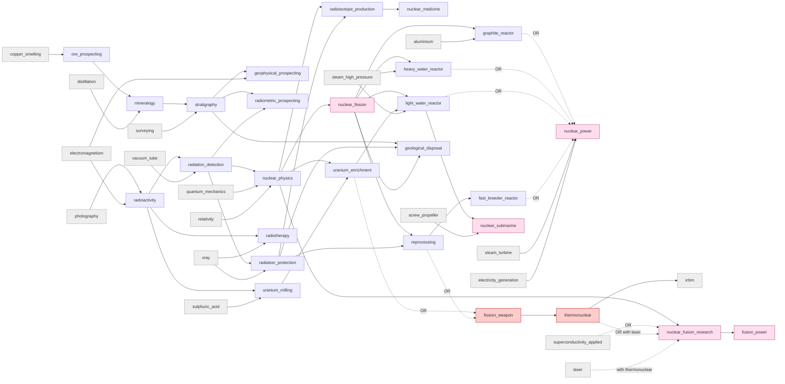

# D11 — Geology, resource knowledge and the nuclear-science case study (lane notes)

**Status: PROPOSED design input for the M6 knowledge redesign. Nothing here is ratified, and nothing under `Sim.*`
changed.** Canonical data: `data/proposal-parts/D11-nuclear-geology.json` (this file explains it). Fact base:
`research/nuclear-geology-research-brief.md` (cited as NUC-nn from `sources/nuclear-geology-sources.json`) plus the
searches listed in section 18. Labels: MEASURED · RESEARCHED · INFERENCE · PROPOSED · OPEN DECISION · IMPLEMENTATION
DEFERRED.

**Frozen-Spine constraint (applied throughout; coordinator instruction, verified at
`docs/civ-sim-architecture-v3-outline.md:137` and `:154`).** The Spine scopes the nuclear *layer* to "modern-era
expansion, deterrence-abstraction only" and places "nuclear-as-deterrence" in the modern-era expansion. So:
(1) weapons knowledge realizes only as that deterrence abstraction (milestone M10+), not in the M7 battle layer or M8
diplomacy; (2) civil-nuclear realization (reactors, power stations, enrichment, milling, reprocessing, repositories,
isotope production) has **no Spine-sanctioned system**: those nodes are knowledge-only, and any civil-nuclear mechanic
would need a contradiction report against the frozen Spine (a CR to the Director) — OPEN DECISION; they are not
presented as planned M11+ mechanics; (3) the radiation-medicine nodes name M9 Society as their consumer, because that
consumer is medical, not the nuclear layer.

---

## 1. Summary

The draft's 27-node chain (brief section 4) becomes **6 owned nodes (2 split and re-scored, 3 re-pointed, 1 capability
correction) and 21 new nodes**. Three draft nodes are cut or merged (geological_survey, fuel_fabrication,
centrifuge_enrichment); the draft `assaying` node is replaced by `ore_prospecting` because D02's new `cupellation`
already carries fire assay; borehole drilling is not added because D02's new `percussion_drilling` owns extraction.

- **Science → application → realization, kept apart.** `radioactivity` → `radiation_detection` → `nuclear_physics`
  (which now holds the 1938–39 discovery of fission and the mass–energy edge to `relativity`) → `nuclear_fission`,
  narrowed to the controlled chain reaction (378,480 → 267,620 RP). Applications: four reactor families as alternative
  routes, `uranium_milling`, `uranium_enrichment`, `reprocessing`, `geological_disposal`, `radioisotope_production`;
  medicine: `radiation_protection`, `radiotherapy`, `nuclear_medicine`. Realization: none for civil nuclear (Spine);
  M9 for medicine; M7 for the submarine unit; the M10+ deterrence abstraction for weapons.
- **`nuclear_power` renamed** from the realized "Nuclear power station" to "Nuclear power-plant engineering" (id and key
  unchanged): the knowledge of grid-connected reactor operation.
- **Weapons:** the weapon capability leaves `nuclear_fission` for a new `fission_weapon` reached by
  `uranium_enrichment OR reprocessing` (the two dual-use steps); `thermonuclear` follows it. Recommended Option A
  (section 8).
- **Fusion:** `nuclear_fusion_research` no longer requires weapons: magnetic route via `superconductivity_applied`,
  inertial route via `thermonuclear AND laser` (section 9).
- **Geology path:** `ore_prospecting` (A3 trunk) → `mineralogy` (A7) → `stratigraphy` (A8) → `geophysical_prospecting`
  and `radiometric_prospecting` (A9), plus an **identification contract** for the fog lane covering 14 resources with
  exposed and concealed classes (section 10). Proving and the survey institution: IMPLEMENTATION DEFERRED (M11+).
- **Workload (MEASURED by script):** lane 815,750 → 2,411,330 RP (+1,595,580, +14.2 % of the 11.21M tree), almost all
  A9 and almost all knowledge-only. A reduction ladder is offered (section 12).
- **Validation (MEASURED):** the part file parses; an independent checker finds 0 errors (cost model, quarter steps and
  ranges, prerequisite-complexity convention, Age monotonicity, trunk closure, emerged chronology rule, Eureka
  dead/implied checks, one primary university, split lineage, and the generation-locality test — which is why
  `fission_weapon` is left outside the "nuclear" family); `tools/integrate.py` and `tools/validate.py --no-corpus`,
  run on a scratch copy with all lane parts present at the time, report 0 errors and no warning on any D11 node; every
  D11 node is optional (none becomes mandatory for an Age CORE fact or the research stage).

## 2. Dispositions

| disposition | count | nodes |
|---|---|---|
| split + rebalance | 2 | `nuclear_fission` (→ `nuclear_physics`, `fission_weapon`), `nuclear_power` (→ four reactor families) |
| keep, prerequisite re-pointed (cost unchanged) | 3 | `thermonuclear`, `nuclear_submarine`, `nuclear_fusion_research` |
| keep, capability block corrected only | 1 | `fusion_power` |
| new | 21 | 5 geology/resource, 3 science, 4 medicine/isotopes, 4 fuel cycle, 4 reactor families, 1 weapon |

New nodes by branch: trunk 1 · natural_science 8 · engineering 8 · medicine 3 · military 1.

## 3. Chain diagram



ASCII summary (`a + b → c` = AND; `|` = OR):

```
GEOLOGY / RESOURCE KNOWLEDGE
  copper_smelting → ore_prospecting (A3 trunk; identifies tin ore; proving by trial assay)
  ore_prospecting + distillation → mineralogy (A7; identifies bauxite, uranium minerals with chemistry_quantitative)
  mineralogy + surveying → stratigraphy (A8; concealed coal, ironstone, oil, salt, potash, phosphate; survey institution)
  stratigraphy + electromagnetism → geophysical_prospecting (A9; concealed iron, oil, copper, salt, sulphur)
  stratigraphy + radiation_detection → radiometric_prospecting (A9; concealed uranium — contract only)
SCIENCE
  photography + electromagnetism → radioactivity → (+ vacuum_tube) radiation_detection
  radiation_detection + quantum_mechanics + relativity → nuclear_physics → nuclear_fission (controlled chain reaction)
MEDICINE (M9 consumer)
  radiation_detection + xray → radiation_protection      radioactivity + xray → radiotherapy
  nuclear_physics + radiation_protection → radioisotope_production → nuclear_medicine
FUEL CYCLE AND REACTORS (knowledge-only: Spine)
  radioactivity + sulphuric_acid → uranium_milling;  nuclear_physics + uranium_milling → uranium_enrichment
  nuclear_fission + aluminium → graphite_reactor;    nuclear_fission + steam_high_pressure → heavy_water_reactor
  nuclear_fission + uranium_enrichment + steam_high_pressure → light_water_reactor
  nuclear_fission + radiation_protection → reprocessing → fast_breeder_reactor
  (graphite | heavy water | light water | fast) + steam_turbine + electricity_generation → nuclear_power
  stratigraphy + radiation_protection + nuclear_fission → geological_disposal
  light_water_reactor + screw_propeller → nuclear_submarine (unit, M7)
WEAPONS (deterrence abstraction only, M10+)
  (uranium_enrichment | reprocessing) → fission_weapon → thermonuclear → icbm (D09)
FUSION
  nuclear_physics + (superconductivity_applied | (thermonuclear + laser)) → nuclear_fusion_research → fusion_power
```

## 4. Changes to owned nodes

| node | change | reason |
|---|---|---|
| `nuclear_fission` (321) | split; prereq `quantum_mechanics AND electricity_generation` → `nuclear_physics`; prereq_complexity 0.5 → 0.0; 378,480 → 267,620 RP; capability strings → controlled chain reaction; Military secondary university dropped | It bundled the discovery (science), the pile (application) and Trinity (weapon). The key keeps the controlled chain reaction (the part that keeps its Age, emerged "1942 CE" and dependants). Electricity was an operating input: CP-1 first ran at ~0.5 W with no grid [NUC-53]. Other factors kept: the pile still needed boron-free graphite and refined uranium [NUC-54, NUC-55]. |
| `nuclear_power` (322) | split; renamed "Nuclear power-plant engineering"; prereq → `(4 families OR) AND steam_turbine AND electricity_generation`; difficulty 3.5 → 3.0, material 2.0 → 1.5, prereq_complexity 0.5 → 1.0; 94,620 → 66,900 RP | The name described a realized plant. Reactor design moved into the families, leaving station integration (unit size ≤ ~10 % of grid load, load following [NUC-221, NUC-223]); for a station, electricity generation is its own knowledge (the output), not an operating input. |
| `thermonuclear` (323) | prereq `nuclear_fission` → `fission_weapon`; cost unchanged | Staged on a fission primary [NUC-214]; follows the weapon split; kept for corpus preservation and `icbm`. |
| `nuclear_submarine` (402) | prereq `nuclear_fission AND screw_propeller` → `light_water_reactor AND screw_propeller`; cost unchanged | Nautilus used a pressurised-water plant from the naval programme that also led Shippingport [NUC-71, NUC-69]; prototype critical 1953. |
| `nuclear_fusion_research` (356) | prereq `thermonuclear AND superconductivity_applied` → `nuclear_physics AND (superconductivity_applied OR (thermonuclear AND laser))`; cost unchanged | Controlled fusion must not require weapons (section 9). |
| `fusion_power` (409) | capability block only | The integrator's class-J default (deferred, M6) is wrong: a fusion plant is nuclear generation, with no Spine-sanctioned owner. |

## 5. New nodes

| id | Age · branch | prerequisites | RP | kind | owner · milestone | why it is a node |
|---|---|---|---|---|---|---|
| `ore_prospecting` | A3 · trunk | copper_smelting | 1,240 | resource | DiscoverySystem (proposed) · M6 (tin is a good today); proving M11+ | Recognising non-obvious ores (cassiterite: the Bronze Age tin bottleneck) is a different capability from smelting; D02 asked for a node tin_bronze can require. |
| `mineralogy` | A7 · natural_science | ore_prospecting, distillation | 9,950 | science | DiscoverySystem · M10+ (bauxite M11+; uranium none sanctioned) | Typing a mineral species ≠ recognising a familiar ore ≠ predicting ore under cover; pitchblende was a nuisance mineral for two centuries [NUC-04, NUC-01]. |
| `stratigraphy` | A8 · natural_science | mineralogy, surveying | 23,650 | science | DiscoverySystem + InstitutionsSystem · M10+ (M11+) | Spatial prediction under cover (concealed coalfields, oil traps, evaporites); hosts the survey institution (draft C04 merged). |
| `geophysical_prospecting` | A9 · natural_science | stratigraphy, electromagnetism | 66,900 | resource | DiscoverySystem · M10+ (M11+) | Different physics and reach from radiometrics; magnetics for iron (Thalén 1879), electrical for sulphide copper (Schlumberger 1912–13), gravity and seismic for oil (1915, 1921). |
| `radiometric_prospecting` | A9 · natural_science | radiation_detection, stratigraphy | 47,310 | resource | none for uranium (Spine) · M6 contract | The uranium-specific survey method [NUC-175–NUC-178]; kept apart so oil and iron prospecting do not depend on radiation detection. |
| `radioactivity` | A9 · natural_science | photography, electromagnetism | 79,560 | science | knowledge · M6 | The radium era and early radiation medicine precede fission by four decades [NUC-10]. |
| `radiation_detection` | A9 · natural_science | radioactivity, vacuum_tube | 66,900 | application | knowledge · M6 | Shared enabler of four users (brief §1 item 9). |
| `nuclear_physics` | A9 · natural_science | radiation_detection, quantum_mechanics, relativity | 159,130 | science | knowledge · M6 | Common root of the pile, enrichment, isotopes and fusion; receives the discovery of fission. |
| `radiation_protection` | A9 · medicine | radiation_detection, xray | 39,780 | medical | M9 Society (medical) | Harm before protection: miners and dial painters were harmed before 1928 [NUC-148, NUC-135]. |
| `radiotherapy` | A9 · medicine | radioactivity, xray | 47,310 | medical | M9 Society (medical) | First large beneficial use of radioactivity (1901 radium treatment; cobalt-60 1951). |
| `radioisotope_production` | A9 · natural_science | nuclear_physics, radiation_protection | 94,620 | application | none (Spine) · M6 knowledge | Main peaceful spillover; needs only a cyclotron or research reactor. |
| `nuclear_medicine` | A9 · medicine | radioisotope_production | 33,450 | medical | M9 Society (medical) | Clinical tracer diagnosis and therapy (Tc-99m ~40 million procedures a year [NUC-199]). |
| `uranium_milling` | A9 · engineering | radioactivity, sulphuric_acid | 39,780 | application | none (Spine) · M6 knowledge | Processing is separate from discovery and mining; radium was the first product of these ores. |
| `uranium_enrichment` | A9 · engineering | nuclear_physics, uranium_milling | 189,240 | application | none (Spine) · M6 knowledge | Needed by light-water and naval reactors only — the moderator decides; a dual-use step [NUC-80, NUC-117]. |
| `reprocessing` | A9 · engineering | nuclear_fission, radiation_protection | 133,810 | application | none (Spine) · M6 knowledge | The other dual-use step; optional in the civil cycle; feeds breeders. |
| `graphite_reactor` | A9 · engineering | nuclear_fission, aluminium | 133,810 | application | none (Spine) · M6 knowledge | Natural-uranium route and the historical plutonium route. |
| `heavy_water_reactor` | A9 · engineering | nuclear_fission, steam_high_pressure | 94,620 | application | none (Spine) · M6 knowledge | Natural uranium with a heavy-water industry (Canada, India) — an independent invention. |
| `light_water_reactor` | A9 · engineering | nuclear_fission, uranium_enrichment, steam_high_pressure | 189,240 | application | none (Spine) · M6 knowledge; feeds the M7 submarine unit | The dominant family and the naval lineage; the only family that needs enrichment. |
| `fast_breeder_reactor` | A9 · engineering | reprocessing | 94,620 | application | none (Spine) · M6 knowledge | Closed fuel cycle; different spectrum and coolant. |
| `geological_disposal` | A9 · engineering | stratigraphy, radiation_protection, nuclear_fission | 94,620 | application | none (Spine) · M6 knowledge | The only end state for high-level waste; the geology path's second nuclear consumer. |
| `fission_weapon` | A9 · military | uranium_enrichment OR reprocessing | 94,620 | military | deterrence abstraction · M10+ | Houses the weapon split out of nuclear_fission; the OR states the dual-use facts. |

Every new node carries the full capability block, `whyDistinct`, `acceptanceTest`, `costAnalog` and an era-marked
`emerged` in the part file. Four Eurekas were added, each a knowledge condition that is neither implied nor dead
(checked): `radioactivity` ← xray (Becquerel's question came from Röntgen's rays [NUC-11–NUC-13]);
`stratigraphy` ← canal_navigation (Smith's canal cuttings); `geophysical_prospecting` ← petroleum_refining (gravity and
seismic were developed for oil [NUC-246, NUC-247]); `radiometric_prospecting` ← nuclear_fission (state uranium demand
drove the 1948+ boom [NUC-182, NUC-183]).

## 6. Causality review of the draft edges (brief section 4.2)

| draft node | edge | verdict | reason |
|---|---|---|---|
| C01 assaying | copper_smelting, hacksilver | node replaced by `ore_prospecting` | D02's new `cupellation` carries fire assay ("assay is cupellation in miniature"); hacksilver is dated ~2,000 BCE, after the assay evidence (chronology rule), and its content (weights, silver) is not needed to recognise ore. |
| C02 mineralogy | mining_shaft | pruned | Mines supplied specimens — context, not knowledge. |
| C02 mineralogy | assaying, distillation | → ore_prospecting, distillation | Agricola codified miners' and prospectors' knowledge [NUC-229]; wet tests need mineral acids [NUC-226]. |
| C03 stratigraphy | mineralogy, surveying | kept | Smith's surveying (levelling, plotting) is how beds were traced and mapped [NUC-238]. |
| C04 geological_survey | stratigraphy, printing_press | node merged; printing_press pruned | The survey is an institution (an entity can require `stratigraphy` directly); map reproduction is a realization input — Smith's 1815 map was engraved and hand-coloured — so printing_press was a chronological companion. |
| C05 geophysical | geological_survey, electromagnetism | survey → stratigraphy | Interpretation needs geology, not the institution. |
| C06 radioactivity | photography, electromagnetism | kept | Plates and electrometry [NUC-11, NUC-18]. `xray` stays a Eureka: Niépce de Saint-Victor saw uranium salts expose plates in the dark in 1857–61, so the observation did not need X-ray knowledge (D10 called xray the causal parent; declined as a prerequisite). |
| C07 radiation_detection | radioactivity, vacuum_tube | kept | Amplified counting, coincidence circuits and photomultipliers are tube electronics [NUC-150, NUC-151, NUC-154]. This edge is the main cost driver of the new nuclear closures (section 13), and it is real. |
| C08 radiometric | radiation_detection, geological_survey | survey → stratigraphy | As C05. |
| C09 radiation_protection | radiation_detection, xray | kept | The roentgen (Stockholm 1928) measured X-ray exposure; the protection committee came from radiology [NUC-138]. |
| C10 radiotherapy | radioactivity, xray | kept | Radiotherapy grew inside clinical radiology. |
| C11 nuclear_physics | radiation_detection, quantum_mechanics | + relativity (D04 request) | Binding and reaction energies follow from E = mc²; Meitner–Frisch derived fission's ~200 MeV from the mass defect [NUC-41]. Anchored at 1932 so the chronology rule holds with quantum_mechanics (1925). |
| C12 nuclear_fission | nuclear_physics (was QM + electricity_generation) | kept as drafted | Electricity is an operating input [NUC-53]. |
| C13 uranium_milling | radioactivity, sulphuric_acid, mining_shaft | mining_shaft pruned | Mining is the separate extraction stage; in-situ leaching needs no shaft [NUC-97]. |
| C14 uranium_enrichment | nuclear_fission, uranium_milling, milling_machine | nuclear_fission → nuclear_physics; milling_machine pruned | Enrichment needs the U-235 fact and isotope-separation physics, not the chain reaction (Y-12 and K-25 were built in parallel with the piles [NUC-105, NUC-107]); precision barriers are a plant input. |
| C15 centrifuge | uranium_enrichment + materials | node rejected | A plant variant (electricity ~50 vs ~2,500 kWh/SWU [NUC-81]) needing a rotor-material node (D02, Q6). |
| C16 fuel_fabrication | nuclear_fission, uranium_milling, aluminium | node folded into the families | Fuel design is reactor-specific (canned metal slugs, Magnox, UO₂ in Zircaloy, MOX); a node every family must pass adds no decision. |
| C17 graphite_reactor | nuclear_fission, aluminium | kept | Aluminium **is** causal: canned slugs and 2,004 aluminium process tubes at Hanford B; canning was a critical wartime problem [NUC-57; NPS]. |
| C18 heavy_water_reactor | fuel_fabrication, steam_high_pressure | fuel_fabrication → nuclear_fission | Folded fuel; heavy-water production (Vemork 1934, GS 1943) folded in. |
| C19 light_water_reactor | fuel_fabrication, enrichment, steam_high_pressure | fuel_fabrication → nuclear_fission | As above; zirconium cladding is a material input (Q5). |
| C20 reprocessing | nuclear_fission, radiation_protection | kept | Hot cells and canyons [NUC-160]. |
| C21 fast_breeder | reprocessing, fuel_fabrication | → reprocessing | Folded fuel. |
| C22 nuclear_power | families OR + steam_turbine + electricity_generation | kept | See section 4. |
| C23 geological_disposal | geological_survey, radiation_protection, nuclear_fission | survey → stratigraphy | Siting needs host-formation geology. |
| C24 radioisotope_production | nuclear_physics, radiation_protection | kept | Reactor irradiation is a facility input. |
| C25 nuclear_medicine | radioisotope_production, radiation_detection | radiation_detection pruned | Implied through radioisotope_production; a redundant conjunct inflates prereq_complexity. |
| C26 nuclear_submarine | light_water_reactor, screw_propeller | kept | Section 4. |
| C27 thermonuclear | fission_weapon | kept, with fission_weapon admitted | The draft's unadmitted D01 would fail the loader's reachability rule. |
| D01 fission_weapon | nuclear_fission AND (enrichment OR (graphite_reactor AND reprocessing)) | → `uranium_enrichment OR reprocessing` | The uranium route needs no reactor; reprocessing already implies nuclear_fission; which reactor bred the plutonium is an input question. |

## 7. Candidates considered and rejected

| candidate | why rejected |
|---|---|
| `assaying` as the early trunk node (draft C01) | Grades, does not recognise; fire assay duplicates D02's `cupellation`; the touchstone is a precious-metal quality test that belongs with weighed silver and coinage (D05). The proving activity moves to `ore_prospecting` (+ cupellation for precious metals). |
| A recognition node for copper | D02: `copper_smelting`'s OR group (copper_native OR ochre_processing) already stands for knowing the green ore; the contract lists copper identification on it. |
| `geological_survey` (C04) | An institution, not knowledge: `inst.geological_survey` (PROPOSED) is granted by stratigraphy. |
| `petroleum_geology` | The anticline theory (Hunt and Andrews 1861, White 1885) is stratigraphy applied to a known resource; modelled as the requirement `stratigraphy AND petroleum_refining` on concealed petroleum. |
| `borehole_drilling` | D02's `percussion_drilling` (A6, Sichuan brine wells → Drake 1859) is the extraction node; D11 owns identification only. |
| `fuel_fabrication` (C16), `centrifuge_enrichment` (C15) | Section 6. |
| Separate PWR/BWR, Magnox/AGR/RBMK nodes | Variants sharing fuel, moderator and materials; the variant's safety parameter (RBMK void coefficient [NUC-82]) is realization data. |
| Heavy-water production node | Folded into heavy_water_reactor (its only consumer). |
| Separate "discovery of fission" node | One year of science between nuclear_physics and the pile; it is nuclear physics. |
| Accelerators, hot cells, reactor safety as nodes | Parts of nuclear_physics, radiation_protection and realization data respectively. |
| Radiocarbon dating (brief Q8) | No consumer of absolute dating; educational content for radiation_detection or radioisotope_production. |
| Thorium fuel cycle (Q13) | Not researched; no thorium good; never commercial at scale. |
| Uranium refining to metal (Q10) | Folded into uranium_milling (purification is ore processing); listed as an input of the pile. |
| Remote-sensing identification on `earth_observation` (D08's offer) | Remote sensing changes survey coverage, not the kinds recognised; never reveals extent (D-054). |
| `dynamite` as an extraction prerequisite (D04) | An operating input of mining and seismic work, like electricity for enrichment. |
| Identification of wild domesticable animals (D03) | Fauna, not deposits; recognising a horse needs no knowledge; herd ranges are regional geography shown on observation. |

## 8. Weapons: facts, options, recommendation

**Facts (RESEARCHED, brief section 2.20 and 1.6).** Weapons need uranium enriched above 90 % or plutonium; commercial
fuel is 3–5 %; the safeguards line between LEU and HEU is 20 % [NUC-115, NUC-119]. **Enrichment and reprocessing are
the proliferation-sensitive steps, not reactors** [NUC-117, NUC-118]. First test 16 July 1945; the first programme cost
about $2.2 billion with up to 129,000 workers [NUC-212, NUC-218, NUC-219]; NPT 1968/1970 [NUC-216].

**Loader constraint (MEASURED, engine audit Q6 row 22).** Every node must be reachable, so the draft's plan to keep
`thermonuclear` locked behind an unadmitted node fails validation.

- **Option A — keep the knowledge, defer the realization (RECOMMENDED).** `fission_weapon` (new) and `thermonuclear`
  stay reachable; capability status deferred; realized only as the frozen Spine's deterrence abstraction in the
  modern-era expansion (M10+), never as battle-layer mechanics; the abstraction reads knowledge state and its own
  abstract programme costs, because the fissile-material facilities are not Spine-sanctioned. No civil node requires a
  weapon node (only the inertial-fusion OR route uses `thermonuclear`). `icbm` keeps its prerequisite (D09).
- **Option B — retire.** Retire `thermonuclear` (key 323 reserved forever), add no `fission_weapon`; D09 must re-point
  `icbm`; the inertial-fusion route disappears; violates corpus preservation (D-044 R15, "Do NOT discard it") and loses
  the dual-use structure from the graph.

**Recommendation: Option A.** It satisfies the loader, preserves the corpus, matches the Spine (which rescopes the
nuclear layer to a deterrence abstraction; it does not delete it) and teaches the dual-use facts through the graph at
no M6 cost.

**Director decision to state.** *Is D-011 deterrence in M6 scope?* Not as realization: M6 is knowledge and
eligibility; the frozen Spine places nuclear-as-deterrence in the modern-era expansion (outline :137, :154), read as
M10+ under the 2026-10-03 rebase. What M6 decides is only whether the knowledge stays reachable (Option A) or is
retired (Option B). **Citation drift found (MEASURED):** the current capability string "nuclear weapon (D-011
deterrence)" cites D-011, but `docs/d011-battle-layer-addendum.md` contains no nuclear content; the governing record is
the Spine rescoping. AI: no weapon goal until the abstraction exists (the cheapest-available fallback may still
complete the nodes as knowledge).

## 9. Fusion fix (RESEARCHED, searches 2026-10-22)

Controlled fusion rests on light-element fusion reactions — D–D fusion was observed at the Cavendish in 1934, with
tritium and helium-3 identified — which is `nuclear_physics`. **Magnetic confinement** came from plasma physics: the
tokamak concept (Sakharov and Tamm, about 1950–51) and Spitzer's stellarator (1951) were secret national programmes,
declassified around the 1958 Geneva conference; Sakharov also worked on the H-bomb, but the knowledge path is plasma
physics, not bomb design. **Inertial confinement** did grow out of weapons work: Nuckolls' group at Livermore described
laser compression of fusion pellets publicly in *Nature* in 1972, after a classified programme that scaled the
thermonuclear stage down. Hence `nuclear_physics AND (superconductivity_applied OR (thermonuclear AND laser))`: weapons
knowledge is a justified alternative, never a requirement. The magnet edge (superconductivity_applied) is kept from the
current content; early tokamaks used copper coils, so it stands for reactor-scale confinement (open question).

## 10. Geology path and the identification contract (for the fog lane)

**Stages (framework section 6), owners kept apart.** *Locating* = fog (known extent; M6 T6.7–T6.9). *Identifying* =
knowledge applied to observed land (this contract; M6 vocabulary). *Prospecting/proving* = an action or institution:
`production:activity.deposit_assay` (ore_prospecting; precious metals also need D02's cupellation), exploratory boring
(D02's percussion_drilling AND stratigraphy), `inst.geological_survey` — **IMPLEMENTATION DEFERRED, named milestone
M11+ (Depth & Content: new resources; needs the per-place deposit truth of D-051 section 2, scheduled for M6)**.
*Extracting* = production (mining_shaft, percussion_drilling; copper and tin extraction stays ungated today).

**Vocabulary (PROPOSED).** `identification:deposit.<resource>` — exposed class, automatic on observation once the
requirement holds. `identification:deposit.<resource>.concealed` — needs the requirement **and** survey work; yields a
prospect with a likelihood, never a proved deposit. Requirements are node expressions like entity `requires`.

**Gating rule (PROPOSED).** Gate identification only where recognising the material as a resource needs knowledge — a
non-obvious mineral (cassiterite, bauxite, phosphate, potash, caliche, uranium minerals) or a non-obvious value (green
copper minerals as ore, galena as silver ore, volcanic ash as pozzolana). Self-evident materials — outcropping coal, oil
and bitumen seeps, salt, native sulphur, red iron ores — are identified on observation without research, because
research must not hide what any observer sees (D-045 baseline, F-46). A deposit a settlement already works is known by
use. No nuclear-science node carries an identification grant; research never places, reveals or proves a deposit.

| resource | good today? | exposed requires | concealed requires | note |
|---|---|---|---|---|
| copper ore | yes | `copper_smelting` [D02] | `geophysical_prospecting` | electrical methods (Bor, 1913) |
| tin ore | yes | `ore_prospecting` | — (OPEN) | **live in M6**; D02 offered tin_bronze ← copper_smelting AND (D11 node); D11 suggests ore_prospecting alone (cost unchanged) |
| iron ore | no | baseline (D02's recommendation) | `stratigraphy OR geophysical_prospecting` | ironstones; magnetite |
| coal | no | baseline | `stratigraphy` | Godwin-Austen 1856–57 → Dover 1890 |
| petroleum | no | baseline (seeps; bitumen since the Palaeolithic) | `(stratigraphy AND petroleum_refining) OR geophysical_prospecting` | extraction: percussion_drilling [D02] |
| salt | no | baseline | `stratigraphy OR geophysical_prospecting` | salt domes (Nash 1924 [NUC-246]) |
| nitrate | no | `saltpetre_refining` [D04] | — | caliche, nitre |
| sulphur | no | baseline | `geophysical_prospecting` | salt-dome caprock |
| phosphate (rock, guano) | no | `chemistry_quantitative` (or D01's agricultural_chemistry) | `stratigraphy AND chemistry_quantitative` | D01's request |
| potash | no | — | `stratigraphy AND chemistry_quantitative` | Stassfurt evaporites, 1850s |
| bauxite | no | `mineralogy AND chemistry_quantitative` | — | Berthier, Les Baux, 1821 |
| argentiferous galena | no | `ore_prospecting AND cupellation` [D02] | — | silver-lead ore |
| pozzolana | no | `concrete_pozzolan` [D02] | — | the concrete knowledge itself |
| uranium | no | `mineralogy AND chemistry_quantitative` | `radiometric_prospecting` (deep: OPEN, Q1) | **contract only**: no Spine-sanctioned consumer |

## 11. The four test chains: state → owner → milestone

| stage | uranium | copper + tin → bronze | iron ore + coal → steel | petroleum → refining → combustion |
|---|---|---|---|---|
| deposit exists | no good; worldgen addition would be part of the civil-nuclear CR — OPEN | per-settlement `DepositRow` today (MEASURED); per-place truth D-051 §2 — M6 | no goods — M11+ (D02) | no good — M11+ |
| located | fog known extent — M6 | fog — M6 | fog — M6 | fog — M6 |
| identified | exposed: mineralogy + chemistry_quantitative; concealed: radiometric_prospecting — contract only | copper: copper_smelting; tin: ore_prospecting — **M6 (live)**; concealed copper: geophysical — M11+ | exposed baseline; concealed: stratigraphy / geophysical — M11+ | exposed baseline; concealed: stratigraphy + petroleum_refining, or geophysical — M11+ |
| prospected / proved | assay + boring — CR | deposit_assay (ore_prospecting) — IMPLEMENTATION DEFERRED, M11+ | deposit_assay; exploratory boring (percussion_drilling + stratigraphy) — M11+ | exploratory boring — M11+ |
| extracted | mining_shaft / in-situ leaching (uranium_milling knowledge) — CR | baseline Extraction sector, ungated — realized today | mining_shaft [D02] — M11+ | percussion_drilling [D02] — M11+ |
| processed | uranium_milling → uranium_enrichment — knowledge-only (CR) | recipe.bronze_casting ← tin_bronze — realized today | bloomery → coke → puddling/Bessemer/open hearth [D02] — M11+ | petroleum_refining [D04] (building.refinery deferred) — M11+ |
| used | reactor families → nuclear_power (knowledge-only); nuclear_submarine (unit, M7); fission_weapon (deterrence abstraction, M10+) | bronze good — realized today | steel goods — M11+ | internal_combustion [D06] (A9 CORE knowledge today; fuel use M11+) |

## 12. Reduction ladder (if the Director wants fewer knowledge-only nodes under the Spine)

| step | cut | saves | effect |
|---|---|---|---|
| 1 | `fast_breeder_reactor` | 94,620 | nuclear_power keeps three family routes; reprocessing keeps the weapon route as dependant |
| 2 | `geological_disposal` | 94,620 | loses the waste back-end and the second geology link |
| 3 | merge `heavy_water_reactor` into `graphite_reactor` as "natural-uranium reactors" | 94,620 | keeps the enrichment decision; loses the moderator-industry distinction |
| 4 | `radiometric_prospecting` | 47,310 | uranium identification becomes exposed-only (contract-only anyway) |
| 5 | merge `radioisotope_production` into `nuclear_medicine` | 94,620 | loses industrial uses (radiography, sterilisation, tracers) |

Not on the ladder: the science hubs, `uranium_milling` and `uranium_enrichment` (the submarine and weapon routes),
`light_water_reactor` (the submarine unit), `reprocessing` (the plutonium route) and the geology nodes (they serve
non-nuclear resources). Full ladder: −425,790 RP.

## 13. Cost findings (MEASURED by script; BaseCost = 92.4 × 2^m rounded to 10, as `tools/integrate.py`)

| group | nodes | RP |
|---|---|---|
| geology and resource knowledge | 5 | 149,050 |
| nuclear science | 3 | 305,590 |
| medicine and isotopes | 4 | 215,160 |
| fuel cycle | 4 | 457,450 |
| reactor families | 4 | 512,290 |
| fission_weapon | 1 | 94,620 |
| **new nodes** | **21** | **1,734,160** |
| owned nodes (old 815,750) | 6 | 677,170 |
| **lane total** | **27** | **2,411,330 (+1,595,580; +14.2 % of 11,210,860)** |

- **Fission split:** 378,480 → nuclear_physics 159,130 + nuclear_fission 267,620 + fission_weapon 94,620 = 521,370
  (+37.8 %, under the framework's "more than doubles" flag). The excess is nuclear-physics content the tree held only
  as a capability string on quantum_mechanics.
- **Power split:** 94,620 → 66,900 station + four families 512,290 = 579,190 (6.1×), but the families are OR
  alternatives: the cheapest increment to reach the station is 161,520 (1.7×). The old node priced only the station
  increment over the bundled fission node (novelty 0.5).
- **Closures (current inventory + D11 only):** nuclear_fission 69 nodes / 1,034,060 → 86 / 1,657,620; nuclear_power
  77 / 1,290,950 → 96 / 2,028,720; nuclear_submarine 76 / 1,212,070 → 100 / 2,321,390; thermonuclear 70 / 1,081,370 →
  90 / 1,794,400; nuclear_fusion_research 75 / 1,298,620 → 88 / 1,547,470. The main driver is radiation_detection's
  causal edge to vacuum_tube (which brings radio and telegraph), then radioactivity, nuclear_physics and relativity.
- **Re-scored existing nodes:** nuclear_fission 378,480 → 267,620 (prereq_complexity only); nuclear_power 94,620 →
  66,900 (content: reactor design moved out; prereq_complexity up). Others unchanged.
- **Pacing (context, not a lever; D-046 §1):** the canonical campaign generates ≈ 0.70M RP and the driver never
  reaches A9; the seed-42 AI polity completes 36 A9 nodes including xray and quantum_mechanics (MEASURED,
  `measurements/baseline-ai-node-completions.csv`), so `radioactivity` (79,560 RP, prerequisites the AI completes) will
  likely enter its late game (INFERENCE) — AI-empire goldens move. `ore_prospecting` (1,240 RP, A3 trunk) changes early
  cheapest-first sequences for both driver and AI.

## 14. Conflations found

1. `nuclear_fission`: science + application + weapon (split).
2. `nuclear_power`: power-reactor engineering + station integration, under the name of a realized plant (split,
   renamed).
3. `nuclear_fusion_research`: magnetic confinement (plasma physics) and inertial confinement (weapons-derived) behind a
   weapons-only prerequisite (OR routes).
4. Knowledge vs operating input: `electricity_generation` as a prerequisite of the pile (removed); kept for the power
   station, where generation is the node's own knowledge.
5. Resource discovery vs exploitation vs processing: identification (contract), proving (deferred action), extraction
   (D02) and processing (D02/D04/D11) now have one owner each.
6. Citation drift: "nuclear weapon (D-011 deterrence)" — D-011 has no nuclear content (section 8).
7. `quantum_mechanics`' capability string "nuclear physics" stands for knowledge that is now a node (D04 asked to
   relabel, optional).

## 15. Dead ends resolved

`nuclear_power` (leaf; declared station unrealizable — stated honestly, no false M6 owner); `fusion_power` (feeds
fusion_propulsion; declared plant unrealizable); `thermonuclear` (deferred to the M10+ deterrence abstraction; feeds
icbm and the inertial fusion route); `nuclear_submarine` (unit, M7). New leaves each have a stated reason:
`geophysical_prospecting` and `radiometric_prospecting` (identification grants), `radiotherapy` and `nuclear_medicine`
(M9 medical consumer), `geological_disposal` (knowledge-only back end, ladder step 2). `relativity` (D04) loses its dead
end through nuclear_physics; `stratigraphy` gives D04's evolution its deep-time prerequisite.

## 16. Alternative routes (OR, independent inventions)

Four reactor families into nuclear_power (graphite: US/UK/USSR; heavy water: Canada/India; light water: US naval
programme; fast: EBR-I/BN/Phénix); fissile material by enrichment OR reprocessing; fusion by magnetic OR inertial
confinement; concealed petroleum by structural geology OR geophysics; concealed salt and iron by stratigraphy OR
geophysics.

## 17. Cross-lane requests and answers

Sent (full text in the part file): **D02** — tin via ore_prospecting (tin_bronze ← ore_prospecting keeps its cost),
copper listed on copper_smelting, assay with cupellation, drilling stays percussion_drilling, the identification needs
D02 listed, reactive metals (Q5/Q6). **D04** — radioactivity as an optional prerequisite of quantum_mechanics (no cost
change), stratigraphy for evolution, relativity accepted, crude-oil/saltpetre/sulphur identification rows, dynamite
declined. **D01** — salt, nitrate, phosphate and potash rows. **D03** — domesticable animals declined (fauna, no
knowledge gate). **D08** — no grant on earth_observation. **D09** — thermonuclear kept; icbm's nuclear role is the M10+
deterrence abstraction only. **D10** — boundary accepted; xray a Eureka for radioactivity. **D06** — electricity as
operating input; no nuclear station in any energy contract without a CR. **D12** — optional safeguards treaty civic and
survey co-requirement. **Fog lane** — adopt the identification contract.

## 18. Open questions and decisions

1. **OPEN DECISION (Director): civil nuclear** — every civil-nuclear node is knowledge-only under the frozen Spine;
   realizing any of it needs a CR.
2. **OPEN DECISION (Director): weapons** — Option A recommended (section 8); relabel the D-011 citation.
3. **OPEN DECISION:** does a reactor-propelled unit (`unit.nuclear_submarine`) fall under the Spine rescoping (M7 → M10+)?
4. **OPEN DECISION (package):** an alias/remap seam for split keys (old saves holding nuclear_fission or nuclear_power
   receive none of the split-off nodes).
5. **OPEN (fog lane):** adopt exposed and concealed classes and the gating rule; go live for copper and tin in M6?
6. **OPEN (brief Q1, Q2):** geophysics in deep unconformity uranium discoveries; depth reach of gamma surveys.
7. **OPEN (Q5/Q6, D02):** reactive metals (zirconium/hafnium, Kroll) and rotor materials.
8. **OPEN:** fusion_power has no electricity_generation prerequisite (unlike nuclear_power) — left unchanged.
9. **OPEN:** the superconducting-magnet edge in the magnetic fusion route represents reactor-scale confinement.
10. **Compatibility (MEASURED rules, engine audit Q14):** new keys only (none renamed); renaming key 322 needs an entry
    in the corpus-sync rename exceptions; branch counts become trunk 178, natural_science 52, engineering 139,
    medicine 25, military 38 (before other lanes), which moves `finite_nodes_to_exhaust` of the recursive nodes;
    all new `emerged` texts are era-marked (the "83 marker-free" pin is unchanged); prerequisite changes leave partial
    progress dormant; no Eureka removed (append-only).

## 19. Sources

**Brief register (NUC-nn):** NUC-01, 04, 10–13, 17, 18, 27, 30, 32–36, 41, 44, 45, 53–59, 62, 65, 68–71, 76–82, 87,
88, 97, 100–102, 105, 107, 115, 117–119, 121, 122, 125, 126, 128, 129, 131, 134, 135, 138, 139, 148, 150, 151, 154–158,
160, 165, 175, 177, 178, 180, 182, 183, 194, 196, 198, 199, 201, 202, 204, 206, 212, 214, 216–221, 223, 226, 229, 231,
232, 238, 239, 242–244, 246–249.

**Searches this session (2026-10-22; WebSearch extracts only — pages were not opened, so claims are
search-corroborated, not source-checked):**
- Fusion history: [PPPL, 50 Years of Fusion Research](https://fire.pppl.gov/sofe09_meade.pdf); [Meade, History of Fusion](https://courses.physics.ucsd.edu/2020/Winter/physics218b/1_Meade_History%20of%20Fusion%20(2).pdf); [SB RAS, Star Reactors](https://scfh.ru/en/papers/star-reactors/); ICF: [McCrory, Lasers and ICF](https://fire.pppl.gov/NIF_ded09_McCrory.pdf); [Physics World](https://physicsworld.com/a/fusions-bright-new-dawn/); D–D fusion 1934: [arXiv 2302.04206](https://arxiv.org/pdf/2302.04206), [arXiv 2311.17427](https://arxiv.org/pdf/2311.17427).
- Cupellation and touchstone (for the rejected assaying node): [Pernicka et al. 1998](https://www.academia.edu/7001043); [Murillo-Barroso et al. 2014](https://discovery-pp.ucl.ac.uk/1462031/1/Murillo-Barroso%20et%20al.%2C%202014.pdf); [touchstone review](https://hmsjournal.org/index.php/home/article/download/74/72).
- Early ore working: [Rudna Glava, OUP](https://academic.oup.com/book/40320/chapter/346874017); [UCL, Curak copper mine](https://discovery.ucl.ac.uk/10197684/1/challenging-the-boom-and-bust-models-the-fourth-millennium-bc-copper-mine-of-curak-in-south-west-serbia.pdf); Kestel–Göltepe tin: [ISAC News & Notes](https://isac.uchicago.edu/sites/default/files/uploads/shared/docs/nn146.pdf), [Göltepe Excavations](https://instappress.com/product/goltepe-excavations-tin-production-at-an-early-bronze-age-mining-town-in-the-central-taurus-mountains-turkey/).
- Geophysics: [Cambridge, magnetic methods](https://www.cambridge.org/core/product/identifier/CBO9781139171168A023/type/BOOK_PART); [Runeberg, Sweden handbook](https://runeberg.org/sweden14/2/0276.html); [SLB history 1870–1910s](https://www.slb.com/about/who-we-are/our-history/1870-1910s).
- Petroleum geology: [ETHW, Birth of Petroleum Geological Science](https://ethw.org/The_Birth_of_Petroleum_Geological_Science); [AAPG 1972 note](https://archives.datapages.com/data/bulletns/1971-73/data/pg/0056/0003/0550/0566.htm); [AAPG abstract 1998](https://www.searchanddiscovery.com/abstracts/html/1998/eastern/abstracts/1776e.htm).
- Stratigraphy: [NASA Earth Observatory, William Smith](https://earthobservatory.nasa.gov/features/WilliamSmith/page2.php); [Encyclopedia.com, Smith](https://www.encyclopedia.com/history/encyclopedias-almanacs-transcripts-and-maps/william-smith); Kent coal: [Nature 1890](https://www.nature.com/articles/042319a0), [NMRS](https://nmrs.org.uk/?p=17703).
- Evaporites and bauxite: [Scientific American, Stassfurt](https://www.scientificamerican.com/article/potash-from-a-new-sourcethe-stassfu); [NZETC](https://nzetc.victoria.ac.nz/tm/scholarly/tei-Stout73-t14-body-d1-d7.html); [Earth Magazine, bauxite 1821](https://www.earthmagazine.org/article/march-23-1821-bauxite-discovered/); [Britannica 1911, Bauxite](https://en.wikisource.org/wiki/1911_Encyclop%C3%A6dia_Britannica/Bauxite).
- Radioactivity and medicine: [APS, Becquerel](https://www.aps.org/publications/apsnews/200803/physicshistory.cfm); [Niépce de Saint-Victor, 1857](https://thesciencebookstore.com/books/2017/08/on-nearly-discovering-radioactivity-in-1857.html); [Garrison-Morton, Danlos 1901](https://historyofmedicine.com/author?id=5597); [IN2P3, radium medicine](https://laradioactivite-prod-en.apps.wok3.in2p3.fr/articles/phenomenon/radium_medicine); [ICRU history (Taylor 1958)](https://www.icru.org/wp-content/uploads/2025/07/History-of-ICRU_Taylor-1958.pdf); [Radiology 1929](https://pubs.rsna.org/doi/full/10.1148/13.4.366a).
- Reactors and fuel cycle: [Naval Reactors HA, S1W](https://www.nr-ha.org/nr-projects/s1w-(nautilus-prototype)); [ANS, first Navy prototype](https://ans.org/news/article-1635/they-harnessed-the-atom-the-first-navy-prototype-nuclear-plant); [NPS, Hanford science](https://www.nps.gov/articles/000/manhattan-project-science-at-hanford.htm); [AHF, Grills interview](https://ahf.nuclearmuseum.org/voices/oral-histories/raymond-grillss-interview); [PNNL-13605](https://www.pnnl.gov/main/publications/external/technical_reports/PNNL-13605rev4.pdf); [NAP, Hanford history](https://www.nap.edu/read/9228/chapter/4); [AHF, Vemork](https://ahf.nuclearmuseum.org/ahf/history/operation-gunnerside/); [NAP, Disposal of Radioactive Waste on Land 1957](https://nap.nationalacademies.org/read/18527); [WIPP timeline](https://www.wipp.energy.gov/historytimeline.asp).
- Drilling (context for D02's node): [AAPG, ancient Chinese drilling](https://www.aapg.org/?p=39899); [ETHW, oil and gas industry](https://ethw.org/Beginnings_of_the_Oil_and_Gas_Industry).
