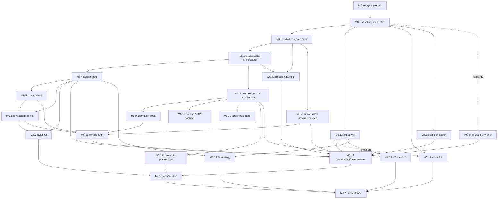

# M6 dependency graph

**Status: PROPOSED (planning input, 2026-10-20, tree `dc83a67`).** The directed graph over the workstreams of
`m6-task-register.md`. Edges mean "cannot be accepted before". Workstreams M6.1–M6.20 are the Director's 2026-10-20
decomposition; M6.21–M6.24 are the authoritative-scope items of `docs/milestones.md:74-88` that the decomposition did
not name, and the conditional D-051 carry-over.

## Edges

| Workstream | Depends on | Enables |
|---|---|---|
| M6.1 Baseline, scope, governance (spec with S8 §4.1; T6.1 foundations audit; housekeeping) | M5 exit gate passed (S8 §4) | everything |
| M6.2 Existing technology & research audit | M6.1 | M6.3, M6.21, M6.22, M6.23 |
| M6.3 Progression architecture & capability reconciliation | M6.2 | M6.4, M6.8, M6.21 |
| M6.4 Civics model (points, micro/macro, states) | M6.3; Decisions D-D, D-I | M6.5, M6.6, M6.7, M6.17, M6.23 |
| M6.5 Age-specific civic content & historical audit | M6.4 | M6.6, M6.16 |
| M6.6 Macro government forms — availability in M6; adoption per Decision D-D | M6.4, M6.5 | M6.7, M6.16, M6.18 |
| M6.7 Civics UI & legal-action exposure | M6.4, M6.6 | M6.18 |
| M6.8 Unit progression architecture (design + contract) | M6.3; Decision D-E | M6.9, M6.10, M6.11, M6.12, M6.19 |
| M6.9 Military promotion trees (content schema + validator, inert) | M6.8 | M6.16, M6.19 |
| M6.10 Repeatable training & AP contract (contract only) | M6.8; Decision D-F | M6.19 |
| M6.11 Settler / hero / special-character progression (design note) | M6.8 | M6.19 |
| M6.12 Unit training UI placeholder | M6.8 | M6.18 (optional), M6.19 |
| M6.13 Fog of war, scouting, visibility persistence (S2a–S2c, v35) | M6.1; Decisions D-J, D-K | M6.14 (ghost display), M6.17, M6.23; closes DW-002/003/004 |
| M6.14 Visual milestone E1 | M6.1; M6.13 for the LIVE/GHOST/UNKNOWN art only; Decision D-L | M6.20 |
| M6.15 One-file session export | M6.1; Decision D-G | M6.17, M6.20 |
| M6.16 Content corpus & consequence audit | M6.5, M6.6, M6.9, M6.22 | M6.17, M6.18 |
| M6.17 Save/load, replay, determinism coverage | M6.4, M6.13, M6.15, M6.21, M6.22, (M6.24); Decision D-H | M6.18, M6.20 |
| M6.18 Vertical slice & integration | M6.7, M6.12, M6.16, M6.17 | M6.20 |
| M6.19 M7 handoff & deferred work | M6.8–M6.12, M6.13 | M6.20 |
| M6.20 Milestone integration & acceptance | all | — (M6 exit gate) |
| M6.21 Knowledge diffusion, Eureka / foreign exposure, persistent knowledge | M6.2, M6.3 | M6.16, M6.17 |
| M6.22 Universities, research modifiers, deferred research entities (tiers A–D, G) | M6.2 | M6.16, M6.17 |
| M6.23 AI research & civics strategy; AI information access under fog | M6.4, M6.13 | M6.20 |
| M6.24 Conditional: D-051 carry-over (§2, §4; §1(a), §6-remainder) — only if closure ruling R2 assigns them to M6 | M6.1; ruling R2 | M6.17 |

## The graph

## Critical path

M6.1 → M6.2 → M6.3 → M6.4 → M6.5 → M6.6 → M6.7 → M6.16 → M6.17 → M6.18 → M6.20. Everything on it is civics-shaped;
the knowledge-engine completion (M6.21/M6.22) joins at M6.16/M6.17 and is the second-longest chain.

## Lanes that run independently once M6.1 is done

| Lane | Workstreams | Why independent |
|---|---|---|
| Fog | M6.13 (+ M6.23's AI half) | Its seam, plan and tests exist; it touches no civics type; schema v35 is reserved for it |
| Visuals | M6.14 | Asset production and rendering only; reads simulation state, writes none |
| Export | M6.15 | Tooling beside the record; no simulation type |
| Units (design) | M6.8–M6.12 | Design, content schema and a placeholder; no state unless Decision D-E says otherwise |
| Knowledge completion | M6.21, M6.22 | After M6.2; shares the research engine, not the civics work |
| Carry-over | M6.24 | Economy lane; only if ruled in |

## Proposed execution sequence (dependency-ordered; no dates)

1. **M6.1** — spec, T6.1 foundations audit, housekeeping, decision register rulings D-D…D-L collected.
2. **M6.2** — audit of the tree as built; names the reusable types.
3. In parallel: **M6.3** (critical path), **M6.13** (fog lane), **M6.15** (export lane), **M6.14** (visual lane starts
   with conventions and the slice's art), **M6.22** (universities / deferred entities).
4. **M6.4**, then **M6.5** and **M6.6** together, then **M6.7**; meanwhile **M6.8–M6.12** (units design lane) and
   **M6.21** (diffusion/Eureka).
5. **M6.16** corpus audit over everything authored; **M6.17** coverage as each table lands (not at the end).
6. **M6.18** the vertical slice — the first thing the Director plays.
7. **M6.19**, **M6.23**, then **M6.20**.

Meaningful reorderings against the Director's proposed order (§4 of the instruction): the fog, export and visual lanes
are pulled forward to run beside the civics chain rather than after it (they do not depend on it); the knowledge-engine
completion (M6.21/M6.22) is added and runs after M6.2; the unit-progression items (M6.8–M6.12) stay in order but are
design/contract scope pending Decision D-E; save/replay coverage (M6.17) is per-table as each lands, not a single late
stage; D-051 carry-over is a conditional lane, not part of the chain.

## Dated note — 2026-10-21 (M6.1; appended, the text above is unchanged)

- The spec (`docs/m6-spec.md` §4) re-expresses this graph as packets T6.1–T6.21 with a gate the graph did not have:
  **D-061 ratification** between T6.2 and T6.3 (civics currency). Critical path: T6.1 → ratify → T6.2 → T6.3 → T6.4 →
  T6.5 → T6.6 → T6.15 → T6.17 → T6.18 → T6.20. Fog, export, E1, units, diffusion, universities are independent lanes.
